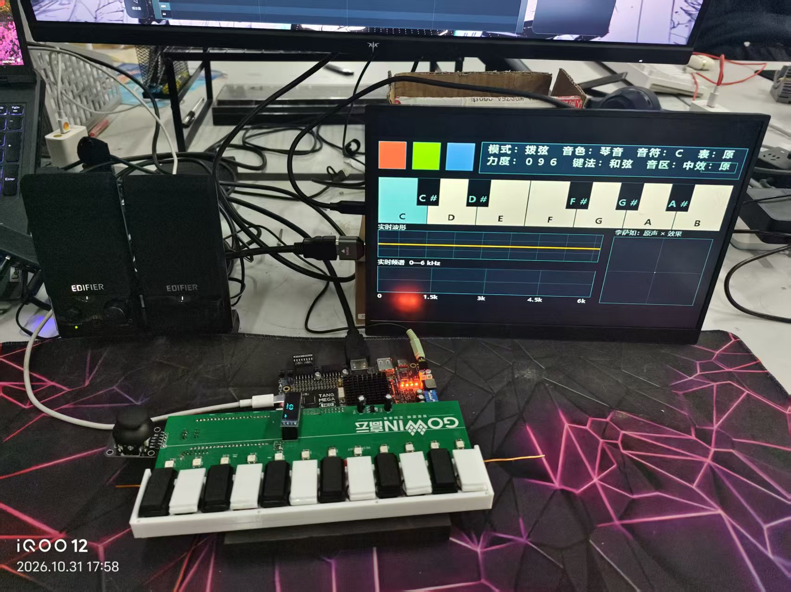
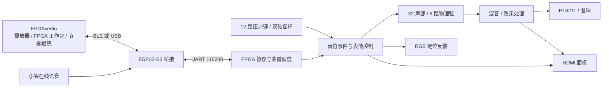

# 灵弦 · FPGA 多维交互数字乐器

基于 Tang Mega 138K 的软硬件协同乐器：12 路压力键负责演奏，FPGA 实时合成声音，HDMI 与 RGB 显示反馈，电脑和 Android 应用完成曲谱管理与节奏跟练。

**Verilog · 32 复音 · 8 路物理弦 · ESP32-S3 · BLE / USB · Electron / Android**

[系统架构](docs/ARCHITECTURE.md) · [最新 FPGA 工程](fpga/rhythm/README.md) · [构建方法](docs/BUILD.md) · [验证记录](fpga/rhythm/VALIDATION.md) · [简历与面试材料](docs/portfolio/README.md)

*实物照片摄于 2026-10-31，展示当时已运行的系统；画面不代表最新版本的界面。*

## 项目做了什么

| 场景 | 实现 |
| --- | --- |
| 手动演奏 | 12 路逐键压力输入、和弦、音色选择；摇杆 X 轴弯音、Y 轴控制颤音深度 |
| 板端合成 | 32 个独立声部及包络，8 路物理弦，滑音、混音与效果处理 |
| 视听反馈 | HDMI 设置/演奏页面、琴键状态、波形、频谱、李萨如图形和 RGB 键位指引 |
| 曲谱重奏 | MIDI 或音频转谱，整理和弦、延音与力度，经 ESP32-S3 上传，由 FPGA 调度播放 |
| 节奏跟练 | 上位机 12 轨舞台与实体键对应；配套 FPGA 根据目标键判定，按对才发声 |
| 跨端控制 | Windows / Android 共用工作台；BLE 主连接、USB 手动备用，小智在线语音选曲 |

音频导入使用 Basic Pitch 等组件提取音符，再由 FPGA 重奏；板端不解码 MP3，也不传输原曲 PCM。歌曲容量为 4096 个事件，起音与释放各占一个，通常最多容纳 2048 个完整音符。曲谱保存在 RAM，断电后不保留。

## 系统如何协作

FPGA 维护采样节拍、声部状态和输出时序。上位机承担计算量较大的转谱与界面交互，ESP32-S3 负责通信桥接和语音命令。音符事件携带身份，释放按事件 ID 定位，避免同音高重奏时旧释放误关新声部。

## 工程重点

**把计算安排到真正需要它的时间。** 声部状态保持独立，可共享的算术按采样槽调度；显示数字在帧前串行预计算。最新显示实现让六个字段共用一个 BCD 加三单元，78 拍内完成，距画布首次使用还有明确的扫描时间。优化同时检查结果、流水对齐和提前使用的负向用例。

**用协议区分“已发送”和“已执行”。** BLE/USB 传输成功不代表 FPGA 接受曲谱。上传以能力协商、分块确认、CRC 和提交应答推进；语音与上位机共享 UART 时处理所有权和超时，不通过界面计时猜测板端状态。

**从物理引脚验证完整链路。** 仿真从 ADC、UART 和设置键引脚施加激励，解码 PT8211 与 RGB 输出。HDMI 检查菜单逐键刷新、帧边界提交与像素等价；时序约束根据综合网表证明共同使能，再验证压缩前后端点集合一致。

## 最新归档状态

2026-11-11 整理，最新源码入口为 [fpga/rhythm/v3_hdmi_top.gprj](fpga/rhythm/v3_hdmi_top.gprj)。设置与演奏均使用底板 HDMI，不需要 LCD。

| 项目 | 最新 HDMI 单屏版本的结果 |
| --- | --- |
| 完整 RTL 回归 | 163 项通过，0 失败 |
| 官方 HDMI 器件模型 | 3 项通过：PLL、串化顺序、停钟复位 |
| 布局布线 | place3 / route2 完成，生成 .pr、STA 报告和位流 |
| Setup / Hold | +0.556 ns / +0.187 ns |
| 时序违例 | 建立、保持违例端点为 0；恢复、移除报告无负余量 |
| Logic / Register | 72539 / 34810 |
| CLS / BSRAM / DSP | 48587 / 205 / 126 |
| 引脚与时钟 | 31 个物理 I/O、4 个时钟审计通过 |

以上来自 2026-11-10 的实施与验证记录，详见 [完整验收说明](fpga/rhythm/VALIDATION.md)。该位流尚未烧录；已有实物照片及此前联调结果与本版仿真、STA 分开记录。历史回归文档保留当时的日期与验证范围。

## 源码导航

| 目录 | 用途 |
| --- | --- |
| [fpga/rhythm](fpga/rhythm/README.md) | 最新 HDMI 单屏 RTL、约束、仿真及验收记录，阅读和重建从这里开始 |
| [fpga/playability](fpga/playability/README.md) | 保留的早期已上板基线，用于追溯，不代表最新板上程序 |
| [host/mineradio](host/mineradio/README-FPGA.md) | FPGAvedio Windows / Android 应用，基于 Mineradio 扩展 |
| [host/instrument-web](host/instrument-web/README.md) | 共用转谱、曲谱上传、跟练、录音和可视化 |
| [firmware/xiaozhi-v3](firmware/xiaozhi-v3) | 小智语音工具、板型与外设适配 |
| [firmware/esp32s3-bridge](firmware/esp32s3-bridge) | BLE / USB / UART 桥接与共用协议核心 |
| [hardware/V5](hardware/V5/README.md) | V5 键盘板嘉立创 EDA 工程 |
| [docs/portfolio](docs/portfolio/README.md) | 简历条目、面试讲解、演示脚本与证据索引 |
| [docs/submission](docs/submission/README.md) | 比赛技术报告及原有照片、流程图；版本数据以最新验收记录为准 |

重建需 Gowin V1.9.12.03、ModelSim、ESP-IDF 及 Node.js 等工具，见 [构建方法](docs/BUILD.md)。FPGA 工程应复制到独立 ASCII 路径；修改 RTL 后须按新网表重新生成约束，不能混用不同工程的网表和 SDC。

## 接口与实现边界

- 音频输出采用 **PT8211 右对齐格式**，不标作标准 Philips I²S；采样帧间隔为 1024 个音频时钟，采样率约 48 kHz。
- HDMI 当前为 **800×600 @56.25 Hz**，800×480 面板居中，不宣称原生 1080p。
- BLE 广播名为“行者无疆”，UART 为 115200 / 8N1；USB 是手动备用链路。小智云端语音需要互联网，曲谱上传本身不依赖 Wi-Fi。
- 联动可视化使用设备状态与 SCOPE1 有限音频快照，不等于持续无损音频回传。音频转谱对复杂配器仍有误差。

## 来源与协作

本项目由团队完成软硬件协作。应用基于 Mineradio，小智功能基于 xiaozhi-esp32，音频转谱使用 Basic Pitch / TensorFlow.js；项目工作集中在乐器逻辑、协议、跨端适配及系统联调。各目录保留上游许可证，详见 [第三方来源](THIRD_PARTY.md)。仓库公开展示工程，公开访问不替代各组件的许可条款。
