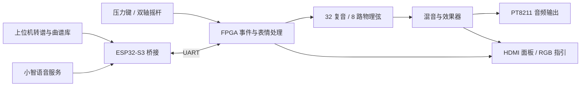

# 行者无疆 · FPGA 多维交互数字乐器

以 FPGA 为声音合成核心，结合十二个压力键、双轴摇杆、HDMI 图形界面和无线曲谱上传，构建一套可手动演奏、可导入曲谱、可语音控制的数字乐器。

本仓库统一组织 FPGA、FPGAvedio 上位机和 ESP32-S3 固件，作为比赛作品的源码入口。

## 设计思路

系统按“交互输入、声音合成、显示反馈、曲谱管理”分工。FPGA 负责采样节拍、声部状态和音频输出；上位机负责音频识别、曲谱整理及操作界面；ESP32-S3 负责 BLE/USB 与串口桥接，并接入小智语音服务。

手动演奏和曲谱播放共用音符事件接口。每次起音具有独立事件 ID，释放事件按 ID 找到对应声部，支持和弦、重叠音符与连续演奏。声音和图像分别输出，HDMI 显示演奏状态，PT8211 驱动外部音频链路。

## 核心功能

| 部分 | 功能 |
| --- | --- |
| 演奏交互 | 12 路压力键及逐键力度、摇杆 X 轴弯音、Y 轴颤音深度、菜单设置 |
| 声音引擎 | 32 复音、8 路物理弦、音色选择、滑音、弯音、颤音及效果器 |
| 显示反馈 | HDMI 参数面板、琴键状态、压力曲线、波形、频谱、XY 余辉和 RGB 演奏指引 |
| 曲谱管理 | MIDI/普通音频导入、音符识别、和弦与延音整理、相对力度与低音平衡、参考试听 |
| 连接控制 | BLE 主连接、USB 手动备用、UART 曲谱传输、小智语音命令 |
| 板端播放 | 曲谱存储、按时间调度、播放/停止与状态回传 |

板端曲谱容量为 4096 事件，起音和释放分别占一个事件，通常可容纳最多 2048 个完整音符。音频导入采用“识别音符后由 FPGA 重奏”的方式；歌曲存储在板端 RAM 中，上电期间可脱离电脑播放。

## 工程结构

| 目录 | 职责 |
| --- | --- |
| [hardware/V5](hardware/V5/README.md) | 当前 V5 键盘板嘉立创 EDA 工程 |
| [fpga/playability](fpga/playability/README.md) | 当前板上程序对应源码：压力键拨弦/滑音、明确语音选曲、青蓝色曲目键位指引 |
| [fpga/rhythm](fpga/rhythm/README.md) | 十二键跟练与 LCD 设置 / HDMI 演奏双屏候选；通过仿真和时序，尚未烧录 |
| [host/mineradio](docs/HOST.md) | FPGAvedio 播放器、FPGA 播放、节奏跟练三模式桌面及 Android 工程 |
| [host/instrument-web](host/instrument-web/README.md) | 共用转谱、上传、曲谱库和可视化逻辑 |
| firmware/xiaozhi-v3 | 小智语音及通用 ESP32-S3 套件适配 |
| firmware/esp32s3-bridge | BLE、USB、UART 桥接及共用命令处理核心 |
| [docs](docs/ARCHITECTURE.md) | 工程原理、模块划分、构建与使用说明 |
| [docs/submission](docs/submission/README.md) | 官方模板技术报告、原理流程图和可编辑矢量图 |
| [artifacts/playability](artifacts/playability/README.md) | 当前工程的功能测试及实施报告 |
| tests / tools | 固定参考、自动化脚本与开发辅助工具 |

## 主要配置

- FPGA：Tang Mega 138K，GW5AST-138C。
- 显示：底板 HDMI，800×600 @56.25 Hz，800×480 面板居中。
- 音频：PT8211，采样帧间隔 1024 个音频时钟。
- 串口：115200、8N1；BLE 广播名称“行者无疆”。
- ESP32-S3：通用套件板型 fpga-bread-s3，N16R8。

## 阅读与使用

1. [工程原理、设计思路与模块结构](docs/ARCHITECTURE.md)
2. [硬件接线](docs/HARDWARE.md)
3. [FPGAvedio 操作流程](docs/HOST.md)
4. [构建方法](docs/BUILD.md)
5. [工程功能说明](docs/RELEASE.md)
6. [作品技术设计报告（Word / PDF）](docs/submission/README.md)

## 项目来源

上位机基于 Mineradio 扩展，小智固件基于其开源工程适配，保留上游许可证和第三方声明，见 [THIRD_PARTY.md](THIRD_PARTY.md)。仓库不包含个人账号凭据、Wi-Fi 密码、设备身份或签名私钥。

本仓库保持私密，比赛提交时需为评审账号提供访问权限。

提交源码包与仓库使用相同目录结构，只包含当前生产工程。`tests/reference`、
`tests/fixtures` 和仿真目录中的固定参考是自动化测试依赖，不是备用生产版本。
构建所需工具链和依赖按 [构建方法](docs/BUILD.md) 安装。
