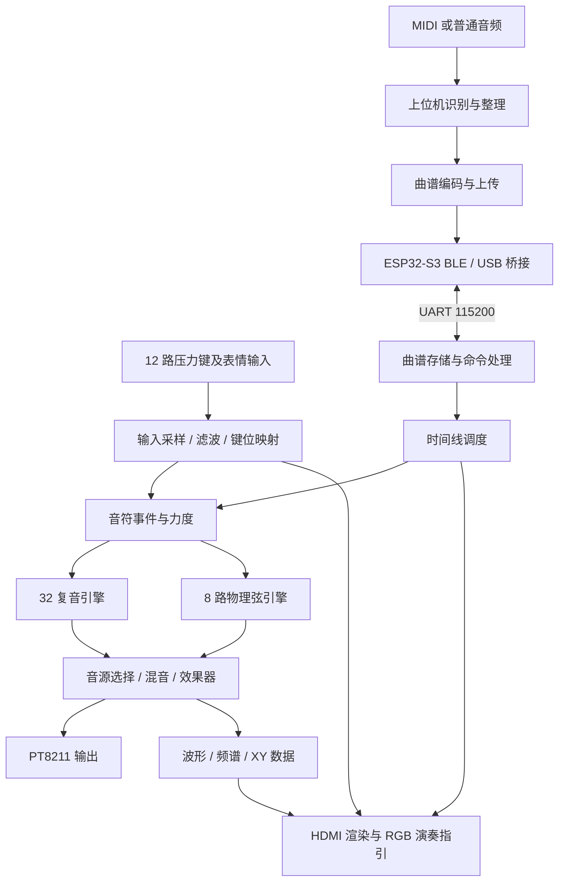

# 工程原理、设计思路与模块结构

## 一、总体思路

作品将 FPGA 用于实时声音合成，将上位机用于曲谱准备，将 ESP32-S3 用于连接与语音交互。三部分通过音符事件和命令协议协作，使手动演奏、歌曲重奏和图形反馈围绕同一套板端声音引擎运行。

FPGA 不直接解码 MP3。上位机先将音频中的音高、起止时间和力度转换成事件，再交给 FPGA 以选定音色重奏。MIDI 则从原有音符信息生成事件。这样，板端只需处理有明确时间戳的乐谱数据，无需持续接收原始音频。

## 二、数据流与控制流

手动输入按菜单模式选择复音库或物理弦库，上传曲谱由时间线送入复音演奏路径。图中的两种引擎是不同演奏模式的音源，不表示每个事件同时触发两套引擎。

## 三、交互输入与音符事件

输入链路通过外部 ADC 采集压力键及模拟控制量，再完成滤波、按下/松开判断和力度映射。键位设置决定音阶与音区，摇杆和旋钮提供音高及表情参数。

keyboard_note_events 将键状态变化转换为统一事件，包含 ON/OFF、16 位事件 ID、音名、八度和力度。发送端通过 valid/ready 交接；接收端忙时，事件保持到可接收为止。flush 用于模式切换等场景，清理待处理事件和接收状态。

事件 ID 标识一次起音，而非固定声部或音高。相同音高连续起音也具有不同 ID，旧释放事件不会错误地释放新的起音。物理弦和复音库按各自分配规则选择空闲或被替换的声部。

## 四、声音合成

### 32 复音

polyphony_bank_32 保存 32 份独立的相位、音高与包络状态。相位累加器按频率增量推进，音色波形与包络结合生成各声部采样，再求和输出。力度影响振幅，弯音、颤音和滑音影响频率变化。

部分音高运算和查表采用分时共享，在相邻音频样本之间轮询处理多个声部。共享的是运算资源，每个声部的相位和包络状态独立保存。

### 8 路物理弦

physical_string_bank 负责事件接入和弦分配，每条 physical_string_voice 拥有独立延迟 RAM 与反馈状态。算法采用 Karplus–Strong 波导结构：起音时填入激励，随后将延迟反馈、低通和损耗组合形成逐渐衰减的弦音。分数延迟插值用于细化音高，力度影响起音能量。

### 混音与输出

音源经过模式选择后进入 audio_effects。上传歌曲使用适合曲谱重奏的包络与干声路径，手动演奏保留效果器选择。pt8211_tx 将采样值串行输出到 DAC；音频采样帧间隔为 1024 个音频时钟。

PT8211 使用其规定的对齐格式，HDMI 仅承载视频。声音仍由 DAC、功放和扬声器链路播放。

## 五、时钟与吞吐安排

音频输出串行器按音频时钟运行，合成引擎的部分状态使用共同的半速使能推进。DAC 帧节拍保持不变，声部计算在两帧之间完成，避免将音频接口频率与算法推进频率绑定。

HDMI 像素时钟为 36 MHz，串化时钟为 180 MHz。音频、控制和图形之间通过专用跨时钟模块交接采样与状态，显示刷新不参与音频采样节拍。

## 六、HDMI 与视听反馈

HDMI 链路由时钟生成、800×600 时序、面板渲染、TMDS 编码和串化输出组成。面板在输出画面中居中，显示菜单、演奏参数、键位、压力曲线及音频图形。

instrument_panel_renderer 将纵向区域判断与逐像素横向处理分开，减少单个像素周期内的组合判断。波形来自采样序列，频谱来自音频分析结果，板端 XY 余辉使用同一音频信号的延迟采样相图。

RGB 灯带根据手动按键或歌曲引导信息显示对应键位。上位机另外提供本地试听图形和板端联动图形：前者来自电脑音频，后者来自 FPGA 状态及有限采样快照。

## 七、上位机转谱与曲谱管理

FPGAvedio 保留播放器模式，并加入 FPGA 工作台。共用前端承担 MIDI 解析、音频识别、选段、曲谱整理、试听、曲谱库和上传操作。

普通音频通过 Basic Pitch 识别为音符，再按推荐策略整理和弦、重复起音与长音。相对力度从原音频的基频与谐波能量估算；移调低音默认采用 60% 力度，减少伴奏低音上移后对旋律的遮蔽。

演奏曲谱与显示引导分轨，显示只选取引导线，实际播放保留复音。容量为 4096 事件，起音和释放各占一个事件。选段和容量整理在上传前完成，用户可试听实际待上传版本。

## 八、ESP32-S3 连接与语音

ESP32-S3 通过 BLE NUS 服务与上位机通信，广播名称为“行者无疆”。USB 为手动备用通道，二者共用到 FPGA 的 UART。桥接核心处理分片、排队、会话与链路互斥，避免多个来源同时向 FPGA 注入命令。

SONG2 协议采用分块传输和设备应答，曲谱提交完成后由用户单独启动播放。FPGA 保存歌曲后按板端时间线推进，不依赖电脑持续逐音符发送。

小智通过 Wi-Fi 连接语音服务，将支持的意图映射为 FPGA 命令，例如内置演示、停止和状态查询。语音事务与上位机会话共用串口，因此由固件协调控制权。

## 九、源码结构

| 路径 | 主要职责 |
| --- | --- |
| fpga/current/rtl/v3_hdmi_top.v | 板级端口和功能参数 |
| fpga/current/rtl/av_hdmi_top.v | 输入、事件、音频、显示和曲谱的系统集成 |
| fpga/current/rtl/keyboard_note_events.v | 压力键到统一音符事件 |
| fpga/current/rtl/polyphony_bank_32.v | 32 个独立声部状态与采样合成 |
| fpga/current/rtl/physical_string_bank.v | 8 路物理弦事件分配 |
| fpga/current/rtl/physical_string_voice.v | 单弦波导与延迟反馈 |
| fpga/current/rtl/audio_effects.v | 音频效果处理 |
| fpga/current/rtl/pt8211_tx.v | DAC 串行发送与帧节拍 |
| fpga/current/rtl/song_timeline.v | 内置曲谱时间线 |
| fpga/current/rtl/song_upload_link.v | 上传曲谱接收、存储及命令链路 |
| fpga/current/rtl/instrument_panel_renderer.v | 面板布局、文字与图形 |
| fpga/current/rtl/hdmi_tmds_tx.v | TMDS 编码及串化集成 |
| host/instrument-web/src | 转谱、曲谱库、上传协议与可视化 |
| host/mineradio | 桌面播放器、工作台壳和 Android 工程 |
| firmware/esp32s3-bridge | 桥接与命令核心 |
| firmware/xiaozhi-v3 | 语音服务和套件外设适配 |

## 十、配置取舍

当前工程启用 32 复音和 8 路物理弦，保留源码中的参数化能力；旧四声部 DDS 与 32 路加法合成未在当前板级配置中启用。显示统一使用 HDMI，LCD 和触摸不参与当前顶层输出。这样的划分将声音、显示与连接的职责集中在各自模块，便于后续独立扩展。
