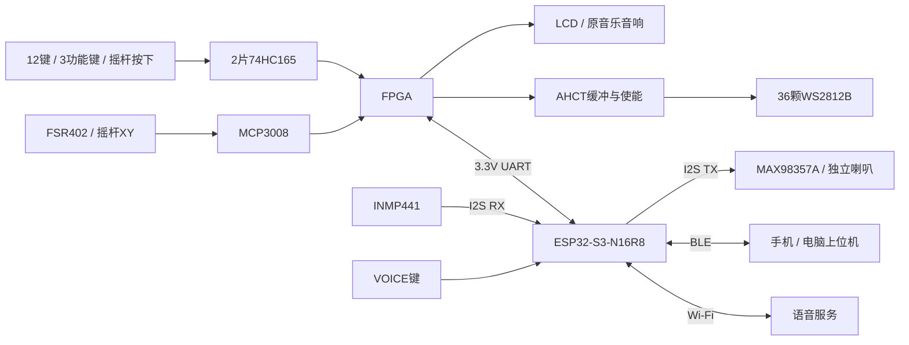

# 第三版封装、引脚分配与画板交接

> 2026-10-15：本文为早期设计提案，实际 V3 硬件已更改为双 MCP3008、12 路独立 FSR。
> 下文 74HC165、GPIO8/9 UART、GPIO18 静音和灯带使能等旧分配不再适用。
> 实物适配以 [V3 实际引脚与程序适配](V3实际引脚与程序适配_20261015.md) 和用户提供的生产原理图为准。

日期：2026-10-07。适用：Tang Mega 138K，SOM30354 + Dock31005，GW5AST-138C。

本文是第三版原理图的信号分配基线，配套[整体方案](第三版整体方案_ESP32S3语音与灯带.md)。已收集真实封装文件、厂家手册和尺寸图，见[资料包索引](v3_reference/README.md)。尚未取得第二版生产网表和最终采购模块，因此这不是已完成 ERC/DRC 的生产文件。

当前确定：S3模组直接贴装；12键各3灯、36颗单链级联；B16发送灯光数据，B15控制缓冲器使能，共占2个FPGA IO。本文是接线主文件，采购选项和历史参考不能覆盖本表。

## 1. 本版定下来的结构

FPGA 负责按键、压力、摇杆、乐器合成、LCD 和 36 颗琴键灯；ESP32-S3 负责小智语音、Wi-Fi、BLE 与命令仲裁。两者用双向 3.3V UART 通信。麦克风和语音功放接 S3，原来的 R10U 仍接 FPGA 音频输出。

用户已确定主控为 **ESP32-S3-WROOM-1-N16R8 模组，直接焊接在第三版键盘 PCB 上**。不安装整块 S3 开发板、不配置双排开发板插座。模组内部已有 16MB Flash、8MB PSRAM、晶振和 PCB 天线；主板补齐电源、启动/复位、下载调试与外设电路。采购链接见[第三版采购与队友交接清单](第三版采购与队友交接清单.md)。

主 S3 自带 BLE 是拓展四默认方案，不增加 HC-05。预留的独立 BLE 接口接 S3 第二路 UART，默认不装；后续需要时采用可编程 ESP32-C3 子板。



## 2. 封装选型与使用边界

| 器件/模块 | 本版安装方式 | 已收集文件 / 决策 |
|---|---|---|
| ESP32-S3-WROOM-1-N16R8 | 直接贴装，主板实现最小系统 | 乐鑫官方 `.kicad_mod`、STEP 与手册；本版已确定 |
| ESP32-S3 开发板 | 不装、不采购插座 | 已下载资料仅作原理图/调试参考，不纳入生产BOM |
| INMP441 小板 | 短线接 J_MIC，另设机械固定 | 暂不凭商品名称画直插封装；本版不移植裸麦克风焊盘 |
| MAX98357A 小板 | 短线接 J_AMP，喇叭单独出线 | 已下载 Adafruit 单声道参考板 Eagle 原理图/PCB；仅适用于对应板，非任意淘宝小板 |
| SN74AHCT125DR | SOIC-14，3.9×8.7mm，1.27mm 间距 | 已收集 TI 手册和标准封装；不要采购成 SSOP/TSSOP 后套本封装 |
| 2N7002 类开关 | SOT-23 | 已收集通用封装；最终料号必须核对 G/S/D 与符号映射 |
| WS2812B | 优先成品灯条；也可 36 颗上板 | 已收集经典 5050 PLCC4 参考封装；不同版本、MINI、2020、反向焊接型不通用 |
| 2×74HC165 | 继承第二版，若新选则 SOIC-16 候选 | 已收集 3.9×9.9mm、1.27mm 间距封装；实际采购后缀须一致 |
| MCP3008 | 继承第二版，若新选则 MCP3008-I/SL 候选 | 同尺寸 SOIC-16 参考封装；不能套到 MCP3008-I/P 的 DIP-16 |
| FSR402、摇杆、按键 | 优先继承实际第二版机械件 | 本轮没有这些实物的最终尺寸证据，不重新猜安装孔/引脚间距 |
| ESP32-C3-MINI-1 | 独立 BLE 子板的后备裸模组 | 已收集乐鑫官方封装和 STEP，默认不装，不等于 C3 开发板插座 |

### 2.1 S3模组封装和最小系统

WROOM-1本体约 **18.0×25.5mm**，使用 `ESP32-S3-WROOM-1` 模组封装。不要用 `ESP32-S3-DevKitC` 整板封装，也不要替换成外接天线版本 WROOM-1U 后沿用布局。官方封装与STEP见资料包；41号地焊盘在封装中分成多块同编号焊盘，不是多根独立GPIO。

| 网络 | 模组焊盘 | 原理图要求 |
|---|---:|---|
| 3V3_ESP | 2 | 稳定3.3V，模块工作范围3.0～3.6V；不能输入5V。电源建议按至少1A级瞬态能力设计并核算实际负载，贴近模组布置10µF及100nF去耦，最终按稳压器与乐鑫参考设计选值 |
| GND | 1、40、41 | 全部接地，中心焊盘接地及过孔/开窗按官方封装、贴片工艺处理 |
| EN / RESET | 3 | 候选10kΩ上拉到3.3V、1µF对地；RESET键按下接地。RC最终按电源上升时间复核，EN不得悬空 |
| GPIO0 / BOOT | 27 | 10kΩ上拉3.3V，BOOT键按下接地；手动进入下载时保持BOOT低并复位 |
| USB_D− | 13 / GPIO19 | 接USB下载口D−，预留靠近S3的22～33Ω串阻和接口侧低电容ESD |
| USB_D+ | 14 / GPIO20 | 接USB下载口D+，与D−按USB差分规则走线 |
| UART0_TX | 37 / GPIO43 | 调试测试点，外部USB-TTL的RX，3.3V逻辑 |
| UART0_RX | 36 / GPIO44 | 调试测试点，外部USB-TTL的TX，3.3V逻辑 |
| 其他启动绑带 | GPIO3、45、46 | 按N16R8官方默认启动要求处理，不挂会改变上电电平的外设；不要套用其他ESP32型号的绑带电阻 |

初版保留原生USB Serial/JTAG下载和BOOT/RESET即可，板上不必额外装CH340/CP2102；UART0测试点作为备用。USB-C做USB2.0设备口时，CC1、CC2分别配置5.1kΩ到地，不能合并；重复的D+/D−触点按USB-C器件图连接。USB VBUS与键盘外部5V需电源选择/防反灌，禁止直接硬并；自供电USB的连接检测按最终USB电路复核，VBUS不能直接进入S3 GPIO。

模组PCB天线优先伸出主板边缘；若不能伸出，严格按乐鑫硬件设计指南留天线净空，不在其下铺铜/走线/放金属。最小系统参考本地模组手册第9章外围原理图、第10～11章尺寸与推荐焊盘。旧DevKit资料仅供参考，不定义本版针号。

### 2.2 模块接口与原生排针不是一回事

本文 J_MIC/J_AMP 等是**第三版自定义线束接口**。它们的针序不是对商家模块排针的描述。采购模块后，通过短转接线或专用小转接板逐网连接，不能拿同针数线束直接平行相连。

这使主键盘 PCB 的接口可以先确定，同时避免 INMP441 常见双排/单排版本、MAX98357A 不同端子位置导致整板返工。若坚持模块直接插主板，则要先获得该商品尺寸图或实物测量，再冻结其插座。

## 3. FPGA J13 分配：保留原接口，替换灯驱动

接口为 **PCIe 金手指旁的 J13，2×20，2.54mm**，不是靠 PMOD 的 J14。表内方向相对 FPGA。电平为 Bank2 / VCCIO2 的 3.3V。行号按针1/2为第一行计算；实际左右方向由板上针1标记确定。

| 行 | J13针 | FPGA球位 | 第三版网络 | 方向 / 用途 |
|---:|---:|---|---|---|
| 1 | 1 | E14 | KEY_LOAD_N | 输出，74HC165 并行装载 |
| 1 | 2 | E13 | KEY_SHIFT_CLK | 输出，74HC165 移位时钟 |
| 2 | 3 | C15 | ADC_SCLK | 输出，MCP3008 时钟 |
| 2 | 4 | C14 | KEY_SERIAL_DATA | 输入，近端 165 的 QH |
| 3 | 5 | B13 | ADC_MISO | 输入，MCP3008 DOUT |
| 3 | 6 | C13 | ADC_MOSI | 输出，MCP3008 DIN |
| 4 | 7 | A14 | PLUCK_DEBUG | 输出，拨弦时序测试点 |
| 4 | 8 | A13 | ADC_CS_N | 输出，MCP3008 片选 |
| 5 | 9 | B16 | WS2812_DATA_3V3 | 输出，替换旧 LED_LATCH |
| 5 | 10 | B15 | LED_ENABLE | 输出，高电平开放灯带缓冲，替换旧 LED_OE_N |
| 6 | 11 | — | NC_5V_DOCK | Dock 原有 5V；V3 默认断开，不与键盘5V并联 |
| 6 | 12 | — | GND | 信号参考地 |
| 7 | 13 | A16 | FPGA_UART_TX | 输出，接 S3 GPIO9 / RX |
| 7 | 14 | A15 | FPGA_UART_RX | 输入，来自 S3 GPIO8 / TX |
| 8 | 15 | A20 | RESERVED_STATE | 默认 NC，不把 BLE 状态硬接到这里 |
| 8 | 16 | B20 | RESERVED_CTRL | 默认 NC，不接 ESP32 EN/BOOT |
| 9～20 | 17～40 | 不分配 | NC | 不连接任何新负载；其中各针不应被假定全是等价 GPIO |

已核对 Dock31005 原理图连接器页和 Bank2 映射，以及 SOM30354 的 VCCIO2/FB15。当前已验收 stage20 CST 中 A15/A16 已是 hc05_rx/hc05_tx：更换为 S3 时复用这两针，**拆开旧 HC-05，不能两路 TX 并接**。其余本表外设网络属于待接入新板的候选分配，并非当前位流已驱动它们。

板载 status_led/T18 保持原功能；灯带不是接这个板载 LED 焊点。LCD 与原 I2S 音频引脚保持原设计。板载 S2/F4 属于 1.5V 接口，不能把 S3 的 3.3V 信号并进去。

### 3.1 WS2812 驱动细化

采用 SN74AHCT125 的第1通道：14脚接5V、7脚接GND、2脚接 DATA、3脚经候选330Ω到灯带 DIN。芯片旁100nF。2脚加100kΩ下拉；灯带 DIN 端加100kΩ下拉，使输出三态时仍有确定低电平。

1脚 `/OE` 用10kΩ上拉到5V；用一只2N7002将其拉低：D接/OE，S接GND，G经100Ω接 FPGA B15，G对地100kΩ。所以 **LED_ENABLE=0/FPGA未配置→关；=1→开**。5V上拉只在MOS漏极一侧，不能直接上拉FPGA引脚。未用的三通道 /OE 接5V、A接GND、Y悬空。

FPGA先保持DATA低，电源稳定后开放缓冲，再发送全灭帧。旧2×74HC595及其与ADC时钟/数据的分支从V3移除，不保留会加载新网络的旧连接。芯片具体上掉电输入容忍仍按最终物料/供电顺序检查，串阻不是掉电隔离器。

**LED_ENABLE只控制数据通路，不控制灯带供电，也不清除灯珠已经锁存的颜色。** 正常熄灯要在使能有效时发送36颗全黑数据及完整复位间隔，再按需要关闭缓冲。FPGA重启而灯带仍供电时，灯珠可能保持原来的颜色；若要求主控失效也强制全灭，必须另设计灯电源开关/故障控制，本版不能用B15代替该功能。

灯带电源独立大电流走线，不由GPIO或J13-12细排线承担36灯的回流。若灯带使用单独可开关电源，需同时处理缓冲与DIN的掉电状态，不能只关灯带VDD而继续送5V数据。

### 3.2 12组三灯的实际布置

数据连接固定为：B16→AHCT→第1组DIN，第1组第3颗DOUT→第2组DIN，逐组接至第12组。最后一颗DOUT留测试焊盘或悬空。各段5V/GND并联到灯电源支路，数据线旁伴随地线；不能把12段DIN并在一起，否则各组会重复同一段颜色数据。

| 琴键丝印 | 音名（八度由软件决定） | 软件灯索引 | 实物灯序号 |
|---|---|---|---|
| KEY0 | C | 0～2 | 1～3 |
| KEY1 | C# | 3～5 | 4～6 |
| KEY2 | D | 6～8 | 7～9 |
| KEY3 | D# | 9～11 | 10～12 |
| KEY4 | E | 12～14 | 13～15 |
| KEY5 | F | 15～17 | 16～18 |
| KEY6 | F# | 18～20 | 19～21 |
| KEY7 | G | 21～23 | 22～24 |
| KEY8 | G# | 24～26 | 25～27 |
| KEY9 | A | 27～29 | 28～30 |
| KEY10 | A# | 30～32 | 31～33 |
| KEY11 | B | 33～35 | 34～36 |

“三颗一组”由软件定义，每颗仍可独立设色。硬件支持多键同时亮，不需要12路并行IO。36颗×24位在800kbit/s下发送约1.08ms，复位低电平按采购版本设置，候选至少300µs并留容差；FPGA独立发送状态机不阻塞音频。

成品灯带需先核对三灯段能否放进一个琴键对应区域。60灯/米的节距约16.7mm，三灯可裁段通常约50mm；144灯/米约6.9mm节距、三灯段约20.8mm，实际还受剪切焊盘和板宽影响。不能只按总颗数采购。可沿琴键纵向布置；空间不足时选合适密度或单独灯PCB，不强行横排。灯段固定并做线缆应力释放，丝印标KEY号、DIN/DOUT及5V/GND。

用户提供的《第五期-WS2812B灯.rar》包含STM32例程，PB7/TIM4_CH2单路输出、默认9灯、逐灯24位GRB缓存。它支持本方案的单链控制思路，但不作为FPGA可直接运行的驱动；72MHz计数、DMA调用和200µs复位不能直接搬用。未执行其中程序。

## 4. ESP32-S3 GPIO 分配

下表为本项目新板级配置，后续小智固件必须按它适配，不能直接烧入任意商家预编译固件。所有信号GPIO为3.3V逻辑。

| 功能网络 | S3 GPIO | WROOM-1焊盘 | 方向（相对S3） | 外接端 |
|---|---:|---:|---|---|
| MIC_BCLK | 4 | 4 | 输出 | INMP441 SCK |
| MIC_WS | 5 | 5 | 输出 | INMP441 WS |
| MIC_DATA | 6 | 6 | 输入 | INMP441 SD |
| VOICE_KEY_N | 7 | 7 | 输入 | 独立语音键 |
| FPGA_LINK_TX | 8 | 12 | 输出 | J13-14 / FPGA A15 |
| FPGA_LINK_RX | 9 | 17 | 输入 | J13-13 / FPGA A16 |
| BLE_AUX_TX | 10 | 18 | 输出，预留 | 独立BLE子板RX |
| BLE_AUX_RX | 11 | 19 | 输入，预留 | 独立BLE子板TX |
| AMP_BCLK | 15 | 8 | 输出 | MAX98357A BCLK |
| AMP_WS | 16 | 9 | 输出 | MAX98357A LRC/LRCLK |
| AMP_DATA | 17 | 10 | 输出 | MAX98357A DIN |
| AMP_MUTE | 18 | 11 | 输出 | 通过MOS拉低功放SD_MODE，高为静音 |

PCB符号和封装采用本表的WROOM-1焊盘号；GPIO号仅作为网络/软件标识。比如GPIO8是模组12脚，不能连到模组8脚。供电/下载针号另见第2.1节。

### 4.1 为什么这样分配

- 用两套I2S信号分别收音和播报，便于收音16kHz和播报采样率分别设置；INMP441和MAX98357A均按其接口工作，不额外占MCLK。S3两个I2S控制器的最终驱动配置仍需固件验证。
- UART通过GPIO矩阵分配到GPIO8/9，保留GPIO43/44的UART0调试链路。GPIO10/11只预留第二UART，不分配给其他功能。
- 避开启动绑带GPIO0、3、45、46；保留GPIO19/20原生USB。
- 不使用GPIO26～37相关Flash/PSRAM资源，尤其N16R8的八线PSRAM占用GPIO35/36/37，即使开发板有引出也不能用。
- GPIO38/48暂留扩展，不必复制开发板RGB灯；GPIO39～42留作可能的JTAG调试；GPIO1/2/12/13/14/21暂不分配。
- 不把原ESP32“34～39只能输入”等规则套到S3；本表以S3-WROOM-1和对应载板资料为准。

### 4.2 麦克风、功放、语音键

INMP441 模块VDD接3V3，GND共地，L/R在模块端固定到GND，软件读左声道。模块附近100nF与适当储能；SD预留100kΩ下拉，I2S时钟/数据的源端预留22～47Ω串阻位置。先用短线，麦克风声孔不被PCB/泡棉封住。由于未取得具体商品机械图，本轮没有批准裸麦克风封装或商家小板直插位置。

MAX98357A 模块用5V供电，输入I2S逻辑来自S3。**A后缀是标准I2S，B后缀不是本配置的直接替代品。** GAIN按模块电阻和手册设定，不接一个不明5V控制输出到S3。软件初始音量低，4Ω/3W只是喇叭额定值，不要求功放长期满功率输出。

AMP_MUTE通过另一只2N7002控制：G经100Ω接GPIO18并10kΩ上拉到S3的3V3；S接GND；D接模块SD_MODE。高电平/MOS导通时关断；GPIO输出低后释放SD_MODE，由模块原有电阻确定声道。保留模块电阻的前提是已核对实际模块：参考Adafruit单声道板SD_MODE通过1MΩ上拉至VIN，5V时与芯片内部下拉构成混合声道电压。不要再并一个强上拉改变声道。左右I2S时隙都输出相同单声道语音，可减少声道选择导致的无声，但仍需验证时序。

上电后先静音、配置时钟并发送零采样，再渐开音量；结束反向执行。3V3未建立时GPIO上拉并不生效，5V先到情况下不能据此宣称全程硬件静音；需实测上电爆音，必要时给功放加电源时序/使能电路。

喇叭只接SPK+、SPK−，两端都是功放输出，**任一端都不能接GND、耳机地或R10U AUX**。

VOICE键按下接地，GPIO7用10kΩ硬件上拉到S3的3V3，100Ω串阻及可选10nF滤波；按键消抖仍由软件完成。它不接BOOT、不接FPGA S2，也不挤占已经满员的16路165输入。

## 5. 第三版线束接口数字针序

以下统一以**原理图符号针号/PCB方焊盘针1**为准，配对线束需逐针测通；从插头线缆侧看会镜像，不用“左边第一根”表述。低电流信号座候选JST PH、2.00mm，已收集2～6针封装；这些座子的相同外观不构成防误插，电源/喇叭座应使用不同结构或键位。

| 接口 | 针数 | 按1→N的定义 | 说明 |
|---|---:|---|---|
| J_MIC | 5 | 3V3_MIC，GND，MIC_BCLK，MIC_WS，MIC_DATA | L/R在麦克风端接地 |
| J_AMP | 6 | 5V_AMP，GND，AMP_BCLK，AMP_WS，AMP_DATA，AMP_SD_MODE | 第6针接MOS漏极，不是GPIO18直出；核算接插件/线径功放电流 |
| J_VOICE | 2 | VOICE_KEY_N，GND | 独立按钮 |
| J_LINK | 3 | GND，FPGA_UART_TX，FPGA_UART_RX | S3 RX接2，TX接3；只传信号，不互送5V |
| J_BLE_AUX | 4 | 3V3_AUX，GND，S3_AUX_TX，S3_AUX_RX | 默认DNP，限3.3V子板，不能接标5V/VIN的模块供电针 |
| J_FSR | 3 | 3V3_ANALOG，FSR_SENSE，GND | FSR接前两针；分压电阻在主板，见第6节 |
| J_JOY | 5 | 3V3_ANALOG，GND，JOY_X，JOY_Y，JOY_SW_N | 供电3.3V，防止5V模拟输出进入ADC |
| J_EXPR | 3 | 3V3_ANALOG，EXPR_IN，GND | MCP3008 CH3，可选 |
| J_LED_SIG | 2 | WS2812_DATA_5V，GND | 灯带信号线；电源另接粗线端子 |
| J_LED_PWR | 2 | 5V_LED，GND | 大电流端子，按不少于3A支路能力核算；不套PH2信号座 |
| J_SPK | 2 | SPK+，SPK− | 候选3.5mm功放端子，不能与5V插头互插 |
| J_PWR_IN | 2 | 5V_IN，GND | 候选5.08mm接线端子，实际料号/线径额定值须≥总设计电流 |

大电流电源端子及喇叭端子的实际料号尚未锁定，没有用“同间距”冒充已确认封装。若不用线束而直接主板走线，可以省去中间座，但网络名、针序边界和测试点保持清晰。

## 6. 继承部分也明确到芯片脚

### 6.1 74HC165串链与按键位序

U_KEY1为靠FPGA的近端，U_KEY2为远端；两片供电3.3V。16脚VCC、8脚GND；1脚/PL接KEY_LOAD_N（10kΩ上拉）；2脚CLK接KEY_SHIFT_CLK（10kΩ下拉）；15脚CLK_INH接GND；7脚反相QH不用。

U_KEY1的9脚QH接KEY_SERIAL_DATA，10脚SER接U_KEY2的9脚QH；U_KEY2的10脚SER接GND。每个并行输入各有10kΩ到3.3V，按键按下接GND。每片就近100nF。

| 新版采样位 | 芯片输入 | 芯片脚号 | 功能 |
|---:|---|---:|---|
| 0 | U_KEY1 H | 6 | KEY0/C |
| 1 | U_KEY1 G | 5 | KEY1/C# |
| 2 | U_KEY1 F | 4 | KEY2/D |
| 3 | U_KEY1 E | 3 | KEY3/D# |
| 4 | U_KEY1 D | 14 | KEY4/E |
| 5 | U_KEY1 C | 13 | KEY5/F |
| 6 | U_KEY1 B | 12 | KEY6/F# |
| 7 | U_KEY1 A | 11 | KEY7/G |
| 8 | U_KEY2 H | 6 | KEY8/G# |
| 9 | U_KEY2 G | 5 | KEY9/A |
| 10 | U_KEY2 F | 4 | KEY10/A# |
| 11 | U_KEY2 E | 3 | KEY11/B |
| 12 | U_KEY2 D | 14 | MODE |
| 13 | U_KEY2 C | 13 | PREV/- |
| 14 | U_KEY2 B | 12 | NEXT/+ |
| 15 | U_KEY2 A | 11 | JOY_SW/ENTER |

这是V3新定义，不声称V2成品具有同样位序。/PL装载并释放后，在首次移位上升沿前读取近端H为位0，之后移位读后续位。若现有RTL扫描约定不同，在接口层调整映射，不能靠交换一列排针补救。最终用逐键通断表核验。

### 6.2 MCP3008

| MCP3008脚 | 网络 / 处理 |
|---:|---|
| 1/CH0 | FSR_SENSE，经1kΩ串阻，ADC端100nF到模拟地 |
| 2/CH1 | JOY_X，同上RC |
| 3/CH2 | JOY_Y，同上RC |
| 4/CH3 | EXPR_IN预留，10kΩ下拉；装表情器件时重核输入负载 |
| 5～8/CH4～CH7 | 测试点，10kΩ下拉，不悬空 |
| 9/DGND | GND |
| 10/CS | ADC_CS_N，10kΩ上拉3.3V |
| 11/DIN | ADC_MOSI，10kΩ下拉 |
| 12/DOUT | ADC_MISO，预留100kΩ下拉，片选无效时可能三态 |
| 13/CLK | ADC_SCLK，10kΩ下拉 |
| 14/AGND | 连续地平面中安静回流区域，与DGND共地 |
| 15/VREF | 3V3_ANALOG，按手册去耦；上限对应满量程 |
| 16/VDD | 3V3_ANALOG，100nF贴近芯片，局部储能 |

FSR高端接3.3V，低端节点FSR_SENSE用候选10kΩ下拉到地，压力增大时电压升高；最终阻值通过FSR实际受力范围校准。这里需要一只分压下拉，不是上下拉各放一只。电容对高源阻抗FSR还会形成额外响应时间，不能只按1kΩ×100nF估计总延迟；需实测压力阶跃和ADC采样建立时间。

只有一个FSR测量全局力度，不等于12键独立压力。摇杆X/Y是额外表情维度。

## 7. 电源、布局与掉电边界

1. 键盘供电按5V/5A级别初步预留，包含36灯、S3、语音功放与逻辑；不包含Tang Mega和R10U。入口保护、铜宽、线径、接插件额定值需一并核算。USB-C普通5V连接不能直接当作可取5A的电源。
2. 键盘5V分为灯、功放、S3和小信号支路。主板必须为S3模组新增5V→3.3V稳压，优先合适的降压电路；按至少1A级瞬态能力预留，再核算其他负载和温升。模拟/165支路可独立稳压，各稳压输出不能并联。麦克风可由3V3_ESP经滤波供电。
3. J13-11默认NC；J13-12仅作信号参考，灯与功放大电流回到键盘电源入口。保持连续地平面，避免用割裂地平面造成信号回流绕路。
4. 调试USB VBUS与键盘5V不能硬并；第三版主板自行设计电源选择/防反灌，不能指望模组内部包含开发板的电源保护。
5. 独立供电设备之间UART、ADC、165等线均需检查一端掉电时的注入电流。预留串阻/断接位有利于测量，但不构成掉电容忍证明。原型阶段断电接线、两端供电后通信；若要求单端断电仍可插接，生产原理图必须落实带Ioff的缓冲/总线隔离及其供电设计，再做测试，不能只靠1kΩ串阻批准热插拔。
6. ESP天线伸出主板边缘优先；否则遵循模组天线净空，避开铜皮、LCD金属背板、喇叭磁体。开发板整体轮廓不是天线净空规则的替代品。
7. 麦克风远离喇叭和按键机械振动，先实现按住说话的半双工。收音时FPGA音乐渐静音，避免两套喇叭造成回声。I2S模块靠S3布置，不跨整个键盘拉线。
8. 12键每键3灯按DIN→DOUT连续编号0～35；灯带分组在软件中按3颗映射。灯电流、协议复位时间和封装脚序最终按采购版本确认。

### 7.1 电源网络命名与装配方式

```text
J_PWR_IN / 5V_IN → 反接及过流保护 → 5V_SYS
  ├─ 可断接支路 → 5V_LED → AHCT缓冲、灯带电源端子
  ├─ 可断接支路 → 5V_AMP → MAX98357A模块
  ├─ 5V→3.3V降压 → 3V3_ESP → S3模组
  │                             └─ 滤波 → 3V3_MIC → INMP441
  └─ 小信号稳压 → 3V3_ANALOG → MCP3008/VREF、FSR、摇杆、74HC165
GND连续共地，灯/功放大电流回流直接回键盘电源入口
Dock J13-11：NC，不接上述5V网络
```

3V3_ANALOG兼供165时，ADC模拟回流和165时钟回流通过布局分开管理，并分别就近去耦；网络同名不是允许任意走线。3V3_AUX预留电源来自已核算容量的3V3_ESP支路，通过默认不装的0Ω位引出，不与另一独立稳压器输出并联。

电源断接点按支路电流选择额定器件或测试连接结构，不用小封装0Ω电阻盲目承担整机5A。5V/5A是电源容量初值，不是把保险丝一律选5A的依据；按线缆、接插件、启动浪涌和允许故障电流选择保护器件。

USB默认作为自供电设备的下载/调试口，不给36灯和功放供电；USB VBUS不直接并入5V_SYS。若需要“仅USB调试S3”的装配选项，额外设计互斥电源选择/防反灌，隔开灯、功放及FPGA接口，并核对S3到未供电模块的信号注入，不能仅增加一个5V跳帽就宣称成立。无USB供电选项时，连接USB下载仍需键盘外部电源。

电源预算在BOM中分别填写：36灯所选版本最大电流、功放最大工作电流、S3的3.3V负载与降压效率、模拟支路以及线缆压降。示例2.16A灯电流、约0.71A功放输入仅用于早期预算，不替代最终规格与实测。

### 7.2 布线和可测量性

| 区域 | 放置和布线要求 | 测试点 |
|---|---|---|
| 电源入口 | 保护器件贴近入口，先分配大电流路径，再布局信号；预留各支路断接条件 | 5V_IN、5V_SYS、5V_LED、5V_AMP、GND |
| S3最小系统 | 模组靠板边，天线按官方净空；降压开关节点远离天线、麦克风和ADC；USB口及BOOT/RESET可操作 | 3V3_ESP、EN、GPIO0、UART0_TX/RX |
| 麦克风 | 拾音孔开放、机械减振；I2S短线并伴随地，避开扬声器回流 | 3V3_MIC、MIC_BCLK/WS/DATA |
| 功放 | 就近储能，喇叭差分双线短且相邻；不跨FSR区域走输出线 | AMP_BCLK/WS/DATA、AMP_SD_MODE；测SPK须用合适差分方式 |
| ADC/FSR/摇杆 | ADC靠模拟入口，RC贴ADC，VREF去耦就近，避免灯电源和LCD时钟穿越 | VREF、FSR_SENSE、JOY_X/Y、ADC_CS_N/SCLK/MISO |
| 165 | 靠近键阵，每个输入有硬件上拉，两片各100nF | KEY_LOAD_N、KEY_SHIFT_CLK、KEY_SERIAL_DATA |
| 灯带 | AHCT靠数据入口，首颗前串阻；各段注电和回流按压降设计 | B16侧DATA、缓冲后DATA、B15、首/末段5V与GND |

上表网络名可作测试点丝印后缀。普通接地示波器的地夹只能接系统GND，不夹功放SPK−；灯波形在第一颗DIN对当地GND测量。

## 8. 队友画图顺序与冻结条件

先画并复核：J13接口→3.3V按键/ADC→S3模组最小系统和UART→麦克风/功放连接座→灯带缓冲→电源。使用本文网络名，器件丝印注明电压、针1和数据方向，给3.3V/5V/GND/UART/I2S/ADC/灯带各留测试点。

在下面几项完成前可以继续原理图和布局，但不把本资料包直接当成投板文件：

- 取得V2最终原理图/网表，核对继承电路和机械件。
- 采购确认：S3完整型号N16R8和模组封装、麦克风/功放真实针序、喇叭外形；核对模组贴装及中心地焊盘工艺。
- WS2812具体版本、成品灯条还是裸灯、全亮电流和焊盘脚序锁定。
- 电源入口和大电流连接器选定具体料号；USB和单端掉电隔离电路审核。
- 1:1机械样纸、符号—封装焊盘映射、ERC/DRC检查完成。

### 8.1 交给画板同学的原理图页划分

| 页 | 内容 | 必须落实的连接 |
|---|---|---|
| 01 电源及保护 | 5V入口、分支、3.3V稳压、USB供电边界 | J13-11断开，各电源输出不互相硬并 |
| 02 FPGA接口 | J13、逐网标签、调试/隔离位置 | J13针号→FPGA球位，不使用J14映射 |
| 03 按键与模拟输入 | 2×165、16路输入、MCP3008、FSR、摇杆 | 新版位序、硬件上下拉、所有闲置输入定义 |
| 04 S3最小系统 | WROOM-1-N16R8、EN/BOOT、USB、UART0 | 模组焊盘号、保留脚、地焊盘和天线区域 |
| 05 语音与通信 | INMP441、MAX98357A、VOICE、FPGA UART | I2S两套时钟、MOS静音、UART交叉、BLE_AUX默认DNP |
| 06 琴键灯 | AHCT、MOS使能、灯电源/信号出口 | B16数据+B15使能、36灯串链、电源并联 |

### 8.2 必装、默认不装和待选物料

- 必装：S3模组最小系统、12音符键和3功能键、摇杆按键、2×165、MCP3008/FSR/摇杆、VOICE键、麦克风/功放/语音喇叭、36灯和AHCT使能电路、供电保护。
- 默认不装（DNP）：独立C3/BLE子板及其供电跳接、CH3表情器件、旧蓝牙调试旁路。BOOT和RESET仍须可操作，不列为DNP。
- 不沿用：S3开发板插座、两片74HC595及旧琴键LED驱动。原4颗状态灯功能优先交LCD，不强制另增驱动。
- 待硬件队友锁定：降压芯片/电感、保护和掉电隔离器件、USB插座/ESD、连接器完整型号、灯带版本/密度、模块固定孔和喇叭尺寸。连接器“2.0/3.5/5.08mm间距”不能代替完整料号。

最终BOM至少包含位号、数量、完整厂家料号、封装、额定值、装配/DNP状态、供应商链接和对应手册。提交原理图源文件/PDF、PCB源文件、网表、BOM、坐标和Gerber，并附模块尺寸图及线束针序；投板前检查源文件与导出文件属于同一版本。

### 8.3 首板上电与联调顺序

| 阶段 | 操作 | 要记录的结果 |
|---|---|---|
| 断电检查 | 核对极性、短路、J13针1、模组供电/地、BTL线束；断开FPGA与灯/功放支路 | 通断表、阻值异常排查、J13-11隔离 |
| 小信号供电 | 限流电源起步，S3保持复位，先测各电源；按实际启动电流逐步调整限流 | 5V/3.3V、电流、温升，无5V误入GPIO |
| S3最小系统 | 外部供电并接USB，验证BOOT/RESET、下载和串口；初始化存储器 | 检出16MB Flash/8MB PSRAM、复位无循环、供电瞬态 |
| 语音模块 | 低音量、短I2S线，先采音再播报；检查上电及复位杂音 | 麦克风声道、连续采样、功放静音状态、BTL正常 |
| 灯带 | 先短段限亮验证，再接全36颗，逐颗点红绿蓝，逐键三灯和多组同时亮 | 编号/GRB顺序、首末段电压、串阻波形；关闭B15不应被误判为熄灯 |
| FPGA接口 | 断电接线，先确认两端电压/隔离，再验证UART、165、ADC | 串口双向应答、16输入一一映射、FSR/摇杆校准范围 |
| 并发与重启 | 逐步提高灯负载，叠加Wi-Fi、语音、ADC和演奏；按电路设计测试重启/断电 | 欠压/重启、温升、ADC噪声、音频杂音、回声、旧灯色清除 |

表内需要对应测试固件。当前工程没有自动具备全部V3驱动，不用“编译成功”代替上述电气和声学检查。带电拔插及单端掉电测试仅在隔离电路已核对后进行；对未设计掉电容忍的原型不要靠反复热插拔验证。

## 9. 本轮检查与证据范围

检查对象为厂家资料中的S3 GPIO/模组焊盘编号、官方封装焊盘及当前stage20 CST中的球位占用。检查结果见资料包索引；不再以DevKit排针编号作为生产接线依据。

技能附带的ESP引脚数据库和validate_pinmap.py在本机缺失，因此没有宣称运行该工具；本轮采用官方资料与本项目独立检查。封装下载、GPIO检查、原理图ERC、PCB DRC、固件编译和上板验证是不同证据，本轮只覆盖前两类及文档复核。

本轮没有修改活动CST/RTL，没有构建或烧录。新GPIO表和接口针序是待实现的第三版硬件设计，不表示现有小智固件、BLE服务或FPGA外设驱动已经适配。
