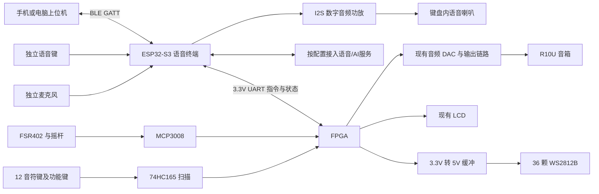

# 第三版数字乐器键盘集成方案：ESP32-S3-N16R8、语音、BLE 与三灯琴键

日期：2026-10-07。

状态：整体设计方案，供第三版原理图、结构布局和器件选型讨论；不是已审核的生产文件。
用户已确认第二版完成打板。本文继承第二版设计意图，但尚未取得第二版最终生产原理图、PCB 和网表，不能把旧方案文档视为实际出厂接线。

本次按用户要求完成第三版集成方案和拓展四蓝牙重新选型；不实施语音、BLE 或拓展四固件。现有基础要求、拓展一至三的优化仍按既定顺序推进。

用户已确定：ESP32-S3-WROOM-1-N16R8 模组直接焊接第三版键盘PCB，主板实现最小系统，集成小智语音与自定义 BLE GATT 服务，搭配 INMP441、MAX98357A 和独立喇叭。常规配置不再增加 HC-05/CC2541 蓝牙模块。若固件或无线共存测试不满足要求，预留独立 ESP32-C3 BLE 子板位置，见第 12 节。

画板采用[第三版封装与引脚分配](第三版封装与引脚分配.md)，采购采用[第三版采购与队友交接清单](第三版采购与队友交接清单.md)。开发板插座方案已取消，下载的DevKit资料仅作参考。

## 1. 已确定的第三版方向

1. 保留 12 个音符键、FSR402、MCP3008、二维摇杆、功能键和现有 LCD。
2. 每个音符键对应3颗WS2812B，共36颗，单链级联；B16为数据、B15为缓冲使能，总共2个IO，替换原74HC595琴键灯方案。
3. 键盘PCB直接集成 ESP32-S3-WROOM-1-N16R8 模组最小系统，增加麦克风和独立小喇叭，运行小智相关语音交互。
4. FPGA 继续负责按键/压力输入、实时音频合成、音效、LCD 和琴键灯光。
5. ESP32-S3 通过双向串口向 FPGA 发送控制指令，并读取实际执行状态。
6. 两套声音输出独立：FPGA 音乐由现有 R10U 播放，助手语音由键盘内的小喇叭播放。
7. 同一颗 S3 提供 BLE 曲谱/控制数据入口；语音和手机指令由 S3 仲裁，再经唯一 UART 链路送入 FPGA。

根据用户提供的模块图片，V3 推荐原型明确采用：ESP32-S3-N16R8 + INMP441 I2S 麦克风模块 + MAX98357A 类 I2S 功放模块 + 独立小喇叭。
S3模组直接焊接主PCB；麦克风和功放先采用有明确接口的小板，通过短线接主板，不必增加另一颗音频Codec。
图片将功放标为 MAX98357，采购时确认实际后缀为支持标准 I2S 的 MAX98357A 或已确认兼容的器件；MAX98357B 使用左对齐格式，不能默认按相同配置替换。

第三版核心分工：ESP32-S3 管语音和联网，FPGA 管实时演奏。
是否使用云端识别、大模型和语音合成，由最终小智固件及服务配置决定；本方案不宣称完全离线 AI。

## 2. 整体架构



助手回复属于 ESP32 音频输出，不经过 FPGA 乐器合成链路。参赛展示时区分助手语音与乐曲声音，乐曲仍由 FPGA 根据音符事件实时生成。

## 3. 相对第二版的变化

| 部分 | 第二版设计意图 | 第三版方向 |
|---|---|---|
| 音符输入 | 12 键、两片 74HC165 | 保留架构，V3位序见新引脚表；与V2实板差异在接口层映射 |
| 功能输入 | 3 个功能键和摇杆按键，合计占满 16 路 | 保留，新增语音键直接接 ESP32 |
| 力度/表情 | 全局 FSR402、MCP3008、摇杆 | 保留，不改为逐键压力检测 |
| 指示灯 | 两片 74HC595、12 琴键灯及 4 状态灯 | 琴键改为 36 颗 WS2812B；原 4 状态灯职责优先迁入 LCD |
| 语音输入 | 无 | 新增麦克风和 ESP32-S3 |
| 语音输出 | 无 | 新增 I2S 功放及独立喇叭 |
| 乐器输出 | FPGA 至现有音响 | 保留 |
| 通信 | 预留蓝牙 UART | S3 自带 BLE，统一经 S3 与 FPGA 通信；不并接两个模块输出 |
| 电源 | 小电流逻辑、传感器和 LED | 重新核算灯珠、Wi-Fi 和功放负载，增加独立电源支路 |

旧文档中的“不使用 WS2812”“不增加 MCU/第二套音频”等限制属于 V2 方案；本次用户已经明确要求 V3 增加这些功能。
V2 文档保留历史状态，不直接覆盖成 V3。

## 4. ESP32-S3 语音子系统

### 4.1 实现形态

第三版采用 ESP32-S3-WROOM-1-N16R8 模组直接贴装；N16R8 对应 16 MB Flash 与 8 MB PSRAM。模组包含存储器、晶振和PCB天线，主PCB负责3.3V稳压、EN/BOOT/RESET、原生USB及UART0调试测试点。
主控采购完整型号已确定，不选WROOM-1U或其他存储版本替代。使用乐鑫WROOM-1模组封装并核对天线净空、中心地焊盘和贴装工艺，不再配置DevKit插座。具体最小系统和焊盘号见配套引脚文档。

不能因为同为 ESP32-S3，就假定所有小智板级配置都可互换。采购前确认实际仓库/固件版本、麦克风接口、音频输出方式、下载接口和可用 UART。

### 4.2 麦克风

- 本版首选用户图片中的 INMP441 I2S 麦克风模块，直接接 ESP32-S3 数字音频输入；不需要额外模拟音频 ADC。
- INMP441 按 3.3V 供电，SCK/WS 为时钟输入、SD 为数据输出、L/R 设定明确电平以选择声道。最终针号以模块丝印和原理图确认；PDM 麦克风不能按相同配置替换。
- 现有 R10U 不作为麦克风采集设备。
- 麦克风靠近键盘上沿/侧边的拾音孔，避免按键敲击直接传入；避开功放、电感和灯珠大电流走线。
- 底部拾音麦克风需要正确的 PCB 声孔与外壳通道；顶部拾音器件按其声学结构布置，不混用封装。

### 4.3 独立小喇叭

建议链路：ESP32-S3 的数字音频接口 → I2S D 类功放 → 单声道小喇叭。

本版首选 MAX98357A 类 I2S 功放及 4Ω/3W 小喇叭；具体模块和喇叭尺寸仍待采购锁定。
须核对所选小智音频驱动是否支持该接口组合、功放在实际电压与负载下的输出功率、喇叭额定功率、温升和腔体尺寸。若成品语音板自带功放，则不再重复增加。

- ESP32-S3 GPIO 不能直接驱动无源喇叭；模块若要求模拟输入，也不能直接接 I2S。
- BTL 功放的喇叭接 SPK+、SPK−，两端都不是地；不得接 R10U AUX，也不得把任一端接 GND。
- 功放关断/使能设计成上电默认静音，固件准备好后启用，降低上电杂音。
- 语音喇叭只播放助手回复和提示，不承担 FPGA 乐器输出。
- 麦克风与小喇叭尽量分居键盘两侧；喇叭增加机械固定和减振，声孔不正对麦克风。

独立小喇叭无需两路模拟音频切换，但仍有空气传播的回声，不能因此宣称免回声消除。

### 4.4 音频模块连接关系（GPIO已分配，商家模块针序待核对）

| 模块接口 | 连接方向 | 说明 |
|---|---|---|
| INMP441 VDD/GND | 3.3V/公共地 | 麦克风不接 5V |
| INMP441 SCK/WS | ESP32 → 麦克风 | I2S 位时钟与字选择 |
| INMP441 SD | 麦克风 → ESP32 | 数字录音数据 |
| INMP441 L/R | 固定接合适逻辑电平 | 声道选择与固件一致，不悬空 |
| MAX98357A VIN/GND | 5V/公共地 | 按实际模块允许范围和功率预算供电 |
| MAX98357A BCLK/LRC/DIN | ESP32 → 功放 | I2S 播放时钟和数据，逻辑匹配须核对模块 |
| MAX98357A SPK+/SPK− | 功放 → 小喇叭两端 | 桥接输出，两端均不接地 |

本版录音采用GPIO4/5/6，播放采用GPIO15/16/17，两套I2S时钟分开；GPIO18通过MOS控制功放静音。小智源码需按此新板级配置适配，不把不同模块的BCLK/WS直接短接。模组焊盘号见引脚文档第4节。

### 4.5 语音键与操作

V2 的两片 74HC165 共 16 路已经分配完。新增 VOICE 键直接接 ESP32 空闲 GPIO，使用明确的硬件上下拉，不挤占琴键或摇杆按键。
已分配GPIO7（WROOM-1模组7脚），10kΩ上拉3.3V、按下接地；与BOOT/RESET分开。

第一阶段推荐按住说话：

1. 用户按下 VOICE，ESP32 请求 FPGA 进入语音交互状态，乐器输出渐静音，等待应答后开始收音。
2. 松开 VOICE，结束本次录音并识别；LCD 显示“识别中”。
3. ESP32 把识别结果转为允许的结构化指令，FPGA 校验并执行或拒绝。
4. 助手通过独立喇叭回复，回复结束后 FPGA 根据成功执行的指令和原状态恢复/开始演奏。

取消、超时或网络失败时退出交互，明确恢复策略；不因为终端重启或一条迟到应答自动开始播放。
第一阶段半双工：助手播报时停止收音。边播放边唤醒/插话需另行评估回声消除、播放参考信号和识别率。
按住说话不自动等于离线识别；离线保底优先保留物理按键，固定语音命令是否本地识别另行验证。

## 5. FPGA 与 ESP32 的接口

### 5.1 通信原则

- 采用 3.3V UART 双向通信并共地。与当前 hc05_link 联调先用既有 9600、8N1；后续曲谱上传目标可设为 115200、8N1，必须同步修改两端并验证，不能只改 ESP32。
- UART 传输命令、参数、状态和错误码；不传实时 MP3/PCM 音乐。
- FPGA 保持实时音频主时钟，ESP32 网络等待不得阻塞按键扫描和音频采样。
- ESP32 掉线时实体演奏继续可用；FPGA 接收串口信号时按实际时钟域完成同步和帧检查。
- 后续协议至少包含版本、命令、长度、序号、载荷、校验和应答；超时重发必须去重，避免重复起播。
- 未知歌曲、参数越界或格式错误返回失败；语音终端收到 FPGA 成功应答后才显示/播报“已执行”。

第一批指令候选：查询状态、选曲、播放、暂停/停止、设置速度、设置已有音色、请求/结束语音交互。
物理停止/静音操作优先；不得被迟到的语音命令立即覆盖。
现有 HC05 链路不等于已经支持小智命令协议，实际接入仍需 ESP32 和 FPGA 两端适配。

### 5.2 基于 V2 文档的 FPGA 接口候选

以下只是沿用既有针位的 V3 改用建议。依据为第二版硬件方案第 4.1 节；尚未对 V2 最终生产网表和 V3 原理图复核，不作为最终放板针表。

| J13 接触号 / FPGA 球脚 | V2 信号 | V3 候选功能 | 处理方式 |
|---|---|---|---|
| 9 / B16 | LED_LATCH | WS2812_DATA | 移除旧 595 锁存负载，经 5V 电平转换接灯带 |
| 10 / B15 | LED_OE_N | LED_ENABLE | 经MOS控制AHCT的/OE，高为开放，详细电路见引脚文档 |
| 13 / A16 | FPGA UART TX | FPGA_TX → ESP_RX | 3.3V逻辑，S3 GPIO9 / 模组17脚 |
| 14 / A15 | FPGA UART RX | FPGA_RX ← ESP_TX | 3.3V逻辑，S3 GPIO8 / 模组12脚 |
| 15 / A20、16 / B20 | BT_STATE / BT_CTRL | 默认不接语音功能 | 若需忙状态/控制，另行定义后再连接 |
| 12 / GND | 公共地 | 信号参考地 | 大电流回路走专用电源连接，不全经此脚 |
| 11 / 5V_Peripheral | V2 电源 | V3 外部供电版本默认隔离 | 防止外部 5V 反灌 Dock |

A16/A15 在既有工程用于蓝牙 UART。V3 默认由 S3 独占这对引脚，拆除原 HC-05/CC2541 的直接连接。
手机 BLE 和小智共享 S3 内部命令入口，不需要两颗芯片并驱 FPGA RX。
若保留 V2 蓝牙插座作调试旁路，用硬件选择同时切换 TX/RX，供电与掉电隔离按实际模块核对，明确互斥装配。
独立 BLE 备选子板接 S3 的第二路 UART，再由 S3 仲裁；它不能直接与 S3 TX 并接。预留 S3 GPIO10/TX（模组18脚）、GPIO11/RX（模组19脚），默认不装配。
S3 的 BLE GATT 不兼容 HC-05 经典蓝牙 SPP，需要软件适配，不能仅换硬件就沿用串口网页。

## 6. 每键三灯的 WS2812B 方案

### 6.1 数量和职责

12个琴键×每键3颗=36颗WS2812B，按键序级联，一根FPGA数据GPIO（B16）控制颜色，另有B15控制AHCT缓冲器使能；用户已同意保留这两个IO。
第 k 个琴键对应灯珠 3k、3k+1、3k+2（k=0…11）；PCB 丝印同时标琴键号、灯珠序号和 DIN→DOUT 方向。

首版显示建议：三个灯同色表示琴键状态；可选力度显示用 1/2/3 颗表示强弱。
当前只有一个全局 FSR，不能把三灯力度效果表述为 12 个琴键各自具有独立压力测量。
语音工作状态优先显示在 LCD，不占用琴键音符含义。原 4 个独立状态灯是否保留需另定，不计入这 36 颗。

### 6.2 电气连接

```text
FPGA 3.3V DATA → 74AHCT125 类单向缓冲（5V 供电）→ 串联电阻 → 第一颗 DIN
FPGA B15 → 2N7002 → 缓冲器/OE（高电平使能，默认关闭数据通路）
第一颗 DOUT → 第二颗 DIN → …… → 第 36 颗
专用 5V 电源支路 → 灯珠 VDD
公共地 → 缓冲器、灯珠、FPGA 信号参考地
```

- 缓冲器具体型号需满足 3.3V 输入识别、5V 输出和本设计上掉电条件；不能任意用 5V 74HC 系列替代 AHCT。
- DATA 串阻先预留 220～470Ω 调试位置，候选 330Ω，最终按波形与线长确认。
- 输入弱下拉并定义 OE 上电状态，保证 FPGA 未配置时数据为低；若两侧独立供电，检查掉电容忍/隔离，防止信号反向供电。
- 每颗裸灯珠按数据手册配置贴近的去耦，缓冲器放 100nF，电源入口预留储能电容；成品灯带核对其现有去耦。
- 使用连续地参考与足够电源铜宽，必要时分区注电；不要让 36 颗灯的电流通过细信号排线或单个未经核算的排针。
- DIN 接输入端，不能把 DOUT 当输入。接口与普通 5V/3.3V 模块作防误插区分。

### 6.3 控制与时序

WS2812B 候选工作速率约 800kbit/s，每颗 24 位，36 颗数据时间约 1.08ms。
复位低电平按最终型号确认，候选取至少 300μs 且留容差，整帧约 1.4ms；不同型号复位下限不可直接套用。
逐帧锁存灯光数据、后台发送，不能等待灯带发送结束才处理音频或按键。
上电先发送全灭帧，再开放状态显示；亮度上限可降低常态功耗，但供电保护不能只依赖软件限亮。

具体上电顺序为DATA保持低→开放数据缓冲→发送全黑帧及复位间隔→开始正常灯效。B15关闭只阻断数据，灯珠可能保留旧颜色；正常熄灯先发全黑帧，不能靠关闭使能完成。12组三灯映射、灯带密度与实际段长见引脚文档第3.2节。

用户提供的 WS2812B 移植指南作为协议参考，不作为已验证的 FPGA 模块：
其 CLK_HZ 参数没有自动换算全部脉宽，时钟变化需重算并验证；3.3V 供电和 200μs 复位也不能对所有灯珠版本通用。

## 7. 电源整体规划

### 7.1 电流预算

| 支路 | 初步预算依据 | 设计要求 |
|---|---|---|
| 36 颗灯珠 | 老款全白按约 60mA/颗估算，共约 2.16A@5V | 最终按采购版本最大值核算 |
| 语音喇叭功放 | 3W 输出、效率按 85% 粗估约 0.71A@5V | 实际与音量、阻抗、功放型号有关 |
| ESP32-S3 | Wi-Fi 发射和音频处理存在电流峰值 | 主板3.3V稳压、瞬态能力和储能按模组资料及负载核算 |
| 165、ADC、麦克风、传感器 | 按最终 BOM 汇总 | 兼顾 ADC 参考和麦克风电源噪声 |

V3 键盘外部供电可先按稳压 5V/5A 级别预留，最终以峰值预算、线缆压降、温升和实测定额。
这个预算不自动包含 Tang Mega 开发板及 R10U；若要整机单电源，必须另核算它们的负载和供电接口。
此前仅灯带的 5V/3A 建议不能直接当作新增 ESP32 与功放后的整机电源结论。

### 7.2 推荐供电结构

- 外部 5V 入口经合适的过流/反接保护，分到灯珠、语音功放、ESP32 稳压和小信号电源支路。
- ESP32-S3-WROOM-1-N16R8使用主板设计的3.3V稳压电源，不直接接5V；本版没有开发板VIN或板载LDO可以借用。
- ESP32 电源可采用降压方案，避免未经热计算就沿用 V2 小 LDO。传感器参考和麦克风支路做好去耦与布局隔离。
- 外部键盘 5V 不与 Dock J13-11 的 5V 硬并联；V3 默认隔离该针供电。USB 调试口同样检查 VBUS 反灌。
- 大电流供电连接器、铜宽、线径和保险额定值一起核算，不能仅换大电源适配器。
- 若选 USB-C 电源入口，必须设计合法的供电能力识别/协商；普通 USB-C 插座加电阻不保证可取 5A。
- 地保持连续，灯珠与功放的大电流回流路径避开 ADC/麦克风区域，共地不等于让所有电流走同一细线。

## 8. 键盘布局和结构建议

演奏面保留 LCD 下方的 12 键操作区域，灯珠每键上方三颗，配扩散罩/导光结构，避免直视刺眼或妨碍按键行程。
功能键区增加单独 VOICE 键，与 MODE/PREV/NEXT 清楚区分；摇杆及 FSR 位置沿用实际 V2 人机测试结果再微调。

- ESP32 天线放板边，严格按最终模组要求留铜皮、金属和器件净空，避开 LCD 背板和喇叭磁体。
- 麦克风和语音喇叭分别布置，喇叭腔体、拾音通道和键盘机械振动一起考虑。
- I2S 和音频功放走线尽量留在语音子板内，避免跨整块键盘拉长线。
- 功放/灯珠电源区域与 MCP3008/FSR 模拟区分开布置，连续地平面保持返回路径。
- 语音子板、喇叭和主键盘各有可靠固定，按键压力不能传到 J13 或 LCD 排线。
- 预留 ESP32 原生USB、UART0测试点及BOOT/RESET操作位置；GPIO和模组焊盘号见配套引脚表。

## 9. 软件职责与歌曲存储边界

| 单元 | 职责 |
|---|---|
| ESP32-S3 | 收音、语音交互、Wi-Fi、BLE GATT、曲名匹配、指令仲裁、助手播报与执行状态回传 |
| FPGA | 按键与 ADC 采集、声部调度、实时音频合成/音效、曲谱执行、LCD 与灯光 |
| 歌曲目录 | 维护曲目 ID、名称/别名、版本与可用状态 |
| 曲谱数据 | 保存音符事件、时长、力度和声部，不用整段预录 PCM 替代乐器合成 |

第一阶段沿用已有有限曲谱，ESP32 只发送曲目 ID。语音不会让 FPGA 自动具备演奏任意歌曲的能力。
后续若曲库放在 ESP32 Flash/其他存储，需要另做曲谱装载、长度校验和预缓冲；实时音频不能依赖网络及时到达。
LCD 初版使用固定中文状态和已知曲名，避免假设现有按需字库能显示任意大模型回复。
助手 TTS 与乐曲数据分开，语音音量由 ESP32 控制；R10U 模拟旋钮位置仍无法从现有链路读取。

## 10. 分阶段验证与交付条件

1. 取得 V2 最终生产原理图/网表，核对按键位序、J13 引脚、上下拉和电源，确定可以继承的部分。
2. 选定受支持的 ESP32-S3 音频方案，独立验证麦克风、助手回复、小喇叭和 Wi-Fi 稳定性。
3. 先用串口测试指令验证 FPGA 执行和应答，再接语音识别；测试重发、非法参数、断网、重启、物理停止优先级。
4. 验证 36 颗灯的顺序、三灯分组、全白/限亮、上电全灭、信号电平和供电压降。
5. 原型上确认半双工流程、按键敲击干扰及麦克风/喇叭机械位置，再冻结 V3 PCB。
6. 最终原理图复核 ESP32 保留脚、启动脚、功放负载、WS2812 型号、电源隔离；完成 ERC/DRC 和机械检查。
7. 完整 FPGA 固件通过综合、布线、时序和引脚审计；上板后检查语音/灯光并发不会破坏音频节拍和输入延迟。
8. 联合测试 Wi-Fi 活跃、灯珠高亮、助手播报和 ADC 采样时的电源、噪声、温升与复位行为；最终进行持续运行测试。

本文件没有宣称新固件已开发、第三版电路已验证或可直接生产。第二版已打板这一事实来自用户，本机尚无最终生产文件验收证据。

## 11. 画第三版原理图前需锁定的项目

- ESP32-S3-WROOM-1-N16R8型号和GPIO已确定；待锁定可维护的小智源码版本并实现本板配置。
- 麦克风型号、拾音方向与接口；功放是否板载；喇叭阻抗、额定功率、尺寸和安装腔体。
- WS2812B 实际版本，是成品灯带还是 PCB 裸灯珠，以及全亮电流和复位时序。
- 麦克风/功放小板、电源连接器、外壳和天线净空尺寸。
- 是否装配独立 BLE 备选子板；默认只用 S3 自带 BLE，备选不装，详见第 12 节。
- V2生产文件与V3引脚表逐网对照，以及独立供电/调试USB和板间掉电隔离的具体电路。

参考：[第二版硬件方案](第二版硬件方案.md)。当前文档是 V3 思路入口，V2 接线表不能未经复核直接当作 V3 接线表使用。

## 12. 拓展四蓝牙重新选型

### 12.1 选型依据与推荐

目标为电脑/安卓上位机传输曲谱和控制数据，保留安卓 Chrome 网页直连及后续原生 APK 路线，因此选择 BLE GATT。
此处蓝牙不用于 A2DP 音乐播放。ESP32-S3 支持 BLE，不支持 HC-05 所用的经典蓝牙 SPP，也不能据此充当经典蓝牙音箱。

| 方案 | 适配性 | 本次结论 |
|---|---|---|
| 主 S3 自带 BLE + 自定义 GATT | 不增加模块/天线/UART，名称与服务可在固件中定义 | **首选**；需要与小智集成，验证 Wi-Fi/BLE 共存 |
| 独立 ESP32-C3 开发板或 ESP32-C3-MINI-1 子板 | 用专用 BLE 固件将曲谱数据送入 S3 第二 UART，音频任务仍由 S3 承担 | **工程备选**；可自主管理协议，但并非买来即透传，需开发固件 |
| JDY-23 等有完整手册的 BLE UART 成品模块 | 可以作为专用 BLE 透传入口 | 采购备选；未核实具体供应商固件，不给出已验证 UUID、速度或电源针序 |
| 先前 CC2541/HM-10 类不明固件底板 | 芯片名称、商品 UUID 不足以证明写入/通知/流控和兼容性 | 不作为 V3 默认采购项 |
| HC-05 | 经典蓝牙 SPP，适合系统串口/原生 RFCOMM | 不适合本项目安卓网页 Web Bluetooth 目标，不再为 V3 新购 |

N16R8 使 S3 内存配置更充裕，但不会自动提供 BLE 透传功能。
应选择可修改的小智源码/明确支持自定义服务的固件。原有小智 BLE 配网服务不等于曲谱 GATT 服务；固件若配网后释放蓝牙资源，需要调整生命周期。
若必须原封不动使用商家封闭固件，主 S3 方案不能保证实现，应先验证其控制扩展能力再选择备选结构。

### 12.2 单 S3 共存策略

S3 的 Wi-Fi 和 BLE 共用 2.4GHz 射频资源，采用时间复用；官方支持共存不代表两种业务都有独立的满速无线链路。
初版按以下业务约束降低资源竞争：

- BLE 保留短控制与状态功能；语音会话期间暂停或限速大块曲谱上传，不承诺网络语音和最大速率上传同时运行。
- 曲谱先完整上传、校验、提交，再由 FPGA 本地调度；蓝牙和 Wi-Fi 的到包抖动不参与乐曲节拍。
- 语音播放使用有界音频缓冲；BLE 写入使用有界队列和背压，队列满返回忙，禁止静默丢包。
- Wi-Fi 断网不应自动断掉本地 BLE 演奏控制；BLE 断开不影响已提交曲谱的本地演奏。
- 识别/回复期间使用半双工流程，优先保证当前语音和物理停止命令。

只有在实测出现无法接受的音频欠载、BLE 中断，或选定固件不能集成服务时，才转向独立 BLE 子板。
增加第二颗无线芯片仍存在同频干扰，不能把它当作无线性能保证；独立子板也仍需解决指令仲裁。

### 12.3 GATT 与上位机适配约定

建议自定义 128 位 UUID 服务，设备名候选 FPGA-Instrument-XXXX，XXXX 为设备区分后缀。
不冒用 FFE0/FFE1 作为“已支持”证据，也不把 BLE UART 当作标准串口配置文件。

| 特征 | 属性建议 | 含义 |
|---|---|---|
| CONTROL_RX | Write with response | 上位机发送短指令和上传数据片段 |
| STATUS_TX | Notify | 回传板端应答、上传进度及状态 |
| INFO | Read | 协议版本、容量、设备能力和 FPGA 在线状态 |

初版一台上位机作为写入控制者。手机命令和语音命令统一进入 S3 仲裁器，至少区分来源、会话和请求序号。
FPGA 物理 STOP/设置静音优先；上传事务进行时，语音 PLAY/选曲不能破坏事务，返回忙或等待明确完成。
BLE 写入成功只说明 GATT 层接收，不表示 FPGA 已执行；只有板端 ACK 才能让上位机显示执行成功。

ATT 未协商更大 MTU 时按 20 字节有效载荷起步，按实际可用 MTU 分片；分片重组后再解析协议帧。
保留应用层序号、长度、校验、ACK、超时重试和去重；不能将一次 BLE 回调当作完整曲谱包，也不能依赖固定延时防止溢出。
设备名不是密码。若采用绑定/加密，按实际手机和浏览器测试；可由物理键限定配对/控制窗口，拒绝第二个会话抢占当前控制权。

### 12.4 现有软件真实状态与工作量

本轮检查到的代码：

- host/instrument-web/src/transport.js 保留 navigator.serial.requestPort 的 Web Serial/HC-05 路径；网页上位机已增加 src/ble-transport.js，按 MICU-OmniProbe 的 Central 流程实现可配置 GATT 服务发现、Notify、Write/Write Without Response、20 字节分片队列和断线清理。
- host/instrument-web/src/protocol.js 的 SONG 帧属于预览编码，不能据此认定 FPGA 已支持通用曲谱上传。
- work/string_expression_stage22_20261006/rtl/hc05_link.v 为已有 9600 波特率短文本探路协议，包含 PING/HELLO/PLAY/STOP 等，不是完整歌曲数据库接收器。

当前已完成网页端 BLE 适配，但只默认填入 NUS 兼容 UUID，V3 自定义 GATT UUID 仍以 S3 固件最终定义为准；网页 BLE 写入成功不能替代 FPGA ACK。后续需要 ESP32 增加 GATT/语音命令到 UART 的适配，并由 FPGA 另行实现和验证完整曲谱装载/提交协议。
沿用已有 MIDI 分析、音符事件和状态机制，避免让 FPGA 解析大模型文本或原始 MP3。

安卓 Chrome 使用 HTTPS/受信任本地来源、用户主动点击连接、系统蓝牙和相应权限，最终机型实测。
安卓 APK 可用原生 BLE GATT 桥；WebView 不因打包而自动具备 Web Bluetooth，原有 Web2BlueBuilder 参考仍需队列/分片适配。
Windows Chrome/Edge 的 Web Bluetooth 需蓝牙适配器、系统和浏览器实际支持；保留有线调试。
iOS Safari/微信内置浏览器不作为本版网页 BLE 默认支持范围。

## 13. 第三版采购与集成清单

| 项目 | 建议数量 | 规格/用途 | 当前决策 |
|---|---:|---|---|
| ESP32-S3-WROOM-1-N16R8模组 | 1 | 16MB Flash/8MB PSRAM，PCB天线，直接贴装 | 用户已确定；主板实现最小系统 |
| INMP441 模块 | 1 | 3.3V I2S 麦克风 | 推荐采用 |
| MAX98357A 模块 | 1 | 标准 I2S 单声道数字功放 | 推荐采用，确认 A 后缀 |
| 喇叭 | 1 | 4Ω/3W，尺寸匹配键盘腔体 | 电气候选，机械尺寸待定 |
| 语音键 | 1 | 独立按键，硬件上/下拉明确 | 接 S3，不占原 16 路扫描 |
| WS2812B | 36 颗 | 12 键，每键 3 颗 | 具体版本及裸灯/成品灯条待定 |
| 5V 单向电平缓冲 | 1 组 | 74AHCT125 类，3.3V 输入兼容 | 按供电时序和封装核对 |
| 键盘电源 | 1 | 稳压 5V/5A 级别预留 | 只覆盖键盘支路，最终功耗核算 |
| ESP32-C3 独立 BLE 子板 | 0，备选 1 | 可编程 BLE/UART | 默认不采购、不装配 |
| 最小系统、电源及连接器 | 按布局 | 3.3V稳压、USB/BOOT/RESET、麦克风/喇叭座、大电流电源入口 | 具体电源和连接器料号由硬件设计锁定 |

不需要为语音子系统另买独立屏幕；键盘已有 LCD，由 FPGA 根据 ESP32 状态消息显示。
商家小智固件若强依赖特定屏幕，需选择无屏配置或改板级支持，而不是默认接现有 LCD 就能兼容。

第三版连接按以下功能划分，数字针序和模组焊盘见配套引脚文档，不混用旧六针蓝牙插头：

- U_S3：WROOM-1-N16R8模组直接贴装，2脚3.3V，1/40/41脚GND，最小系统按配套文档设计。
- J_MIC：3V3、GND、MIC_BCLK、MIC_WS、MIC_DATA；L/R 在麦克风端固定。
- J_AMP：5V、GND、AMP_BCLK、AMP_WS、AMP_DATA，按模块需要另设使能/增益配置。
- J_SPK：只有 SPK+、SPK−，与电源/地插座防误插。
- J_VOICE：语音键及其地/参考电源，按输入电路确定。
- J_LINK：FPGA_TX→S3_RX、FPGA_RX←S3_TX、GND 测试点及隔离位置。
- J_BLE_AUX：备选子板的 UART/地/明确电压电源，默认不装；预留位置是否保留由 PCB 空间决定。

优先把 INMP441、功放和 S3 的 I2S 线布在相邻区域，麦克风与喇叭声学位置仍需隔开。
主控使用官方模组封装直接贴装；麦克风/功放小板的商品针序和机械尺寸另行核对，不用商品照片猜封装。

## 14. 实施顺序及选型验收

| 步骤 | 验证对象 | 通过条件 |
|---|---|---|
| A | N16R8 + INMP441 + MAX98357A | 固件识别 Flash/PSRAM 正确，收音和回复连续，无掉电复位 |
| B | S3 UART 到现有 FPGA 探路协议 | PING/应答、PLAY/STOP 实际执行，波特率一致；不接 BLE 也能工作 |
| C | S3 BLE + 网页/安卓测试端 | GATT 读写通知正常，分片重组正确，显示 FPGA 实际 ACK |
| D | 小智工具调用/本地指令适配 | 语音选曲/停止映射到允许指令，拒绝未知曲目，物理停止优先 |
| E | Wi-Fi/语音/BLE 并发 | 短控制有效，长上传受控暂停/恢复，不发生丢帧、重启或伪成功；失败再评估独立 BLE |
| F | 36 灯、电源和键盘结构 | 分组正确，灯珠高亮与 Wi-Fi/功放负载下电压、温升、ADC 噪声合格 |
| G | 完整曲谱上传 | 容量/校验通过后提交，断连后 FPGA 继续本地演奏，中途断传不可播放半首 |
| H | V3 原理图/PCB 冻结 | 完整引脚表、实际模块封装、供电隔离、ERC/DRC 和机械样纸均检查通过 |

A～F 用于验证集成路线；G 是后续拓展四软件工作，不把它说成当前已完成。
当前最新 stage 22 八弦表情构建已知布线失败，不用它作为已验收的板上联调固件；后续联调须选已通过时序并归档的版本。

## 15. 依据与验证范围

本轮核对了 V2/V3 本地方案、现有 Web Serial 代码和 FPGA hc05_link；只修改设计文档，没有部署小智、改 RTL、烧录或验证真实蓝牙通信。
ESP32 技能的附属参考文件在本机缺失，因此用乐鑫官方资料补充功能边界，不据通用 ESP32 引脚规则分配 S3 GPIO。

- [乐鑫 ESP-IDF v5.4：ESP32-S3 蓝牙 API](https://docs.espressif.com/projects/esp-idf/en/v5.4/esp32s3/api-reference/bluetooth/index.html)：BLE GATT 与主机栈参考。参考版本不等于小智最终使用的 SDK 版本。
- [乐鑫 ESP32-S3 无线共存说明](https://docs.espressif.com/projects/esp-idf/en/stable/esp32s3/api-guides/coexist.html)：Wi-Fi/BLE 共享射频、共存策略与配置。通用页面中其他芯片的协议描述不能当成 S3 能力。
- [小智开源项目](https://github.com/78/xiaozhi-esp32)：本轮读取 README，确认 ESP32-S3、设备控制扩展及语音服务路线；没有核验整份源码的 BLE 并发实现。正式开发锁定提交和对应 SDK，不能假定现成固件含本项目曲谱服务。
- [Web Bluetooth API](https://developer.mozilla.org/en-US/docs/Web/API/Web_Bluetooth_API)：浏览器安全上下文与兼容性参考，最终以目标手机和电脑实测为准。

未评估具体淘宝店铺质量、未购买模块、未锁定商品尺寸；“推荐采购”与“已验证可用”在本方案中分别标注。
