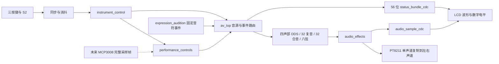

# 当前工程整合与架构交接（2026-10-02）

版本：`integration_20261002`。基线为用户已试听认可的
`effects_expression_20261002`，旧版镜像和源代码保留在同名交付包。
本轮整理控制/显示合同和音源路由，音色、包络、效果算法、菜单操作保持基线行为。
构建与验收结果见交付包 `validation.md`；未烧录前不能把本轮称为已上板验证。

## 硬件与时序基线

- Tang Mega 138K SOM30354 + Dock31005，GW5AST-138C，完整料号
  `GW5AST-LV138PG484AC1/I0`；Gowin V1.9.12.03。
- 正式工程：`E:/Gowin/workspace/fpga_instrument_av/fpga_instrument_av.gprj`，顶层 `av_top`。
- 板载输入 50 MHz；音频时钟按 SDC 为 50 MHz × 58/59，像素时钟为 50 MHz × 2/3。
  PT8211 每 1024 音频时钟消费一帧，名义采样率约 48 kHz；按当前比例计算约 48,000.53 Hz。
- 各域异步复位置位、同步释放。S2 高电平按下，KEY0/1/2 低电平按下；消抖后进入控制器。
- 本轮不修改引脚、CST/SDC、PLL 或 PT8211 串行时序。

## 一条控制链，两条观察链



| 归属 | 当前职责 | 后续修改入口 |
|---|---|---|
| `instrument_control.v` | 菜单、范围、预设、S2 优先、触发收集、演示启停 | 新设置项与输入事件优先级 |
| `instrument_contract.vh` | 页内行→参数编号、56 位显示字段、上电默认值 | 参数编号、状态位、默认值只在此定义 |
| `av_top.v` | 时钟复位、音源选择、普通演奏/试听路由、状态组包 | 新输入接入、音源和显示消费者连接 |
| `performance_controls.v` | 校准、死区、平滑、压力迟滞、输入超时 | 新板 ADC 帧；目前 sensor_enable=0 |
| `audio_voice_mixer.v` + `pitch_expression.v` | 四声部 DDS、ADSR/拨弦、滑音/颤音/弯音 | 普通演奏算法 |
| `polyphony_bank_32.v` | 动态声部分配、释放和满载替换 | 32 复音事件入口；当前为手动按键 |
| `additive_bank_32.v` | 32 分量自动合成演示 | 自动演示，不等同于 32 个独立按键 |
| `physical_string_bank.v` + `physical_string_voice.v` | 八个独立物理弦状态、分配和截止时间计数 | 物理建模事件入口 |
| `audio_effects.v` + `reverb_comb.v` | 延迟、合唱、混响、强度档位、切换淡出淡入 | 统一 PCM 后处理 |
| `lcd_test_pattern.v` | 固定界面、菜单、琴键、波形与数字电平渲染 | 拓展三显示区域与可视化数据 |
| `status_bundle_cdc.v` / `audio_sample_cdc.v` | 控制快照/音频采样的跨域传输 | 新显示消费者的 CDC 边界 |

## 控制与音频合同

普通 DDS 与物理弦共用 `routed_voice_trigger/gate`、演奏方式、键法、音高与八度选择。
力度试听由 DDS 使用变化力度；琴弦对比仍使用固定 96，避免改变已确认的对比语义。
32 复音只消费实时手动事件，保持原来的输入；32 合音自动推进。
试听、32 路测试和设置页的优先关系保持基线，S2 进入设置停止演示。

所有正式音源使用音频域的单周期 `sample_strobe`，输出 signed 16-bit PCM。
PT8211 消费上一份已完成的 PCM，模块在下一采样间隔内计算后续样本。
这是固定周期调度，未增加另一套 ready/valid 协议或改变计算延迟。
效果器接在音源选择之后；32 路演示选原声旁路，普通演奏和试听按原规则选择音效。
音频电平和波形取效果器输出，无法测量音箱模拟旋钮或实际声压。

## 菜单和 LCD 合同

`settings_field_id(page,row)` 由控制器与渲染器共享；页签/无效行返回 FIELD_INVALID，
不再借用参数编号。基础页 6 行，拓展页 7 行；行高与字形仍由 LCD 渲染器拥有。

| 页 | 行顺序 |
|---|---|
| 基础要求 | 触动/拨弦、音色、根音、力度、键法、八度 |
| 拓展要求 | 音效、音效强度、32 合音、32 复音、八弦建模、表情预设、对比试听 |

KEY0 移动焦点，KEY1/KEY2 调整；页签上 KEY1 选基础、KEY2 选拓展。
S2 进入/退出；上电默认拨弦、琴音、C、中八度、力度 96、和弦键法、原声、中档音效强度。
默认值是上电初值，没有增加断电保存菜单参数的功能。

状态总线保留 56 位布局，模块端口宽度仍明确写为 28/56 位，内部使用共享宽度与字段起点。
字段采用 `[ST_x +: 位数]` 组包/解包，避免无注释的位号在多个文件重复。

| 位区间 | 内容 |
|---|---|
| 27:0 | KEY、八度、键法、力度、根音、音色、触发模式、焦点、设置、音效和测试选择 |
| 33:28、34、35 | 声部计数、琴弦标志、设置页 |
| 43:36、45:44、47:46 | 琴弦超期计数、滑音、颤音 |
| 48、49、50、53:51、55:54 | 试听准备/活动/A-B、试听目标、音效强度 |

控制域快照经 request/ack 握手整体传输；LCD 保存 shadow，并仅在 frame_start 提交 active。
显示快照允许合并中途参数更新，不能用它传输必须逐个消费的音符事件。
原始音频采样另走 audio_sample_cdc；波形银行切换与原有帧提交逻辑保持不变。

## 新硬件与拓展三接入边界

1. MCP3008 驱动交付音频域一致的 `frame_valid + force_raw/x_raw/y_raw`（各 10 位）。
   SPI 若另有时钟域，先整帧握手/FIFO 后接 performance_controls，不能逐位同步数据。
2. 现有零点、中心、增益、摇杆范围参数继续用于真实标定；默认中心 512 不是实测值。
   压力 trigger/gate 尚未接到正式声部分配器，需明确选音、机械键和压力的优先级。
3. 力度进入普通 DDS、32 复音与物理弦；连续弯音/颤音当前只进入普通 DDS。
   新输入是否共用力度、是否每键独立，须以最终 PCB 通道数与题目演示方式定案。
4. 无摇杆时可用三按键及对比试听验证原有滑音/颤音；连续摇杆路径只具备虚拟 ADC
   仿真和独立综合证据，不能声称已完成硬件交互测试。
5. 拓展三频谱优先从音频域最终 PCM + sample_strobe 分支采样，完成一块结果后整体
   跨域，LCD 在帧边界换快照。不能把 FFT 放到当前逐像素字形/波形组合路径上。
6. HDMI 后续单独设计像素时钟、时序、引脚和跨域消费者；当前 LCD 仍为 800×480。
   当前音频左右复制；两路相同的信号只能得到退化直线李萨如图，开发时须先定义两轴来源。

这里明确接入位置与合同，没有添加尚无硬件依据的驱动、HDMI 引脚或空模块。

## 验证与维护入口

在 ASCII 路径的工程副本运行：

```powershell
./sim/run_dynamic_regression.ps1
& 'E:/Gowin/Gowin_V1.9.12.03_x64/IDE/bin/gw_sh.exe' scripts/build.tcl fpga_instrument_av.gprj
```

回归统一为 20 个 bench：原 15 项，加控制器/顶层稳定版对照，以及原有 PT8211、
音频 CDC、32 分量测试。`-Benches` 支持定位单项；交付前仍执行完整默认集合。
冻结控制器/顶层源代码位于 sim，未加入 .gprj，不会综合为第二套硬件。
完整回归日志、音频/图像哈希对照、最终时序/引脚报告随本版本交付。
历史 docs 保留其对应版本事实，当前架构以本文件和当前 README 的入口为准。
