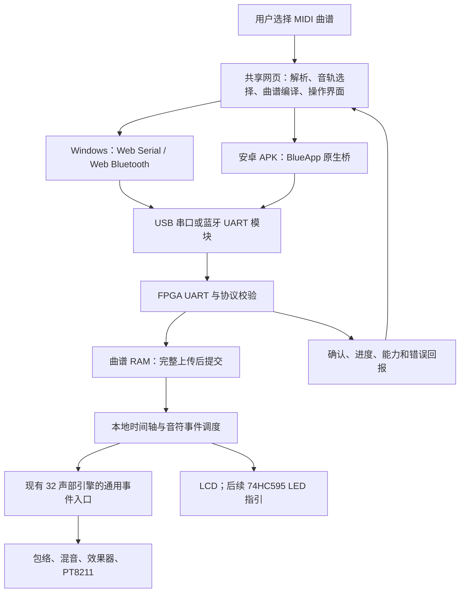

# 拓展四：电脑网页上位机、安卓 App 与 FPGA 曲谱演奏开发方案

2026-10-15 实际硬件更新：当前 S3 UART 改为 TX17/RX18，FPGA RX=A20、TX=A21；功放 SD_MODE 为 GPIO39 低有效关闭。以 [V3 实际引脚](hardware/V3实际引脚与程序适配_20261015.md) 为准，下文旧提案引脚不用于本版。

> 2026-10-07 选型更新：第三版优先采用 ESP32-S3-N16R8 同时承担语音与 BLE GATT，完整集成与备选方案见 [第三版集成方案](hardware/第三版整体方案_ESP32S3语音与灯带.md)。下文保留历史开发规划；第 7 节旧 J14/W21/W22 接线已失效，禁止用于现板接线。当前接口依据 V2 的 J13 表，V3 改用须按新方案和最终原理图复核。旧曲谱协议/容量属于规划，不代表已实现。

日期：2026-10-03。状态：方案与源码参考审查完成；2026-10-14 已在网页端加入独立的 `encodeUploadFrames` 发送层和单测，但尚未接入 UI、尚未修改 FPGA 接收 RTL、未构建 APK、未烧录。

2026-10-14 后续进展：参考 Mineradio 的版本化曲库与状态恢复，完成网页本地曲谱库（保存/搜索/打开/更新/移除撤销/JSON 备份恢复），修正 BLE 短 UUID、断线会话隔离及 UTF-8 分片接收。保持共享网页路线；当前没有生成 Windows EXE。具体实现、参考提交和验证记录见 [本批开发记录](上位机_Mineradio参考与本地曲谱库_20261014.md)。设备上传、S3 固件和 FPGA ACK 不因本批上位机功能而变更完成状态。

2026-10-14 短命令后续批次：网页已按 stage42 RTL 接入 HELLO/PING/PLAY/STOP/STATUS 应答匹配、内置曲目控制、超时和断线处理，43 项单元测试与 Edge 模拟链路回归通过。此处为现有短命令的主机实现，未完成 S3 实机或 SONG1 上传 ACK；见 [短命令联调记录](上位机_板端短命令联调_20261014.md)。

## 1. 目标与路线

2026-10-14 stage48 进展：新增 [ESP32-S3 转发固件](../firmware/esp32s3-bridge/README.md)，采用 ESP-IDF 5.4.4 / NimBLE、网页默认 NUS UUID、V3 GPIO8/TX 与 GPIO9/RX、9600 8N1。完整行双向缓冲、通知分片、错误断开和断线缓存清理已实现，S3 固件编译通过；生产 C 核心及主机协议往返测试通过。未烧录 S3、未完成真实 BLE/V3 链路、小智语音共存或安卓 APK；详见 [stage48 记录](上位机_S3转发固件_stage48_20261014.md)。下文 stage47 及更早状态保留作为历史。

2026-10-14 stage47 进展：上位机 SONG2 曲谱已在新的 FPGA 整机逻辑候选接到原钢琴/音效/PT8211 与 RGB LCD，100/100 RTL 回归通过，保留原 96 项。LCD 显示 `PC曲目` 和实际进度；本地停止/菜单及旧命令兼容已加入整机验证。详见 [stage47 记录](../work/song_integration_stage47_20261014/STAGE47.md)。这不是实板交付；V2 引脚未改，接下来推进 S3 透传软件和断线/分包验证，V3 返回后补物理引脚、P&R/时序及端到端实测。

先在 Windows 上完成通用曲谱上位机，驱动 FPGA 完整演奏歌曲，再把同一套网页界面通过 Web2BlueBuilder 打包成安卓 App。后续按需部署独立网站、加入 LED 曲谱指引和跟练。

电脑端从第一天就使用 HTML/CSS/JavaScript，在本机 localhost 上打开。它是可连接硬件的网页上位机，不需要先实现 Python/Qt 桌面界面再迁移。初期不引入 Electron、云服务器、账号系统和数据库。

题目拓展四要求：脱机 LED 曲目指引；可搭载蓝牙与手机 App 联动，支持在线曲谱下载、键位自定义、演奏录音回传等。自动演奏是后续功能的技术基础，不等于已经完成整个拓展四。

“完整演奏歌曲”指读取音符事件，由 FPGA 的振荡器、包络、混音和效果器实时生成音频。不直接播放 MP3/WAV/预录 PCM；首版支持约定范围内的 MIDI 曲谱，不能承诺任意录音、任意配器或无限长度曲目均可原样还原。

## 2. Web2BlueBuilder 参考审查

来源：<https://github.com/zwisgod/Web2BlueBuilder>。

本次读取的提交：`c95103415c2fc8c64d60a7f5997a8c3b08a4d908`。

只读参考副本：`../.codex_stage/references/Web2BlueBuilder/`。未运行其安装脚本、依赖安装或 APK 构建；下表是源码审查结果，不代表设备兼容性实测。

| 能力 | 源码证据与结论 | 本项目处理 |
|---|---|---|
| 网页打包 APK | CLI `injector.js` 复制网页到 assets/web；`WebViewActivity.java` 加载本地 index.html | 复用静态前端，不依赖运行中的电脑后端 |
| 经典蓝牙 SPP | `SppConnector.java` 实现 RFCOMM Socket、读写线程 | Android APK 可以使用 HC-05 一类 SPP 模块 |
| BLE | `BleConnector.java` 实现 GATT、服务发现、通知及写队列 | 可作为 BLE 接入基础，但要验证所购模块 UUID、通知与写入方式 |
| JavaScript 桥 | `BlueAppBridge.java` 提供 connect/selectDevice/send/disconnect；发送支持文本与 HEX 前缀 | 封装一个 Android 传输适配器，业务代码不直接散用 BlueApp |
| 接收数据 | `CallbackDispatcher.java` 实际按 UTF-8 解码、累计到换行后回调 data.str | 首版采用 ASCII 行协议；不要照注释把 data.hex 当作已实现的二进制入口 |
| BLE 分包 | send 把整个 byte[] 入队，写出时使用完整 nextPacket；请求 MTU 不等于按 MTU 自动分包 | 加入明确的分片、发送完成/失败处理和应用层确认，不能一次发送整首文件 |
| 写入失败 | BLE writeCharacteristic 返回 false 时当前实现丢弃该包并继续队列 | 曲谱协议必须有序号、超时、重试、去重和最终校验 |
| 文件导入 | 已实现 onShowFileChooser 与 ActivityResult 回传 | 复用文件选择流程，实测 .mid/.midi、取消选择、中文文件名和大文件；部分错误文案仍写“图片” |
| 离线资源 | APK 从 assets 加载网页 | JS、字体、图标与 MIDI 解析依赖全部本地打包，不引用运行必需的 CDN |
| 模板附加内容 | 含药箱桥、语音、云配置、二维码等功能和依赖 | 适配时裁掉本项目不使用的功能及权限，保留蓝牙、文件选择和必要调试能力 |
| 许可 | MIT | 采用其源码时保留版权和许可说明 |

关键修正：Web2BlueBuilder 能复用网页代码，但不能直接把 Python/Qt 程序转换为 APK。安卓 App 调原生蓝牙桥，不依赖 WebView 自带 Web Bluetooth。

### 模块选择与平台区别

| 使用目标 | 可选方案 | 边界 |
|---|---|---|
| Windows + 安卓 APK | HC-05 带底板 SPP 模块，或 BLE 透传模块 | APK 已有两类实现；PC 的 SPP 需要系统提供可访问的串口或另做原生适配 |
| 还希望安卓 Chrome 不安装 App 就直接连接 | 优先 BLE 透传模块，例如先前讨论的 JDY-23 | 网页使用 Web Bluetooth/GATT，需要 HTTPS 或受信任本机来源和用户操作 |
| iPhone | 本阶段不纳入 | Android 壳不能产生 iOS App，也不能据此承诺 Safari 蓝牙连接 |

考虑仍有独立 Web 端目标，默认继续按 BLE 路线设计。JDY-23 暂为候选，不把其具体底板供电、UUID、吞吐量当作已验证事实；采购前核对供应商手册。若选择 HC-05，安卓 APK 路线仍成立，但安卓浏览器直接连接不作为该模块的交付目标。

## 3. 系统分工

网页负责 MIDI 解析和曲谱准备；FPGA 负责精确时间调度和全部音频合成；蓝牙模块只传数据。浏览器定时器、手机后台调度和蓝牙到包时间都不作为音乐节拍源。

运行方式先采用“上传整首 → FPGA 校验并就绪 → 开始演奏”。曲谱完整存入 RAM 后，断开电脑/手机不影响继续演奏；断电后曲谱丢失。断电保存属于后续独立功能，不能把 RAM 离线演奏称为掉电保存。

## 4. 首版可交付功能

### 4.1 上位机

- 连接/断开设备，显示协议版本、固件能力、真实连接状态。
- 导入本地 MIDI，显示曲名、时长、音轨、音符数量和峰值同时发音数。
- 选择需要演奏的音轨，将音轨映射到现有支持音色；首轮允许全部旋律轨使用琴音。
- 显示不支持事件、打击乐轨、越界音高、容量不足或复音超限，不能静默漏掉后仍显示“完整支持”。
- 上传进度、取消、错误原因和校验结果。
- 开始、停止、重播；首版速度在开始前设置，改变速度重新编译并上传。暂停/续播、任意拖动和播放中变速留到后续，避免长音状态不一致。
- 显示板端回报的时间与声部数；演示/模拟连接必须明确标识，不伪装硬件成功。

首版采用响应式单页：连接区、曲谱区、播放区、状态区。电脑宽屏分栏，手机竖屏堆叠；不把调试报文放进正常演奏主界面。

### 4.2 MIDI 范围

- 首版支持 Standard MIDI File 0/1、PPQN 时间格式、tempo map、音符开/关、力度和多轨合并。
- Note On 力度为 0 按 Note Off 处理；同刻关音/开音顺序稳定，同音重复与重叠使用实例编号区分。
- 音色程序号先映射到有限的现有音色，明确不是完整 General MIDI 音源。
- 延音踏板 CC64 在曲谱编译阶段折算为释放时间，再检查复音占用；不能简单忽略后声称与原曲一致。
- SMF 2、SMPTE 时间、SysEx、特殊控制器、打击乐和连续弯音等首版未支持项要明确提示；用户可选择兼容音轨后导出受支持曲谱。
- 对峰值按住音符超过 32 的曲谱，首版要求简化音轨或明确拒绝“完整演奏”；包络释放尾音造成的额外占用也要统计和验证声部替换策略。
- 时间换算按完整 tempo map 累计，最后量化到采样时刻，避免逐音符取整造成整首歌曲节拍漂移。

验证先用《小星星》完整主旋律，再用主旋律加和弦/低音、多轨变速曲和同音重叠测试曲。歌曲是验收样例，不能成为代码唯一支持的内容。

## 5. 曲谱与通信合同

下面是 v1 设计选择，实施 P0 时形成独立规范和固定测试向量，再同时用于 JS 与 RTL。

### 5.1 曲谱事件

内部建议固定 16 字节事件，统一小端序：32 位目标采样序号、8 位事件类型、8 位通道、8 位音高、8 位力度、32 位音符实例编号、32 位事件参数。事件包括开音、关音及结束；音轨音色映射放在曲谱头。

音符实例编号把关音与特定一次起音对应起来，避免同音连弹、跨轨同音互相截断。被替换声部也须使旧实例失效，迟到的旧关音不能释放新音。

实际采样率由 FPGA 能力信息提供。当前时钟为 50 MHz × 58/59，每 1024 周期一个采样，约 48000.53 Hz；不要在转换器中把这个工程固定当成严格 48000 Hz。

曲谱 RAM 初步预算为 8192 个事件，即事件区 128 KiB；这是设计目标，不是已分配资源或无限歌曲容量。最终容量由综合与布局布线结果决定，并通过能力查询返回。4096 个开音加关音就可用完 8192 项，不能按歌曲分钟数保证容量。结束事件和元数据也计入实际存储预算。

首版不接 DDR3，也不在配置 Flash 的未知地址写曲谱。容量不足明确拒绝，后续再决定外部存储或分段预取。

### 5.2 链路协议

为直接适配仓库现有按行回调，首版使用有界 ASCII 行帧：固定命令字段、十六进制数值/数据、序号、长度、CRC 与 LF 结束。无需 FPGA 解析 JSON 或原始 MIDI；十六进制仅为传输编码，曲谱 RAM 仍存紧凑二进制事件。

建议每个上传数据块携带 64 字节曲谱数据，单行长度上限 256 字节；CRC16/CCITT-FALSE 的计算范围、标准校验向量、字段宽度与错误码在 P0 写死。完整曲谱提交时同时核对总长度、事件数及整曲 CRC，CRC 用于传输差错检测而非身份认证。

命令集保持最小：

| 命令 | 行为 |
|---|---|
| HELLO / CAPS | 查询协议、采样率比例、音高/音色范围、声部数、曲谱容量 |
| BEGIN | 停止旧曲，开始新上传，清除可播放标志 |
| DATA | 按序号和偏移提交一块数据，FPGA 校验后 ACK |
| COMMIT | 完整校验通过后才进入 READY；失败保持不可播放 |
| ABORT | 中止上传，不允许播放半首曲谱 |
| PLAY / STOP | 从曲首播放；停止调度并释放声部 |
| STATUS | 返回曲谱状态、播放位置、活动声部和错误 |

采用一次仅一个上传块等待 ACK 的方式起步；超时重发同块，FPGA 去重，偏移不符拒绝。STOP 的重发必须幂等；PLAY 使用命令序号防止 ACK 丢失后重复重启歌曲。

UART 是字节流，接收器必须处理拆包、粘包、坏校验、超长行和超时半包，并能在下一行恢复。上传期间中断连接不会将未完成文件标记为成功；首版重连后重新上传，不承诺断点续传。

BLE 传输分片与上述上传块是不同层次：长行拆成协商有效载荷内的小片，串行发送，最后由 FPGA 回 ACK。默认未知 MTU 时保守以 20 字节有效载荷起步，不依赖模块一定接受更大包。原生桥需要有发送失败通知、队列上限及超时处理，不能仅靠任意固定 sleep 保证可靠性。

## 6. FPGA 改造边界

硬件基线：Tang Mega 138K SOM30354 + Dock31005，GW5AST-LV138PG484AC1/I0，Gowin V1.9.12.03。

后续从 `../artifacts/timing_margin_20261003/` 的冻结候选建立新的开发目录；该候选已有 26 项回归通过、建立裕量 +0.060 ns、保持裕量 +0.193 ns，但尚未烧录。不要直接以 `.codex_stage/visual_feedback_20261002/` 的最后一次未选用试验源码作为新基线。

| 位置 | 计划改动 |
|---|---|
| 新增 UART 与曲谱模块 | UART 收发、有界帧解析、曲谱 RAM、校验与本地调度；按职责划分，不引入软核 CPU |
| `polyphony_bank_32.v` | 扩展通用开音/关音事件、音高和实例编号；保留现有三键路径的可验证行为 |
| `av_top.v` | 接入曲谱事件及状态，明确手动演奏、曲谱、现有试听的互斥关系 |
| `instrument_control.v` / `instrument_contract.vh` | 拓展设置内增加曲目演奏入口；基础设置归属保持清楚，新增状态显式定义 |
| `lcd_test_pattern.v` 与状态 CDC | 曲目状态、进度、当前音符和活动声部；整帧提交 |
| 现有 DDS、效果器、PT8211 | 尽量复用，不为曲谱功能另造音频输出链 |

现有 32 声部模块仍以三键 trigger/gate、根音和键法为入口，声部释放也依赖三键来源；并不已经具备任意 MIDI 事件接口。扩展必须同时处理起音和释放，不能只把外部音符接入触发端。

调度基于 sample_strobe。对同一时刻的和弦事件提前准备并在约定采样边界提交，验证最大事件批次的计算预算；若超预算必须计数报错，不能悄悄把和弦排成琶音。此次增加功能后仍做完整时序检查，但不继续单独追逐拓展三时序微调。

优先尝试在音频域同步 UART RX 并处理控制，避免不必要的新时钟域；若确有跨域，使用 FIFO/握手传递事件，不用会合并中间更新的 LCD 状态快照通道传音符。

首版曲谱演奏与手动弹奏互斥；S2 进入设置和 STOP 均停止新事件并让当前声音受控释放。断开上传连接与已就绪曲目的离线演奏分开处理；设备端保留停止入口。

## 7. 杜邦线与硬件衔接

现有 V2 文档已预留 J14 UART：模块 TXD → J14-14/W21（FPGA RX），模块 RXD → J14-13/W22（FPGA TX），GND → J14-12。模块 VCC 依实物底板手册确定；J14-11 为 5 V，不能当 3.3 V。UART 逻辑按 3.3 V 条件核对，不把底板允许 5 V 供电等同于 FPGA 信号允许 5 V。

上述是接线候选，实施时核对实物 Pin 1、占用、CST 和 Pin Report；当前固件尚未实现这条曲谱 UART。蓝牙与 USB-UART 不可把两个 TX 输出同时接在一个 FPGA RX 上，接入方式切换或用明确的独立端口。

先检查板载 BL616 USB 串口的实际 COM 口与对应 FPGA 管脚，也可以用 3.3 V 逻辑 USB-UART 接同一组预留脚完成有线调试。不使用新板的 FSR/摇杆作为首版曲谱演奏依赖。

新板返回后，在同一曲谱时间轴上接入两片 74HC595 的 12 键指引与状态灯。与 MCP3008 共用时钟/数据时统一调度，完整发送 16 位后再锁存；ADC 事务不能意外改变可见 LED 输出。

## 8. 分阶段开发与验收

| 阶段 | 工作与产物 | 进入下一阶段的条件 |
|---|---|---|
| P0 合同冻结与最小探路 | 曲谱/通信规范、测试向量、模块型号与线序；确认网页资源能进入壳，尽早做文件选择与蓝牙小报文探路 | 电脑/FPGA 字段一致；安卓依赖与桥接问题已明确，不把模拟应答当硬件证据 |
| P1 电脑网页与曲谱编译 | 本地静态页面、MIDI 导入/音轨选择、事件编译、容量检查与日志；少量合法测试曲 | 不同 tempo、多轨和同音重叠的事件结果可复现；错误文件和未支持特性有明确提示 |
| P2 FPGA 接收与整曲演奏 | UART 协议、曲谱 RAM、通用音符入口、本地调度；先走有线 | 《小星星》完整演奏，多轨和弦正确；停止无挂音；上传异常恢复；原 26 项回归和新增关键仿真通过，新鲜 P&R 时序满足 |
| P3 电脑蓝牙联调 | 同一网页切换 BLE 适配器；整曲上传、校验、重试 | 同一曲谱有线/无线得到相同存储校验；弱连接/断线不误报成功；上传后断连仍按板端时间演奏 |
| P4 安卓 App | 同一静态构建产物用 Web2BlueBuilder 打包；接 BlueApp；手机竖屏适配 | 真机导入 MIDI、连接、上传、播放、停止；权限拒绝/重连/取消选文件正常；无网络仍能导入本地曲谱并控制 |
| P5 新硬件与脱机指引 | LED、按键映射、曲谱跟练；再按容量需要增加掉电保存 | LED 与曲谱拍点一致；实际按键可与目标音符对照；若实现持久存储须单独做掉电验收 |
| P6 可选 Web 发布与拓展 | HTTPS 网站、在线曲谱来源、键位自定义、记录回传 | 独立网站 BLE 兼容性实测；曲谱来源/格式明确；录音与事件记录分别验收 |

P0 的安卓探路只验证平台可行性，不提前堆完整手机业务。正式使用顺序仍为电脑调通后交付安卓。

本轮已完成电脑端上位机第一版静态原型，源码位于 `host/instrument-web/`，构建产物位于其 `dist/`。当前已实现 MIDI 0/1、PPQN、tempo map、音轨选择、速度/力度转换、钢琴卷帘、32 声部峰值提示、CSV/JSONL/协议预览导出，以及可配置 UUID 的 Web Bluetooth GATT 连接、Notify、20 字节分片队列和断线清理；HC-05/USB Web Serial 仍保留。BLE 只证明网页到 ESP32-S3 的 GATT 层收发，尚未完成 S3 固件、FPGA ACK 和真实 V3 联调。`npm test`、`npm run check`、`npm run build` 均已通过；真实浏览器 BLE 和硬件链路仍需实测。

当前网页不声明已连接 FPGA，也不把导出文件当成上传成功。`src/protocol.js` 的 `encodeUploadFrames` 现在能把已编译曲谱按 8 个 64 位事件字分块，带偏移、块 CRC 和整曲 CRC；它与当前 `hc05_link.v` 的 PING/HELLO/PLAY/STOP/STATUS 入口隔离，尚不能发送到板端取得 ACK。下一步仍需先实现 FPGA 接收、曲谱 RAM、ACK/超时/重试，再接入网页上传按钮。浏览器人工交互和真实蓝牙链路尚未验收，不能提前标为完成。

## 9. 技术栈与目录建议

网页使用原生 HTML/CSS/JavaScript 与轻量构建工具；MIDI 解析优先选经过核对、许可清楚的现成 JS 库，不手写完整 MIDI 解析器。构建后输出独立静态目录，使用相对资源路径，APK 不运行 Node 服务。

在本工作区新建 `host/instrument-web/` 保存网页源码与测试；其 `dist/` 为电脑和 APK 共用的交付资源。JS 只分开曲谱编译、协议、传输适配和 UI 几个明确职责，不搭建多余框架。

传输公共接口仅提供 connect/disconnect/sendBytes 与接收、状态回调。实际适配分别为 PC Web Serial、PC/网站 Web Bluetooth、Android BlueApp；只实现当前阶段需要的一种，后续补齐。统一协议不等于三种平台 API 相同。

Web2BlueBuilder 参考副本保持原样。需要修改安卓桥时使用固定提交的可维护副本，记录改动；只给构建器传入网页 dist 目录，不把整个工程、环境配置或密钥混入 APK。限制原生桥所在 WebView 的导航到本地可信资源，外部链接交给系统浏览器。

当前环境只确认 Node v24.12.0 在 PATH；java 命令指向 Java 8 路径，adb 未在 PATH 发现。仓库要求的 JDK 17 / Android SDK 34 尚需实际定位或准备，不能宣布 APK 构建环境已经就绪。本轮未安装工具链。

安卓打包时确认 `index.html`、相对静态资源和本地依赖可在 file:///android_asset/web/ 下加载；不假定 ES module 动态加载、绝对 /assets 路径或电脑开发服务器地址能直接工作。

## 10. 验证重点与完成边界

2026-10-14 更新：本地曲谱库、短命令应答、SONG2 上位机上传事务与页面均已实现；stage45 加入编号 PLAY/STOP/STATUS，stage46 在独立组件中完成旧短命令与 SONG2 的共享 UART 分流和整行应答仲裁。主机 `npm run build` 为 67/67，Edge 模拟 BLE/网页控制通过；stage46 RTL 专项 5/5、完整回归 96/96、独立综合通过。生产顶层、S3 透明转发、真实 BLE/FPGA 和 P&R/烧录仍未完成。接收端和播放器不再只有 JS 模型，但 stage42 交付固件仍不支持 SONG2；详见 [SONG2 合同](上位机_SONG2可靠曲谱上传_20261014.md) 与 [stage46 记录](../work/shared_uart_stage46_20261014/STAGE46.md)。旧 SONG1 编码为历史预览，不能当作可用板端协议。

- 曲谱编译：多轨、变速、休止、重复音、同音重叠、踏板延音、结束释放和容量边界。
- 协议：任意字节处分包、多帧粘包、坏 CRC、丢 ACK、重复块、错序、超长帧、上传断线与取消。
- 演奏：同拍和弦同步、32 声部与超限策略、完整歌曲无累计时间漂移、STOP/S2 无挂音、数字混音不因新曲谱持续削顶。
- 手机：真实 BLE/SPP 连接与所购模块配对，权限拒绝与重授予，文件选择、横竖屏/后台恢复；App 回到前台重新查询板端状态，不用自己的计时猜进度。
- 回归：现有触动/拨弦、基础/拓展设置、32 合音/复音、物理弦、效果器和 LCD 可视化保持可用；记录必要的界面行为变化。
- 证据：JS/RTL 仿真、综合/P&R、位流、下载记录、听感/屏幕实测分开记录；没有实测的 BLE 吞吐、歌曲容量、安卓兼容性不填“已通过”。

演奏事件记录可以供复盘和重新合成，但不能命名为真实音频录音。数字录音可从最终 PCM 采集，不一定新增音频 ADC；持续 PCM 的存储与回传带宽另行设计，不纳入首版曲谱链路。

## 11. 参考入口

- [原仓库 README（固定提交）](https://github.com/zwisgod/Web2BlueBuilder/blob/c95103415c2fc8c64d60a7f5997a8c3b08a4d908/README.md)
- [接收回调的实际实现](https://github.com/zwisgod/Web2BlueBuilder/blob/c95103415c2fc8c64d60a7f5997a8c3b08a4d908/packages/android-shell/app/src/main/java/com/web2blue/shell/bridge/CallbackDispatcher.java#L107)
- [BLE 实现](https://github.com/zwisgod/Web2BlueBuilder/blob/c95103415c2fc8c64d60a7f5997a8c3b08a4d908/packages/android-shell/app/src/main/java/com/web2blue/shell/bluetooth/BleConnector.java#L259)
- [Android WebView 与文件选择](https://github.com/zwisgod/Web2BlueBuilder/blob/c95103415c2fc8c64d60a7f5997a8c3b08a4d908/packages/android-shell/app/src/main/java/com/web2blue/shell/WebViewActivity.java)
- [第二版硬件方案](hardware/第二版硬件方案.md)
- [现有代码架构说明（历史版本）](当前代码架构与整合_20261002.md)
- [冻结候选验证记录](../artifacts/timing_margin_20261003/validation.md)

本方案使用 Gowin 技能核对器件、现有入口和验收证据；按 auto-embedded 的研究→计划→实现→验证顺序推进；按 ponytail full 复用静态网页、现有合成引擎和最小传输协议。本轮没有初始化额外工作流，也没有扩展开发范围到 App 发布或硬件烧录。
