# 灵弦FPGA多维交互乐器

技术设计报告

赛题：基于 FPGA 的实时多音色合成电子乐器引擎

## 摘要

本作品面向实时演奏与音乐教学，设计了一套以高云 GW5AST FPGA 为声音计算核心的多维交互电子乐器。系统将十二路压力键、双轴摇杆和旋钮输入转换为具有独立身份的音符事件及连续表情参数，在 FPGA 内完成音高产生、包络、复音混合、物理建模与效果处理，再经串行音频接口送至 PT8211 DAC。声音由硬件实时计算，不依靠预先录制的整曲音频播放。

合成部分提供三十二路独立复音状态及八路独立物理弦模型，两种音源按演奏模式选用。通过共享音高运算与波形查表、保留每个声部的相位和包络状态，兼顾并行演奏能力与资源效率。输入链路采用逐键校准、滞回判定、独立力度和完整帧跨时钟域传递，支持和弦及弯音、颤音等连续控制。HDMI 输出显示键盘、波形、实时频谱和延迟相图，RGB 指示逻辑与演奏及曲谱状态联动。

配套 FPGAvedio 电脑与 Android 应用提供歌曲管理、音频转谱、MIDI 导入、参考试听、曲谱上传、自定义键位和真实演奏录音。ESP32-S3 以 BLE 为主要数据链路，以 USB 为电脑端有线备用，并通过 Wi-Fi 接入语音服务。上传的是结构化音符事件，曲谱提交后由 FPGA 独立调度演奏；录音则从 FPGA 最终混音数据采集，供用户回听实际合成结果。

本文围绕系统分工、电路连接、数据契约、定点算法与工程性能展开说明。现有实现完成一百五十项 RTL 功能回归和三项官方器件模型测试，形成了从物理输入到音频及图像输出的整机验证链。现场演奏与曲谱指引用不同灯色区分，指定曲目由带编号命令交付，并以 FPGA 的对应应答确认执行。

关键词：FPGA；多维交互；三十二复音；物理建模；曲谱转译；视听反馈

<!-- page -->
<!-- toc -->
<!-- page -->

# 第一部分 作品概述

## 1.1 功能与特性

作品支持十二键独立力度演奏、和弦、音区与音色选择。摇杆 X 轴用于弯音，Y 轴用于颤音，旋钮调节压力灵敏度；按键布局可在同音色键阶、钢琴白键和自定义映射之间选择。FPGA 提供三十二复音合成与八路物理弦两种音源，并具有包络、延迟、混响等处理。HDMI 显示演奏状态、波形、频谱与 XY 图形，RGB 输出提供逐键提示。电脑与 Android 应用支持转谱、试听、上传、播放、停止、键位编辑及真实演奏录音；曲谱上传后可由板端独立播放，语音入口用于辅助点歌与控制。

## 1.2 应用领域

作品适用于电子乐器演奏、音乐启蒙、嵌入式音乐教学和数字信号处理演示。压力键将触觉力度转为声音强弱，摇杆把音高与调制变化表现为连续动作，便于讲解演奏表情。波形、频谱与相图可帮助理解基频、谐波、和弦及效果器。曲谱导入和离线演奏适合课堂示范与旋律练习，自定义键位可按曲目配置常用音阶。开放的音符事件接口也便于连接其他传感器，开展人机交互与 FPGA 音频算法实验。

## 1.3 主要技术特点

声音主链路采用 HDL 状态机、定点运算和片上存储器实现，以固定采样节拍运行。三十二个复音声部各自保存相位、频率、包络和起音身份，计算单元共享不改变声部独立性。物理弦通过独立延迟环路、分数延迟插值与损耗滤波产生拨弦音。输入、曲谱和远程命令统一为带握手的事件，利用身份匹配实现精确释放。显示、频谱及录音从音频主链路旁路取数，不反压 DAC。上位机把音频识别与实时合成分工处理，板端只接收曲谱并实时生成声音。

## 1.4 主要性能指标

| 项目 | 参数 |
| --- | --- |
| 复音 / 物理弦 | 32 声部 / 8 路，按模式选用 |
| 输入 | 12 压力键、摇杆 XY、旋钮 |
| 音频 | 约48 kHz、16位、双时隙单声道 |
| HDMI | 800×600、56.25 Hz |
| 曲谱容量 | 4096 个事件 |
| 数据链路 | BLE、电脑端 USB 备用、115200 UART |
| 演奏录音 | 约12 kHz单声道，最长60秒 |

## 1.5 主要创新点

（1）独立声部状态配合共享计算，在固定采样期限内完成三十二声部运算。

（2）以起音身份协调压力键与曲谱的发声和释放，隔离同音高重触发。

（3）连接音符识别、板端重奏与真实音频回传，使识别结果和合成结果可对照。

（4）采用行级显示预判与旁路分析，并按实际音高反查实体键，实现声音、图形和曲谱指引联动。

## 1.6 设计流程

以演奏需求确定输入维度和声音路径，依据器件接口建立采集、事件及采样契约；划分 FPGA 实时任务与上位机非实时任务，实现音源、效果、显示和传输；通过模块仿真、引脚级整机测试和实现报告核对功能及资源，结合板上演奏完善交互体验。

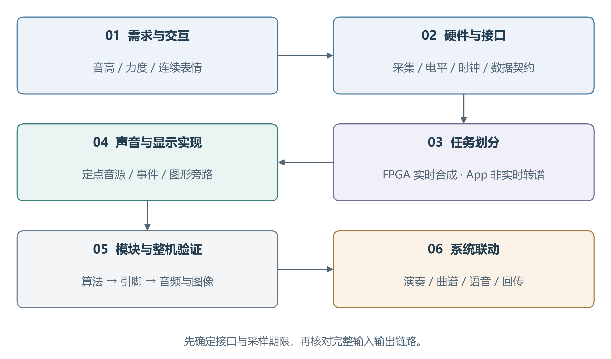

# 第二部分 系统组成及功能说明

## 2.1 整体介绍

系统由交互板、FPGA 主控、音频输出、HDMI 显示、ESP32-S3 通信语音单元以及 FPGAvedio 上位机构成。交互板采集演奏动作，FPGA 将动作映射成具有时间顺序的音符事件，再由选定音源产生逐样本音频。通信端上传曲谱或控制命令，不承担主声音合成。显示端和录音端读取声音及状态，不决定音频采样何时发生。

这一分工把系统中的三类时间尺度分开处理。音频帧在约48 kHz的固定节拍下连续输出；传感器以完整扫描帧更新，音符事件在握手成功时交付；界面和无线通信按各自的刷新、分包与应答周期工作。即使上位机刷新变慢或无线链路暂时阻塞，已提交曲谱与音源状态仍由 FPGA 本地推进。

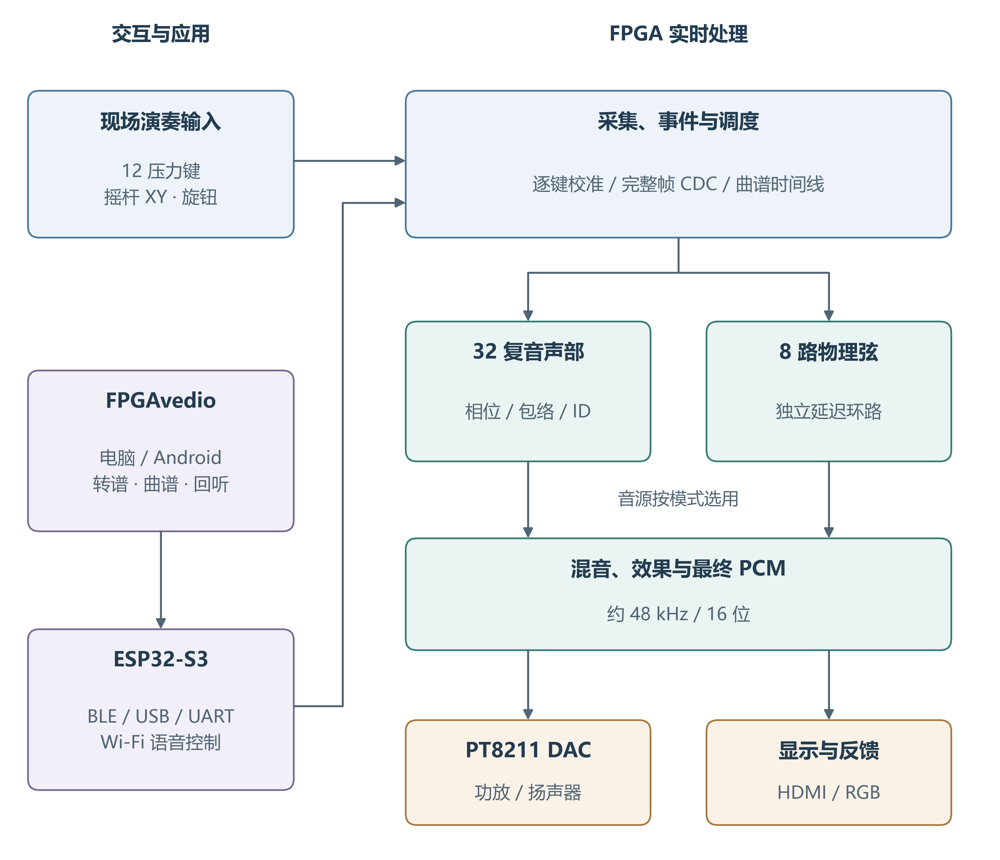

主数据路径为“压力采集—事件协调—模式路由—声部计算—混音效果—DAC”。曲谱时间线是另一音符来源，与现场键盘使用相同的音符语义。菜单控制、摇杆及旋钮形成控制路径，修改模式、音高调制、力度响应与效果选择。HDMI 图形、RGB 提示与音频回传构成反馈路径，分别反映键位、状态、数字音频及演奏结果。

| 子系统 | 主要输入 | 主要输出 |
| --- | --- | --- |
| 采集与校准 | 双 ADC 原始值、菜单按键 | 按键状态、逐键力度、摇杆及旋钮值 |
| 事件协调 | 按下释放、曲谱事件 | 带 ID 的 ON/OFF 与 ready/valid |
| 声音引擎 | 事件、表情、采样节拍 | 复音或物理弦混音采样 |
| 效果与输出 | 混音、效果选择 | 16位 PCM、PT8211 串行数据 |
| 显示与反馈 | 状态快照、音频旁路 | HDMI、RGB 数据、采样快照 |
| 上位机与桥接 | 音频、MIDI、用户操作 | 曲谱、命令、录音及状态界面 |

## 2.2 硬件系统介绍

### 2.2.1 硬件整体介绍

FPGA 平台采用 Tang Mega 138K，核心组合为 SOM 30354 与 Dock 31005，器件为高云 GW5AST-LV138PG484AC1/I0。片上逻辑实现控制与定点计算，BSRAM 存储波表、延迟线、曲谱和图形数据，DSP 承担乘法与乘加。音频合成不调用 ESP32 软件音源，也不由电脑持续发送待播放 PCM。

交互板集成十二路压力传感器接口、双 MCP3008、摇杆、旋钮、ESP32-S3 连接和十二颗可寻址 RGB 的级联电路。FPGA 与交互板之间使用 SPI、UART 和灯珠单线数据接口。音频经 PT8211 DAC 输出到功放及扬声器；底板 HDMI 接口输出图形。显示器自身的物理分辨率不改变 FPGA 当前的800×600输出时序。

供电按数字控制和负载分别考虑。ADC 与 FPGA 逻辑侧使用3.3 V电平；RGB 使用5 V供电。两者共地，但不得将5 V灯电源接入 FPGA 数据脚。ESP32、灯珠和功放的瞬态电流由供电网络承担，不能依靠信号线或 FPGA I/O 提供。芯片电源旁的去耦电容用于缩短高频回流路径，灯链供电与模拟采集走线应避免大电流共用细长回流。

### 2.2.2 交互布局与结构设计

演奏区采用十二键横向排列，对应一个可重新映射的键位组。摇杆和旋钮位于便于手指连续操控的位置，菜单按键承担离散选择，避免把频繁进入菜单作为日常演奏的必要步骤。显示与声音输出独立放置，HDMI 大屏用于观察键盘、参数和三类图形，演奏者不需要依赖手机界面维持基本发声。

PCB 物理编号与演奏视角分别定义。现有布局从演奏者左至右对应 FSR11 到 FSR0；软件在采集帧形成后统一归一化逻辑键序，使音高、力度、屏幕位置和灯链映射使用同一演奏方向。若只倒序按键状态而不倒序力度，多键演奏会把力度作用到错误声部，因此两者必须成对重排。

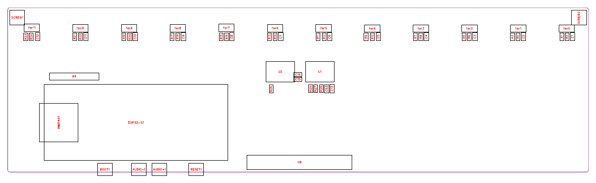

图3用于说明器件、连接器与按键的工程布局。压力键固定结构应保持受力位置稳定，避免焊点和导线承受按压载荷；传感器引线与接口增加应力释放。连接器分别标识电源、电平、输入输出方向与信号名称，便于安装和维护。PCB 图用于表达电路与结构关系，不代替整机装配照片。

琴键结构设计采用局部底座，仅覆盖十二条压力传感器及连接边缘，保留板上标识、RGB 和接口的可见性，FPGA 主板外置。传感器长度34 mm、圆形感压头外径18 mm，键帽按传感器受力位置布置。结构模型分为底座、七颗白键、五颗黑键及可拆前挡条，以独立零件表达装配关系。转轴支撑和柔性接触垫将按压力传递到感压区，避免硬质键帽直接刮擦传感器；黑白外观与软件键位表分别定义。

### 2.2.3 电路各模块介绍

压力采集电路将每个压力传感器与固定电阻组成分压，电压随受力变化进入 ADC。每通道具有10 kΩ分压电阻、1 kΩ串联电阻与100 nF电容组成的输入网络。串联电阻和电容抑制快速干扰，FPGA 进一步以零点校准和门限滞回处理慢变偏置及轻微抖动。传感器输出不能直接等同物理压力单位；本作品将其标定为演奏力度，强调不同按键下可控、连续的发声响应。

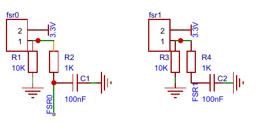

双 MCP3008 提供十六个10位输入，两个器件共用 SCLK、MOSI 和 MISO，分别由片选选择。任一时刻仅一个片选有效，避免两个输出同时驱动总线。ADC 参考电压与模拟输入范围相匹配；模拟和数字地在板上形成可靠公共参考。

| ADC | 通道 | 对应信号 |
| --- | --- | --- |
| U1 | CH0～CH7 | FSR0～FSR7 |
| U2 | CH0～CH3 | FSR8～FSR11 |
| U2 | CH4 / CH5 | 摇杆 Y / X |
| U2 | CH6 | 压力灵敏度旋钮 |
| U2 | CH7 | 未使用，不参与演奏判定 |

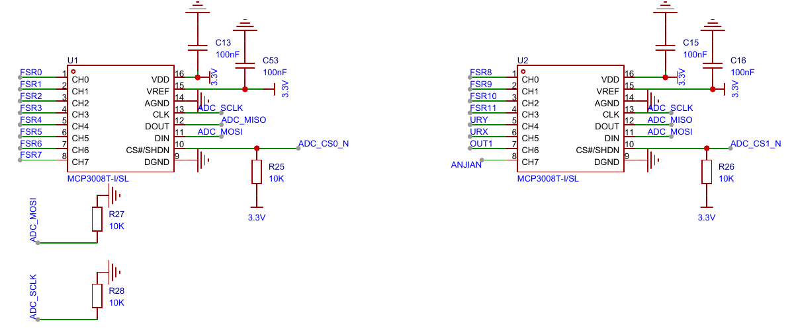

ESP32-S3 负责 BLE GATT、电脑端 USB 备用转发及小智语音服务，通过独立 UART 与 FPGA 交换完整协议行。FPGA 的 RX 与 ESP 的 TX 交叉连接，FPGA 的 TX 与 ESP 的 RX 交叉连接，双方共地。Wi-Fi 用于语音云服务；已准备曲谱的 BLE 上传与 FPGA 本地演奏不要求互联网持续在线。

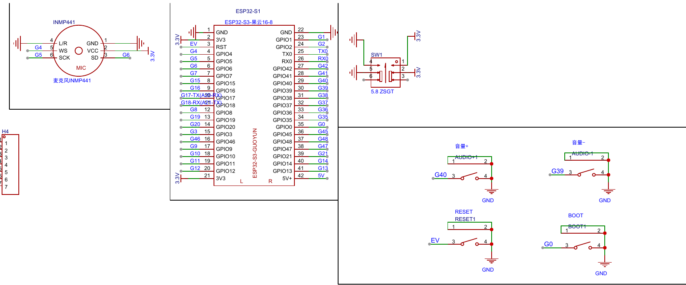

十二颗 RGB 采用逐颗 DIN/DOUT 串联的寻址拓扑，控制器一次发送整链数据。设计驱动使用24位 GRB、高位先发的 WS2812B 兼容格式。每颗灯的电源附近布置100 nF去耦；首颗 DIN 接收 C17 的数据，末颗输出不再连接下一级。灯珠的封装外形相似并不代表协议、焊脚定义和输入阈值相同，电路替代料必须同时满足这三类条件。

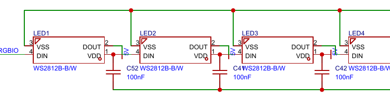

音频输出使用官方 Dock 底板的 PT8211-S DAC，由 BCK、WS、DIN 三根信号及音频使能连接 FPGA。数据为有符号16位，左右时隙复制同一混音采样，构成双时隙单声道。发送器在 BCK 上升沿更新数据，DAC 在下降沿采样；WS 低电平对应左时隙，高电平对应右时隙。当前采用 PT8211 的右对齐串行格式，与 Philips I²S 的“WS 切换后一位时钟再送新声道 MSB”规则不同。本作品保留底板兼容输出，未将该接口标称为标准 Philips I²S。HDMI 仅输出图像，不承担音频传输。

| 外部接口 | FPGA 管脚 | 电路用途 |
| --- | --- | --- |
| 系统时钟 | V22 | 50 MHz参考输入 |
| ADC SCLK / MISO / MOSI | A15 / B20 / B21 | 共享 SPI 总线 |
| ADC CS0 / CS1 | B17 / D17 | 双 ADC 独立片选 |
| UART RX / TX | A20 / A21 | FPGA 接收 / 发送 |
| RGB 数据 | C17 | 十二颗灯单线串行数据 |
| 按压测量标记 | C18 | 任一有效压力键按住时为高电平 |
| DAC BCK / WS / DIN | Y17 / AB17 / AA16 | PT8211 数据与时隙 |
| 音频使能 | AB16 | 音频输出控制 |
| HDMI 数据差分对 | J14/H14、J15/H15、K17/J17 | 三路 TMDS 数据 |
| HDMI 时钟差分对 | G15/G16 | TMDS 时钟 |
| HDMI 使能 | K14 | 底板输出控制 |
| 菜单按键 | AA13、AB13、Y12、F4 | 模式与参数操作 |

引脚约束同时指定电平标准、上拉下拉和驱动属性。F4 所在接口采用1.5 V电平，不能与3.3 V输入直接互换。HDMI 的正负引脚按差分对使用，不能仅检查端口名而忽略配对和底板连线。现有顶层共使用31个外部引脚，包含差分两端。

## 2.3 软件系统介绍

### 2.3.1 软硬件任务划分与工程结构

软件系统包含 FPGA RTL、ESP32-S3 固件和 FPGAvedio 应用三部分。RTL 负责所有具有采样期限的声音计算；ESP 固件提供连接、字节流桥接和语音入口；上位机承担音乐媒体管理、音频识别、曲谱编辑和录音管理。三部分通过明确的能力查询、命令应答与状态字段协作，避免把“蓝牙已连接”误认为“FPGA 已接收并执行”。

| 工程层 | 主要模块或目录 | 职责 |
| --- | --- | --- |
| FPGA 顶层 | v3_hdmi_top、av_hdmi_top | 参数配置、时钟域与模块连接 |
| 输入与事件 | v3_analog_input、keyboard_note_events | 采集、校准、按下释放与身份协调 |
| 音源 | polyphony_bank_32、physical_string_bank | 复音与物理弦计算 |
| 音频 | audio_effects、pt8211_tx | 效果、限幅与 DAC 时序 |
| 曲谱与协议 | song_upload、song_timeline 相关模块 | 上传、合法性检查与演奏调度 |
| 显示与分析 | instrument_panel_renderer、visual_feedback、频谱模块 | 状态、波形、频谱与 XY |
| 演奏扩展 | performance_uart、performance_recorder | 键位配置、录音与回传 |
| 应用 | instrument-web、Mineradio 派生应用 | 共用音乐工作台及电脑、Android 外壳 |
| ESP 固件 | ESP-IDF 桥接与小智集成 | BLE、USB、UART 和 Wi-Fi 语音 |

RTL 以模块端口表达数据流，测试目录保存算法级及引脚级用例。上位机共用曲谱处理和协议逻辑，电脑与 Android 分别处理窗口、文件访问和原生 BLE 权限。协议层不直接依赖某一个界面组件，因此布局调整不会改变上传字节的含义。

### 2.3.2 模拟采集与逐键校准

采集模块在50 MHz系统域工作，通过时钟分频产生约1 MHz的 SPI 时序。扫描控制器依次读取十六通道，并在一次完整扫描结束后更新对外帧。消费者看到的是同一轮采样的键状态与力度，不会同时取到一部分新通道和一部分旧通道。

上电校准先等待输入稳定，再对多个扫描帧求平均形成每个压力键的独立零点。实现采用八帧稳定等待和三十二帧平均，并检查相邻输入变化。压力传感器存在个体偏差，不能用全键统一零点代替逐键基线；摇杆中心也分别估计，避免机械中心偏移导致无人操作时持续弯音。

对某一键，先计算原始值减去零点的非负差值，再按旋钮设置放大并饱和到10位范围。旋钮形成约1～2倍的响应增益，使轻重按压适应不同手感。按下门限与释放门限分别为24和12，并要求连续帧满足条件，形成滞回，避免门限附近反复 ON/OFF。

力度采用分段压缩而非简单线性截断。门限附近给出可听的最低起音力度，中段保留较多分辨率，重按逐步接近127。这样既避免轻按完全无声，也减少传感器末端饱和导致的“必须很用力才有效”。各键拥有独立7位力度，最大力度只用于少量全局显示或控制，不能替代逐声部力度。

| 数据 | 位宽或范围 | 处理方式 |
| --- | --- | --- |
| 原始通道值 | 10位，0～1023 | SPI完整扫描 |
| 零点差值 | 非负10位 | 每键独立校准后相减 |
| 键门控 | 12位 | 双门限与连续帧确认 |
| 逐键力度 | 12×7位 | 分段映射至1～127 |
| 摇杆及中心 | 独立通道值 | 中心校正、死区和表情映射 |

完整控制束通过稳定数据握手跨入音频域。源端锁存载荷并保持到接收确认，目的端只在握手确认后使用整束数据。对多位数值逐位接两级触发器不能保证同一采样帧的一致性，因此本设计区分单比特状态同步与多位快照交付。数据长期未更新时，超时逻辑将连续表情恢复中性，避免失联状态把音高长期拉偏。

### 2.3.3 音符事件与精确释放

键盘状态不能直接接到一个共享音高寄存器，否则同时按下两个键会互相覆盖。事件协调器为每次起音生成16位身份 ID，并保存尚未完成交付的 ON/OFF。音高表示要弹什么，ID 表示是哪一次起音，两者承担不同职责。同一音高的两个键、同一键的连续重弹和曲谱中的重复音都可以拥有不同身份。

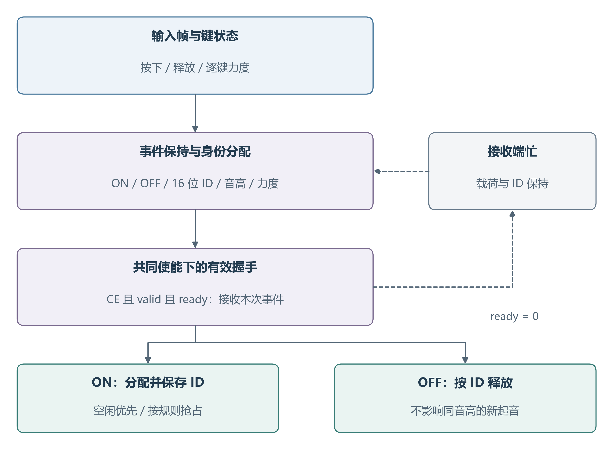

| 事件字段 | 含义 | 接收约束 |
| --- | --- | --- |
| valid / ready | 发送有效与接收就绪 | 同时成立才交付 |
| kind | ON 或 OFF | 起音与释放分别处理 |
| id | 16位起音身份 | OFF按身份定位 |
| note / octave | 音级与音区 | 使用统一音高映射 |
| force | 7位起音力度 | ON携带有效力度 |
| flush | 清理当前事件上下文 | 清除待发送及接收侧相关状态 |

当 ready 为零时，发送端保持 valid 与全部载荷，不能因下一次按键变化覆盖尚未交付的事件。按键若在 ON 被接收前松开，协调器仍需维持相应的身份和释放顺序；不能发送一个找不到所属起音的 OFF，更不能让旧 OFF 作用到后一次重弹。模式切换时通过 flush 清理过期事件，防止旧模式队列在新音源开始后重新进入。

接收端释放采用八组两位比较再归约的 ID 匹配逻辑，缩短宽比较对关键路径的影响。声部被抢占后保存新的 ID，旧事件无法再匹配该声部。板载按键原有 gate_mask 释放路径与事件入口分别保留语义，事件模式下不把物理键掩码误认为事件身份。

### 2.3.4 模式路由与十二键音高

键盘事件按当前模式互斥地发送到三十二复音库或物理弦库。只有被选中的库参与该组现场事件握手，未选中的库不能同时消费同一 ON。模式路由使用接收侧真实 ready 反馈，避免“事件已经从上游移除，音源却没有接收”的丢音问题。

菜单提供同音色布局与钢琴白键布局。前者保持同一音色下的键位规则，后者按 Do、Re、Mi、Fa、Sol、La、Si及高音延续，便于分辨音高和演奏常见旋律。App 还可将十二个物理键分别映射到 C3—B5，提供大调、半音阶和五声音阶等预设。映射改变音高，不改变力度、表情与音源设置。

界面中的键位布局、音色、演奏模式、表情与效果分别控制不同环节，操作关系如下。钢琴白键布局描述音阶排列；钢琴风格音色描述声音波形和包络，二者不是同一个设置。

| 设置层 | 选择或操作 | 实际影响 |
| --- | --- | --- |
| 键位布局 | 同音色键阶、钢琴白键、自定义 | 决定物理键对应的音高 |
| 音色 | 三角、方波、锯齿、琴音、琴弦 | 选择周期波形或物理弦音源 |
| 演奏模式 | 拨弦、按住 | 控制现场复音声部的衰减或维持 |
| 表情 | 原声、滑音、颤音；摇杆弯音 | 改变音高随时间的变化 |
| 效果 | 关闭、混响、延迟等 | 处理混音后的时间与空间感 |

应用键位前要求松开所有键，并在音频引擎允许的边界整体提交。正在发声时逐项更换音高容易产生一半使用旧表、一半使用新表的状态，因此不直接把界面编辑结果实时写入声部。App 保存编辑草稿，连接设备后读取实际设置；上传曲谱使用自身音符，不随实体键位表改变。

### 2.3.5 三十二复音的独立状态与音高计算

三十二复音库中的每个声部独立保存32位相位累加器、频率增量、包络、力度、活动状态及起音 ID。每个音频采样时刻更新该声部相位，波形由相位映射得到。多个音符同时发声时，相位持续独立推进，而不是把同一个振荡器在不同音符之间快速切换。

相位增量由目标频率和采样率计算。使用32位相位可获得较细的频率刻度；实际音准还受参考时钟与音高表取整影响。MIDI 音高采用以 A4=440 Hz为基准的十二平均律关系，离线生成或查表得到相应增量。音区与移调最终都转换成相同的增量表示。

公式：频率 = 相位增量 × 采样率 ÷ 2³²

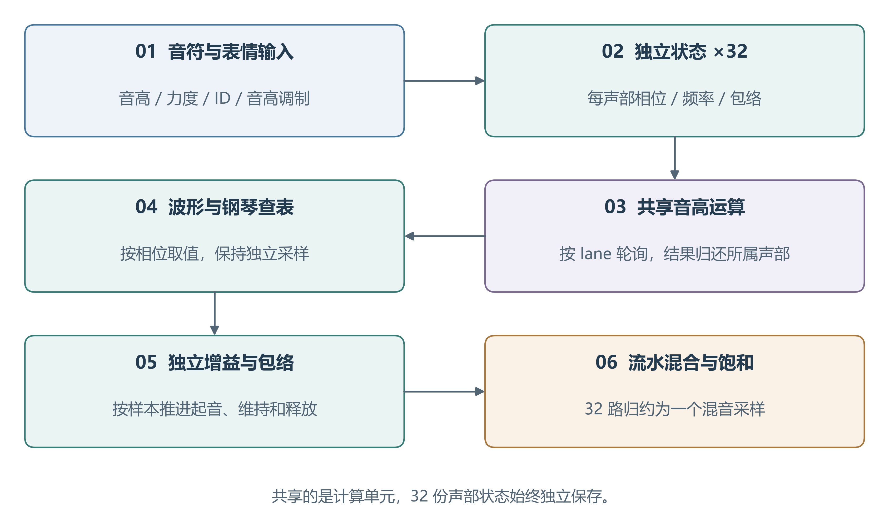

声音波形包括三角波、方波、锯齿波和钢琴风格周期波形。周期波形表是一个周期内的音色描述，不能等同整首歌曲的预录播放。锯齿和方波含较丰富高次谐波，钢琴风格音色结合谐波形状与衰减包络，获得较清晰的起音和自然消退。声部输出先保留中间位宽，再统一混合，避免每一级提前截位造成累积误差。

声部分配优先选用空闲或已经释放的声部；资源不足时根据包络等优先级选择可抢占对象。替换操作同时更新频率、身份和包络，清理与旧主人相关的缓存有效性。不能只改音高而保留旧包络或旧调制结果，否则新音会带着前一个声部的音量、相位或频偏进入。

### 2.3.6 运算共享与采样期限

音频帧间隔为1024个音频时钟。引擎采用共同的隔拍使能，在一帧内有512次有效推进机会。音高乘法、部分波形查表及其外围逻辑按 lane 轮询共享，结果写回各声部缓存；相位、频率、包络与身份仍逐声部保留。

共享音高运算每次发射一条 lane，遍历三十二声部并计入流水延迟后完成一轮。钢琴波形查表同样按轮询回写。相关混音接口采用至少64个有效推进步的保守契约，生产环境提供512步，具有8倍的步数比例。这个比例描述计算期限，不是对最终物理时序余量的替代。

新分配及零增益换音会清除两步有效标志；缓存尚未属于新起音时，频率旁路到新音的原始增量。共享流水中残留的旧请求必须被有效性逻辑隔离，不能返回后覆盖新主人。对这一性质，测试同时覆盖刚分配就采样、连续重弹及旧结果在途的情况。

| 调度对象 | 期限或处理方式 | 生产条件 |
| --- | --- | --- |
| 音高与钢琴缓存、混音流水 | 采样间至少64个有效步 | 每帧512步 |
| 复音批事件分配 | 保守预算320个有效步 | 每帧512步并有ready反压 |
| 相位及包络推进 | 按采样语义更新 | 固定采样脉冲 |
| PT8211发送 | 每个物理音频时钟动作 | 不受半速使能门控 |

计算共享的成立条件通过正、负两类用例检验。正常间隔下与冻结并行参考逐样本核对；故意把采样间隔缩短到契约下限以下时，要求测试能观察到与参考的发散。负向用例用于证明测试确实覆盖了期限约束，而不是只在宽松输入下得到相同结果。

### 2.3.7 包络、力度和连续表情

每个复音声部具有独立包络状态。起音阶段将增益从零平滑上升，随后衰减至维持值，释放阶段逐步归零。钢琴与拨弦感音色使用有衰减特征的控制参数；力度影响起音强度，使同一音高的轻按和重按具有可听差异。包络以音频采样为计量，不能因为内部运算隔拍使能而把音长加倍。

现场复音路径把“拨弦”和“按住”落实为不同的包络行为。拨弦模式中，一次 ON 触发起音及自然衰减；快速松手仍让本次起音完成，持续按压不会无限维持振幅。按住模式中，键保持有效时声部进入维持，收到对应 OFF 后释放。曲谱按自身 ON/OFF 时刻运行，物理弦按延迟环的损耗演化，两者不套用现场复音的单次拨弦开关。

摇杆 X 轴经中心校正与死区转换为弯音比例，连续改变频率而非突变到另一音符。Y 轴控制颤音深度，低频调制器产生周期性频偏。滑音在目标增量之间逐步接近，避免相位突然跳变。频率调整围绕原音高计算，不能反复将调制结果当新基准相乘，以免累积漂移。

单键旋律的滑音在前一键释放、后一键起音时使用前一旋律音高作为起点。多键同时演奏会清除该旋律继承链，每个和弦声部从自己的目标音高发声，避免和弦被拉成多个错误滑音。菜单“表情”的原声表示无预设音高调制，“效果”的关闭表示不叠加所选混音效果；二者有独立设置状态。

表情与力度分别保留含义。力度是每个键的独立强弱，摇杆是全局演奏手势，音色预设则选择包络和调制参数组合。菜单显示当前有效选择，实体输入始终经过同一校准与事件入口。曲谱播放使用记录的力度和时刻，不让现场菜单残留效果任意改变上传曲目的节奏判断。

### 2.3.8 八路物理弦模型

物理弦采用数字波导式反馈延迟结构。每条弦拥有独立512×16位延迟 RAM、读写位置、调音状态、阻尼和输出状态。起音时以位移形状与少量噪声填充延迟线，随后让波形在延迟环中传播，并通过滤波逐步损耗能量。声源来自模型状态的持续演化，具有拨弦起音及衰减特性。[5]

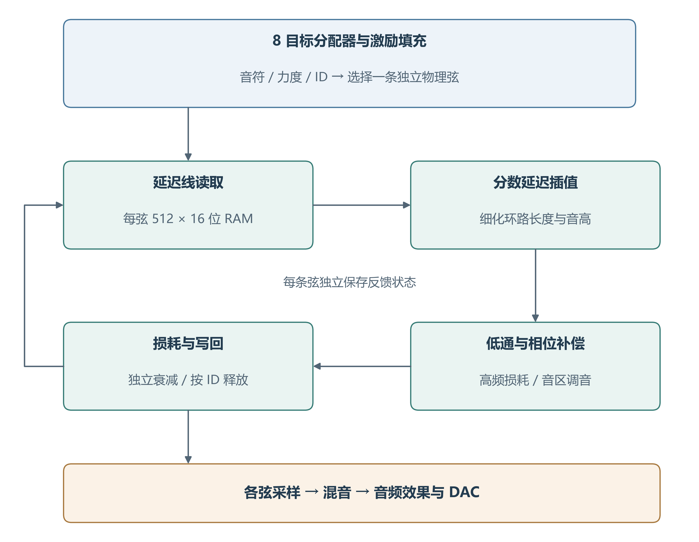

整数延迟决定基频的大体位置，但仅依靠整数长度会使某些音高的误差较大。实现使用12位小数延迟和四点插值，结合低通及相位补偿调整有效环路长度。低通模拟高频比低频更快衰减，全通或相位补偿用于减少滤波附加相位对音准的影响，损耗参数决定尾音持续程度。

起音填充与反馈计算具有不同推进要求。延迟 RAM 的填充需要较快写入，不能把整条物理弦模块笼统视为半速状态；只有真正由共同使能保护的反馈状态才能使用相应时序关系。调音表、波导反馈与 RAM 组织作为音色算法的一部分保持稳定，事件入口只负责把音符及力度正确交给模型。

八目标分配器按 IDLE、PREPARE、SEARCH、PICK、WRITE 状态完成搜索和写入。十二键可以任意选择弦音，最多八条物理弦同时活动；超过容量时按既定优先级抢占。OFF 依据起音 ID 释放，不能简单根据音高关闭全部同音弦。两种音源按模式选用，八弦模式本身不作为三十二复音数量的证明。

### 2.3.9 混音、效果器与输出保护

三十二复音的增益乘积经五级加法树归约，物理弦也在各自输出后形成混音。中间累计值使用足够位宽，最终以有符号饱和限制到16位。饱和处理把过大的正负数限制到边界，避免二进制溢出翻转成相反极性的尖峰；它不能代替合理增益配置，因此多声部测试仍检查峰值和削顶情况。

效果器以采样为单位处理延迟线。延迟存储器为8192×16位，示例延迟长度6144采样约为128 ms。合唱通过缓慢变化的短延迟及插值形成厚度；混响使用1499、1601、1747和1867等不同延迟长度的梳状结构，分散回声的周期性。干湿比提供不同混合比例，不改变原音频帧率。

效果模式切换采用先渐弱、在低增益边界更新、再渐强的方式，避免直接替换反馈状态产生爆音。DAC 启动先输出六十四帧静音，再允许有效音频进入。歌曲重奏路径采用干声，并将歌曲包络的衰减目标设为峰值的50%，减少过短音尾和效果叠加对节奏的影响；退出曲谱演奏后恢复现场演奏的效果选择。

音频发送模块以1024个音频时钟形成一帧，包含三十二个 BCK 周期和左右各十六位数据。BCK 半周期为十六个音频时钟，样本装载与移位边沿固定。引擎的采样预告与发送器保持共同使能关系，确保新样本在正确的帧位置装载，不因内部运算门控出现重复或错位。

### 2.3.10 时钟、复位与跨域数据

系统实际使用系统时钟、音频时钟、HDMI 串化时钟和像素时钟四类时钟。系统时钟驱动 ADC、UART 等接口；音频时钟保证 DAC 连续输出；像素时钟推进图形；串化时钟服务 TMDS。内部引擎通过时钟使能减少有效推进频率，不生成逻辑门控的新时钟。

| 时钟或节拍 | 主要用途 | 关系 |
| --- | --- | --- |
| 50 MHz系统时钟 | ADC、菜单、UART | 外部参考 |
| 约49.152 MHz音频时钟 | 引擎、DAC时序 | 1024拍对应一帧 |
| 36 MHz像素时钟 | HDMI渲染 | 1024×625总扫描 |
| 180 MHz串化时钟 | OSER10与TMDS | 每像素10位DDR串化 |
| 引擎隔拍使能 | 部分音频状态推进 | 同域CE，不是新增时钟 |

复位采用异步有效、受控同步释放，PLL 锁定与串化器停钟场景分别考虑。显示串化器在时钟尚未稳定时保持复位，释放沿遵守器件要求，不能用像素画面“看起来正常”代替启动契约。多周期约束仅用于经过连接关系和共同使能证明的状态对，setup 与 hold 成对出现；模块中混有全速状态时不使用全层级通配放宽。

多位控制束、曲谱描述符、音频快照和频谱结果均以稳定数据交付，不对大总线变化直接做跨域组合比较。源端写完后发起更新，目的端在约定边界接收。显示在帧边界把影子状态转为活动状态，使一帧画面内的模式、文字和图形保持一致。

### 2.3.11 HDMI 时序与面板渲染

HDMI 输出采用800×600有效区域，总水平1024像素、总垂直625行。36 MHz像素时钟对应56.25 Hz刷新率。原有800×480信息面板在有效画面中垂直居中，顶部和底部保留边界。该输出模式由显示器接收并缩放，不能把连接1080P屏幕写成 FPGA 原生输出1080P。

每路 TMDS 数据将8位颜色转换为10位编码，随后由 OSER10 以 DDR 方式串化。180 MHz串化时钟提供每路约360 Mbit/s的数据率。像素颜色、数据使能、水平同步和垂直同步经过匹配流水，防止图形延迟增加后同步仍停留在旧坐标。

面板渲染把不随横坐标变化的纵向区域、文本行和字形行判定移到行边界寄存。逐像素路径只保留横向范围、局部索引及字形选择，避免在一个像素周期内串联多个区域优先级判断。行级预判、预取坐标和帧提交使用一致拍位；屏幕左缘、区域边界及空白区也通过逐拍参考比较检查。

显示内容包括模式与音色、表情设置、十二键按压及力度、曲谱状态和音频图形。菜单切换与图形刷新共享明确的页面状态，避免同一按键既切换页面又触发旧页面参数。显示只读乐器状态，屏幕未连接不影响音频引擎运行。

### 2.3.12 波形、频谱与 XY 图形

波形显示从音频旁路采样，经跨域缓冲形成稳定轨迹。它用于观察起音、包络、周期性和混音峰值。刷新不回压音频源，显示端不能为获得每一个像素样本而阻塞 DAC。对静音、停止后重启和帧边界，缓冲有效性被单独管理，防止显示前一段声音残影却被误认为仍在播放。

频谱使用1024点分析窗，计算第1～128个频点，覆盖约46.9 Hz至6 kHz。窗函数采用周期 Hann，降低非整数周期截断形成的谱泄漏。运算由共享乘加结构分时完成，幅值以实部、虚部绝对值组合近似，再转换为适合柱状显示的压缩刻度。这是实时可视化分析器，不能当作全带宽、高精度的实验室频谱仪。

公式：频率分辨间隔 = 采样率 ÷ 1024，约为46.875 Hz

频谱以完整分析结果更新显示，一轮采集和间隔处理约为数十毫秒。柱状图更新周期与声音采样周期不同，不代表音频具有同样的响应延迟。低于一个频点间隔的相邻音，可能无法在屏幕上分开，因此三十二声部数量的现场谱峰证明应采用更长采样窗和外部分析工具。

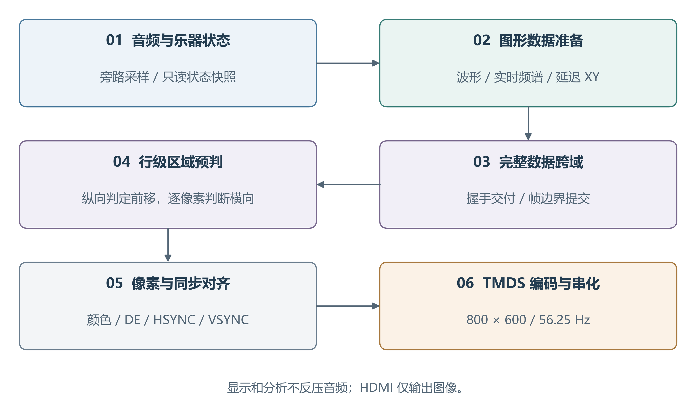

XY 图形使用当前采样与延迟三十二个采样的同一信号构成二维轨迹。由于 DAC 左右时隙复制单声道，直接画左右声道只会接近对角线；采用延迟相图可以表现周期和和弦复杂度。图形以128×128单元、每单元3位亮度保存余辉，新采样点优先写入，空闲显示时隙执行衰减扫描。

这种图形可作为李萨如类视听反馈，但准确含义是单声道延迟相图，不用于证明独立左右声道的相位关系。轨迹大小根据峰值调整，低电平噪声区抑制虚假轨迹。三类图形分别提供时间域、频率域和相空间视角，帮助演奏者观察音色与表情变化。

### 2.3.13 RGB 键位与曲谱指引

RGB 控制先形成逻辑按键掩码，再按 PCB 灯链方向映射到实际发送槽位。十二颗灯每帧发送288位，颜色字按 G、R、B 各8位排列。发送开始时锁存整帧状态，帧中按键变化在下一帧显示，避免同一帧前后灯使用不同逻辑状态。

36 MHz驱动下，码元周期为1.25 μs，0码高电平约0.361 μs，1码高电平约0.806 μs，帧间低电平约350 μs。上电先发送全黑状态，正常运行关闭轮显自检。设置页的布局、音阶等元数据与按键状态分开解释，不把复用显示字段直接送入灯掩码。

现场演奏采用黄色，指示来源为有效物理键状态；曲谱演奏采用青蓝色，提示当前曲谱音符对应的实体键。指引按音级和八度反查当前键位表，兼容钢琴白键和自定义映射。同一音高映射到多个物理键时，只提示最左侧匹配键；当前键盘没有对应音高时保持熄灭，不以取模把音符指向错误位置。

| 演奏状态 | 灯光含义 | 映射与清理 |
| --- | --- | --- |
| 手动演奏 | 黄色表示实际按下 | 使用归一化物理键序 |
| 曲谱当前音符 | 青蓝色表示可弹键位 | 音级与八度同时匹配 |
| 曲谱和弦 | 多个对应键同时提示 | 重复映射只保留最左匹配 |
| 休止、停止或超出键位音域 | 对应指引熄灭 | 不显示替代音高 |

指引跟随当前演奏时刻，不预告下一音，也不等待用户弹对后推进；它为曲谱重奏提供位置参考。音符释放由事件身份管理，旧 OFF 不能清除新起音的指引。灯链每帧锁存颜色和键掩码，保证模式切换时整帧颜色一致。

### 2.3.14 FPGAvedio 的电脑与 Android 界面

应用基于 Mineradio 项目扩展，保留原音乐播放器，并增加独立 FPGA 播放模式。播放器负责曲库、搜索、播放和音乐账户入口，FPGA 工作台负责转谱及设备交互。当前歌曲可以显式导入工作台，用户确认后再处理与上传，不把普通播放器的每一次播放自动转成设备命令。

电脑界面以“准备歌曲—生成曲谱—参考试听—连接上传—板端演奏”为主流程，连接区独立放置。Android 使用侧边导航和适合触屏的操作区，避免固定功能条覆盖搜索栏；文件访问、BLE 扫描及权限由原生外壳提供。两端复用转谱、协议解析、键位编辑和录音状态逻辑。

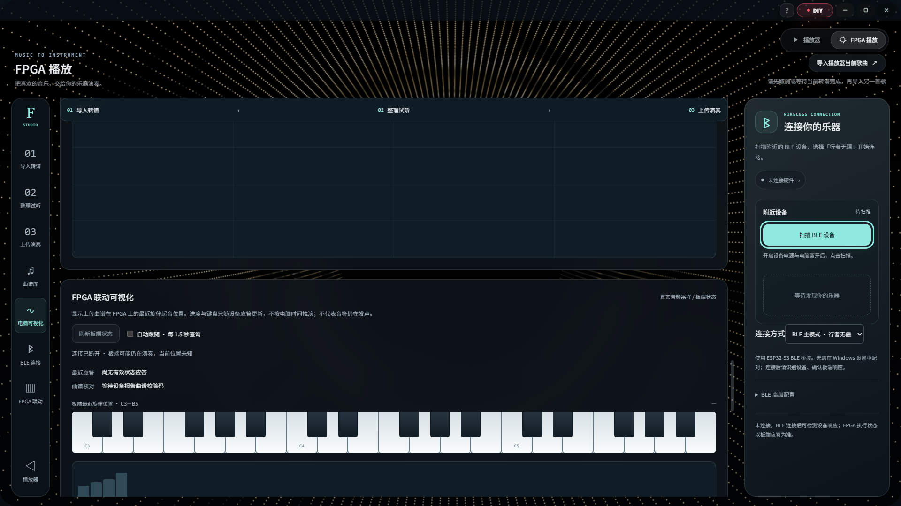

播放、停止和状态查询以 FPGA 应答为准。界面区分连接状态、上传状态与演奏状态，不以本地计时器冒充板端进度。设备停止命令与普通曲目操作有独立入口，传输期间冻结冲突操作，避免按钮反复刷新导致视觉闪烁或重复命令。

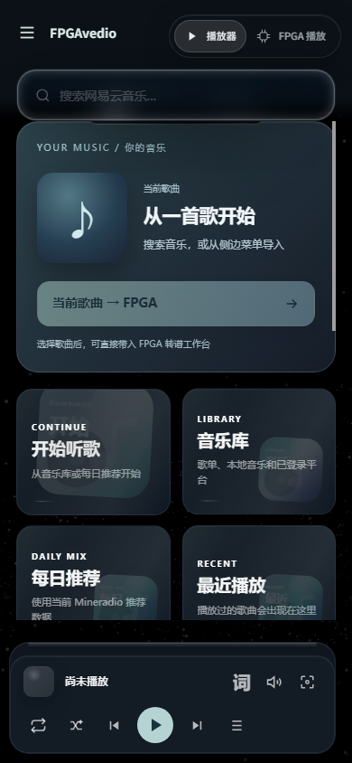

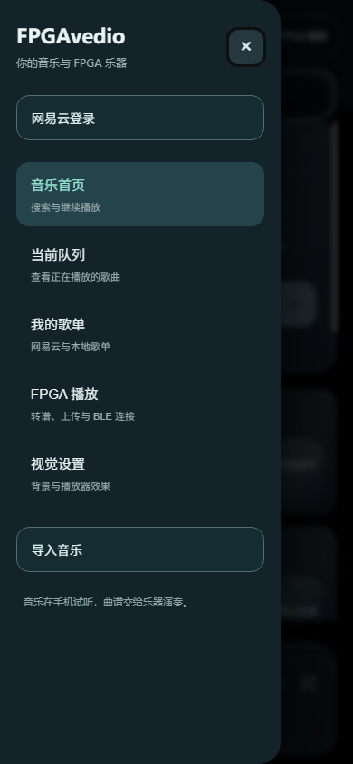

界面提供两种数据来源明确的可视化。参考试听图形使用电脑或手机本地合成数据；FPGA 联动图形使用板端回传快照。波形、频谱、XY 各自独立显示，避免把本地试听波形标成板端输出。音乐平台只开放试听或拒绝媒体读取时，应用按实际访问权限提示，不绕过访问限制。

### 2.3.15 音频转谱与纯音乐整理

普通音频导入后先解码为采样，再由本地 Basic Pitch 模型推断音高、起音和持续时间。[8] 模型输出经过门限、最短时长、重复音与重叠关系处理，形成可编辑音符集合。MIDI 已具有明确音符事件，可直接解析，省去声学识别的不确定性。

纯音乐推荐流程保留和弦和延音，以20 ms邻近起音归组、60 ms最短保留音和原始节奏为整理基准；识别阶段默认最短音长为100 ms，两者分别属于模型结果筛选与演奏曲谱整理，不应混用。保留原始节奏时不强制套用 BPM 量化，避免长音被拍点截短或装饰音被重复合并。

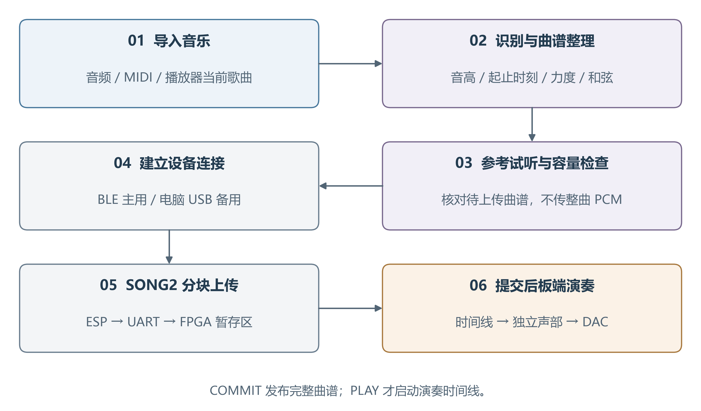

音区整理优先保留原生 MIDI 48～83范围内的音高。超范围低音、高音按组统一移动八度，尽量保持相对旋律走向；无法容纳的音符明确统计。上移低音默认以60%力度参与，减少压到中音区后掩盖主旋律。不能逐音符任意折叠八度，否则和弦结构和声部走向会发生不连续变化。

力度估计从原始音频中相应基频及谐波能量提取相对强弱，再映射到板端力度。模型对音符存在性的置信度不等于音量，因此不直接把置信度作为演奏力度。多个乐器频谱重叠时，能量估计仍会相互影响；该步骤改善重奏平衡，但不是完整的乐器分离。

用户可分别试听“识别音符”和“FPGA 演奏参考”。前者检查模型结果，后者使用实际待上传音高、力度、时刻和近似板端包络，帮助定位整理参数是否合适。参考音不包含全部定点舍入、最终限幅和 DAC/扬声器特性。板端重奏恢复的是音符、节奏与力度关系，不承诺还原原曲全部配器和录音音色。

### 2.3.16 曲谱容量与时间线

板端曲谱存储4096个64位事件，共32768字节。音符通常需要 ON 与 OFF 两个事件，因此常见上限约为2048个完整音符；实际可容纳时长取决于密度、和弦、重复音和持续时间，不存在统一的“三十秒极限”。长音和静音只需要时刻差，不应被扩展成持续 PCM 数据。

编译器在生成前按设备 CAPS 返回的能力检查容量。曲谱过密时优先保留全曲时间覆盖和结构，并报告整理或删减数量；不能静默只上传文件开头。用户可选择片段、减少低优先级伴奏或直接使用准确 MIDI，以获得更可控的演奏结果。

时间线根据板端时间基准调度事件，事件准备与音源分配通过 ready/valid 握手交接。和弦的多个事件保持同一时间标记，由分配器顺序写入不同声部；不能因串行接收而把上传耗时变成音乐节奏。曲谱提交与开始播放分离，COMMIT 成功仅表示可播放，PLAY 才启动时间线。

显示引导轨和实际播放轨用途不同。引导轨选择适合屏幕和灯位提示的音符，播放轨保留和弦与伴奏；显示取舍不能复制音符或截断实际延音。停止操作同时处理时间线和对应声部释放，避免页面显示已停而包络仍被旧事件继续触发。

### 2.3.17 SONG2 上传与原子提交

SONG2 采用能力查询、开始、数据、提交、取消、播放、停止和状态命令。每次上传携带会话身份、顺序与完整性字段，分块确认后继续发送。FPGA 将接收缓冲、解析、曲谱合法性检查与演奏区分开，只有全部条件满足才发布新曲谱。

| 命令 | 主要目的 | 状态变化 |
| --- | --- | --- |
| CAPS | 获取容量与协议能力 | 不改变演奏 |
| BEGIN | 建立上传会话 | 准备暂存与描述符 |
| DATA | 分块写入事件 | 按序确认，拒绝冲突数据 |
| COMMIT | 校验并发布曲谱 | 成功后可被播放选择 |
| ABORT | 取消上传 | 清理未提交事务 |
| PLAY / STOP | 控制板端时间线 | 启动或停止演奏 |
| STATUS | 查询实际状态 | 返回设备结果 |

传输采用 CRC16、16位块顺序及会话信息检查。重发缓存对完全相同的请求返回原应答，避免超时重试把同一块写两次；相同编号但内容不同则拒绝。UART 或 BLE 分片可能切在任意字符位置，桥接端先重组完整协议行，不能把每个 BLE 分包都当成完整命令。

提交前检查事件数量、时间顺序、音高范围、起止身份与内容完整性。成功后原子切换可播放描述符，使播放器不会读到写了一半的曲谱。串口行缓冲采用同步读存储器组织及流水有效标记，避免大容量组合读数组占据大量分布式逻辑。串行解析保留错误定位和明确拒绝应答。

曲谱存放在 FPGA RAM，断电后不保留。ESP 负责转发，不在本实现中承诺把整首曲谱永久缓存到 Flash。歌曲上传完成后，FPGA 的时间线与合成器独立工作，App 不需要按每个音符的播放时刻持续发包。

### 2.3.18 BLE 主链路与 USB 备用

BLE 广播名称使用队伍名“行者无疆”，便于在多个设备中选择。连接建立后，上位机先查询 FPGA 能力和状态；若仅 ESP 连接正常而 FPGA 串口未响应，界面不能显示上传就绪。BLE 服务采用适合双向数据的 GATT 通道，应用层仍处理分片、超时和应答。[7]

ESP 与 FPGA 使用115200、8N1。每个字节包含起始位、八个数据位和停止位，理论上限为11520字节/秒；协议文本、应答和重试还会降低有效曲谱速率。提高 BLE MTU 只能减少蓝牙分包开销，不能突破 FPGA UART 的物理上限。上传界面因此显示板端确认的速度、耗时和重试数。

电脑端可经 ESP32-S3 原生 USB Serial/JTAG 接口进入有线备用，原生数据脚为 GPIO19/20。普通 USB 转 UART 连接不自动等于该备用通道。切换由用户手动发起，先停止并断开原连接，等待租约与缓存排空，再建立新会话；不会自动切线重放 PLAY，也不会把断线当作 FPGA 已停止。

通信任务与音乐任务解耦。比赛环境中可以提前完成转谱，保存曲谱，再选择 BLE 或电脑端 USB 上传；不需要借助内网穿透维持本地演奏。USB 降低无线干扰对传输的影响，但不代替语音云服务所需的互联网。系统对断线、超时和忙状态给出明确结果，避免无反馈地持续等待。

### 2.3.19 自定义键位与真实演奏录音

“我的演奏”提供设备设置读取、十二键音高编辑和录音入口。键位命令经稳定数据握手送入音频引擎，只有板端确认后界面才表示已生效。两个键可映射同一音高，各自仍有独立 ID；释放其中一个不影响另一个。这使自定义音阶与原有复音、力度和物理弦事件机制保持一致。

录音从 FPGA 最终混音 PCM 旁路取数，包含音源、和弦与效果器。它不使用电脑或手机麦克风，也不是重新播放本地曲谱。为适配115200链路，约48 kHz数据经过两级四点移动平均与四倍降采样，得到约12 kHz单声道，再进行 IMA ADPCM 编码并回传为 WAV。

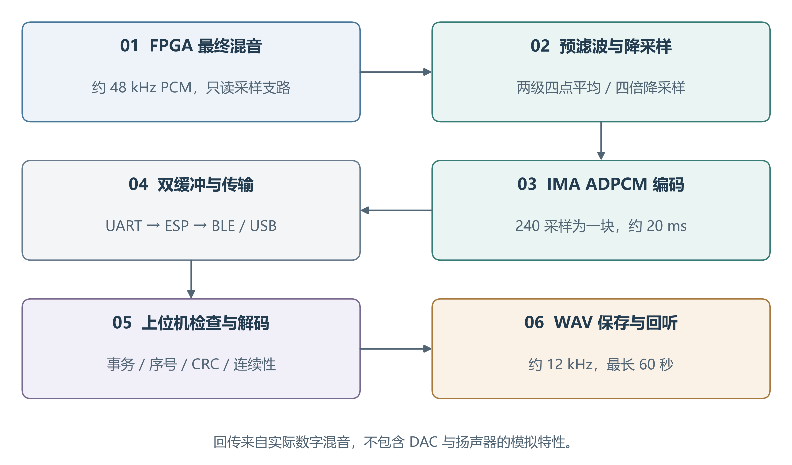

每块包含240个采样，对应20 ms；包含协议字段后的每行196字节，每秒约9800字节，占 UART 理论容量约85%。实现采用双缓冲，编码器处理一块时发送器读取另一块。若接收链路长期阻塞并造成溢出，录音任务报告失败，不能让 DAC 停下来等待上位机。

App 检查事务 ID、块顺序、CRC 和预测器连续性。旧录音事务的停止或续租不能影响新事务；丢块不能直接拼接成看似完整的录音。最长录音六十秒，达到上限自动结束，用户也可主动结束并回传。上传、联动快照及修改键位与录音互斥，避免争夺同一串口带宽。

录音用于回听真实数字合成结果，属于有损、带宽受限记录。12 kHz采样的可表示频带低于原始48 kHz输出，两级移动平均仅为轻量预滤波，并非理想抗混叠器。录音也不包含 DAC、功放、扬声器与房间声学特征；若分析这些部分，应另行进行模拟输出或声学采集。

### 2.3.20 语音控制与系统操作边界

ESP32-S3 集成小智语音入口，通过 Wi-Fi 完成语音服务交互，再将受支持的乐器命令送入 FPGA。麦克风和语音播报使用 ESP 自身的音频通路，不能把语音服务播放的声音作为 FPGA 合成声音。用户操作范围包括辅助点歌及已实现的控制命令，命令效果仍以设备状态为准。

指定内置曲目由 self.fpga.play_demo 工具接收必填 song_id：0 为小星星，1 为欢乐颂。ESP 分别发送 PLAY,0 或 PLAY,1，FPGA 在音频域提交曲目后返回同编号应答。桥接层只把匹配的 OK,PLAY,0 或 OK,PLAY,1 认定为执行成功，入队成功和通用 OK,PLAY 均不能替代指定曲目的确认。未知曲目编号被拒绝，不自动转成另一首歌。

命令经历“语音意图—明确曲目编号—串口排队—板端提交—应答匹配”五个环节。上位机占用 BLE/USB 会话时，语音入口遵循同一租约互斥；使用语音点歌前结束上位机会话。上传歌曲正在播放时，先停止再选择内置曲目；本地停止和设置操作保留优先级。语音入口提供已实现的连接检查、内置曲目选择、停止与状态查询，不把普通对话能力解释为任意歌曲、音色或 FPGA 音量控制。

语音、BLE 和 USB 可以共享同一通信处理框架，但不能绕过事务互斥直接向正在上传的字节流插入另一条命令。ESP 侧维护连接租约和排队边界，FPGA 侧使用协议前缀区分曲谱、状态及演奏扩展。语音服务不可用时，实体键演奏、菜单和已提交曲谱继续保留本地功能。

### 2.3.21 原创实现与第三方组件

本作品自行实现 FPGA 的采集协调、音符身份与路由、复音及物理弦连接、共享运算调度、效果与音频接口、曲谱协议、HDMI 乐器面板及演奏回传，并完成与电脑、Android 和 ESP 的系统集成。上位机使用 Mineradio 的播放器基础，音符识别使用 Basic Pitch 与 TensorFlow.js，小智工程提供语音服务接入基础。[8-10]

第三方组件与原创连接层分别保留来源说明和许可证。音乐文件由用户提供或通过平台允许的接口读取，应用不将平台账户能力等同于媒体复制权限。工程发布时应移除账户令牌、无线密码、Android 签名私钥和设备激活信息。声音核心、数据处理和用户界面的职责边界可在源码结构与协议接口中对应查阅。

<!-- page -->

# 第三部分 完成情况及性能参数

## 3.1 整体介绍

系统形成了“实体压力演奏—FPGA 实时声音计算—HDMI 视听反馈—App 曲谱及录音”的完整功能链。现场演奏由十二键、摇杆和旋钮完成；电脑或手机用于曲谱准备与设备扩展，不是实时发声的必需计算节点。曲谱提交后由板端定时演奏，录音和快照提供数字音频反馈。

工程成果按物理接口、声音算法、数字显示和应用链路分别描述。本文的资源及时序来自实现工具报告，功能数值来自相应仿真用例，软件截图用于展示实际界面。仿真中的采样数、能量和一致性比较不能换算为未经测量的声压、模拟信噪比或整机延迟。

## 3.2 工程成果

### 3.2.1 交互与结构成果

十二键横向布局、摇杆、旋钮与菜单形成独立的交互区域，ADC 电路把每个压力输入转换为可校准的数值。逻辑键序以演奏者视角统一，HDMI 键盘位置与压力事件采用相同编号。独立力度跟随所属键进入声部，两个键同时按下不会因为共享一个力度值而丢失各自强弱。

大屏输出把乐器状态和音频图形集中展示。安装时显示屏、交互板和音频负载分别连接，便于更换外设；核心演奏不依赖触摸屏。PCB 版图和电路局部见图3～图7，分别说明布局及关键连接。

### 3.2.2 电路与 FPGA 成果

工程实现包含三十二复音、八弦物理建模、双 ADC、PT8211、HDMI、UART、RGB 及曲谱存储，完成综合和布局布线。三十二路加法合成及旧 DDS 音源未参与本配置，复音能力以实际启用的三十二独立声部为依据。资源使用由当前完整顶层统计，不能用单模块预估值替代。

| 资源 | 实际用量 | 器件总量或报告占用 |
| --- | --- | --- |
| Logic | 74313 | 138240，报告54% |
| LUT | 59389 | 按工具资源分类 |
| ALU | 14924 | 按工具资源分类 |
| Register | 34282 | 139095，报告25% |
| CLS | 49532 | 69120，报告72% |
| BSRAM | 204 | 340，报告60% |
| SSRAM | 0 | 块 |
| DSP | 125.5 | 298，报告43% |

Logic、CLS 与 LUT 不是同一统计口径。Logic 表示工具的逻辑资源计数，CLS 反映物理逻辑单元使用；触发器与查表逻辑可能共享单元，分布式存储器又具有不同打包条件。因此评估实现规模时同时观察逻辑、寄存器、片上存储和物理单元，不把单个百分比直接解释为布线或时序保证。

### 3.2.3 软件成果

电脑与 Android 均提供播放器和 FPGA 工作台，包含曲目导入、转谱、整理、参考试听、连接、上传、播放与停止。板端能力查询决定容量和功能可用性，上传进度采用设备确认。扩展入口支持十二键音高编辑与真实演奏回传，避免为每个功能维护独立、不一致的连接状态。

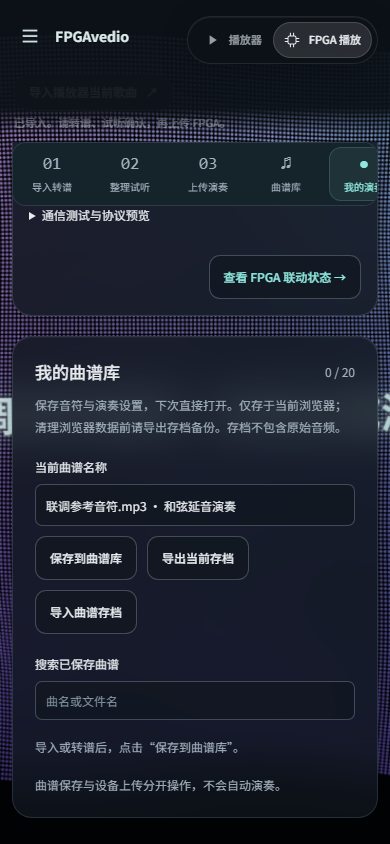

软件将高级参数默认收起，常用流程优先展示。识别原始结果、待上传曲谱和已上传设备状态分别保存，重新生成不暗中改写正在播放的曲谱。用户可以先参考试听，再选择上传；上传失败时保留本地处理结果，便于修正选段或重新连接。

## 3.3 特性成果与性能参数

### 3.3.1 赛题功能对应关系

| 赛题方向 | 工程实现 | 技术说明 |
| --- | --- | --- |
| 多维交互 | 压力、摇杆XY、旋钮 | 力度与连续表情独立处理 |
| FPGA音色合成 | 相位、波形、包络、混音与效果 | 由HDL实时产生声音 |
| 基础复音 | 32独立声部 | 超过4复音的数量要求 |
| 拓展一 | 32复音；另有8路物理弦模式 | 依据“三选一”中的复音分支 |
| 拓展二 | 多音色、力度、滑音、弯音、颤音及效果 | 表情参数与音源状态结合 |
| 拓展三 | RGB逻辑、波形、频谱与XY延迟相图 | 延迟指标需按物理端点测量 |
| 拓展四 | 板端曲谱、BLE/App、键位映射与录音 | 上传后由FPGA独立调度 |
| 现场测试模式 | 独立音高激励与复音计数 | 可配合外部频谱核对声部 |
| 音频接口 | PT8211右对齐串行输出 | 保留与Philips I²S格式差异 |

赛题拓展一中的三十二复音、三十二加法分量和多路物理建模为备选方向，本作品选择三十二复音作为数量依据，并提供物理弦作为另一音源。不能把可选模式的数量相加宣称四十路或七十二路同时可闻。输出采样率采用实际 DAC 帧率，也不以内部声部轮询速率扩大声音吞吐量。

### 3.3.2 功能回归与器件模型测试

完整 RTL 回归共150项，全部通过、失败为0，其中127项为现用模块和整机检查，23项为保留的模块及兼容性检查；官方 HDMI 器件模型测试共3项，全部通过。RTL 测试覆盖模块算法、握手边界、共享运算期限和顶层物理引脚。官方模型补充 PLL 启动、串化顺序及停钟复位契约，避免只使用理想时钟模型检查显示主链路。

| 验证层次 | 主要覆盖 | 判断依据 |
| --- | --- | --- |
| 算法与模块 | 音高、包络、分配、效果、曲谱 | 数值、状态与参考比较 |
| 协议边界 | 阻塞、重试、取消、错误帧、旧事务 | 明确应答与状态不串扰 |
| 共享计算 | 正常间隔与过快采样 | 等价通过及负向发散 |
| 引脚级整机 | SPI输入、PT8211输出、C17、HDMI | 总线模型及逐拍解码 |
| 官方器件模型 | 时钟、OSER10、复位 | 官方模型输出及断言 |

引脚级用例从 ADC 的 SPI 响应产生压力变化，经过校准、门限、跨域、事件、音源与 DAC，不直接向事件总线注入起音。这样能检出输入未接到处理链、顶层被常数覆盖、力度重排错误等模块测试可能漏掉的问题。十二通道逐个按下和松开均检查一次 ON 及匹配 OFF；两端同时按下检查独立力度和释放。

演奏专项同时覆盖拨弦快速释放、按住维持、单键滑音、和弦隔离及曲谱包络不受现场模式影响。整机用例在真实顶层上组合 ADC 压力、菜单输入与115200串口命令，解码 DAC 和 C17 输出，核对指定曲目、停止、非法编号及本地控制优先级。验证对象因此同时包含“命令被正确接收”和“相应声音与指引确实到达输出”。

### 3.3.3 数字音频与多键结果

PT8211 引脚解码检查每帧1024个音频时钟、BCK半周期十六拍，以及串行左右时隙与期望混音数据一致。测试统计中的轻按和重按音频能量分别为92906与193476，说明在该刺激条件下力度映射改变输出强度。这两个数是数字样本统计量，不是声压、响度分贝或全音域的统一增益比。

同音高独立身份、按下后在接收前松开、同一音高连续重弹和多键抢占均属于关键边界。复音库保持三十二份独立状态，物理弦模式保持八份独立延迟环路；测试检查释放只作用于匹配身份。包络尾音存在时，活动声部数与当前按住键数可以不同，这是持续发声语义，不等于按键卡住。

电脑参考试听与 FPGA 重奏使用相同的待上传音符、起止时间和力度关系，有助于分离识别错误与音源差异。若原始识别已经缺少旋律音或把鼓点识别成低音，仅改 FPGA 音色不能恢复；若音符正确但板端过闷或尾音过短，则应检查波形、包络和输出链。这一分层对比用于指导参数选择。

### 3.3.4 HDMI 与 RGB 逻辑结果

HDMI 两组整机参考核对分别覆盖10985971与11283918个渲染沿，比较画面及同步对应关系。此类检查证明测试场景内流水对齐与参考一致，不能代替显示器的电气兼容性测量。官方串化模型检查颜色编码的位序，避免 RTL 面板正确却在实际串行链路中出现颜色或同步错误。

C17 输出按每帧288位解码。启动黑帧、手动黄色（GRB 为0x100800）、曲目青蓝色（GRB 为0x100010）、和弦多键提示及休止黑帧均经过串行波形核对。设置页覆盖全部4096种复用掩码，页面元数据不会触发灯珠。键位测试检查白键布局、自定义重复音、八度不匹配和旧 OFF，确保灯色含义与实际音符归属一致。

波形、频谱和 XY 使用音频旁路及完整帧提交，声音停止和恢复时更新有效标记。频谱显示适合观察音色谐波和较宽间隔的音高，XY 以单声道延迟轨迹展示周期性。显示刷新率、频谱窗长与音频采样率各有独立定义，三者不混写成同一个“实时速率”。

### 3.3.5 实现时序与接口参数

| 项目 | 实际报告结果 | 含义 |
| --- | --- | --- |
| 最差建立余量 | +0.019 ns | 当前约束下为正 |
| 最差保持余量 | +0.189 ns | 当前约束下为正 |
| 建立违例端点 | 0 | 工具报告计数 |
| 保持违例端点 | 0 | 工具报告计数 |
| 恢复最差余量 | +8.257 ns | 已报告路径为正 |
| 移除最差余量 | +0.354 ns | 已报告路径为正 |
| 外部引脚 | 31 | 含HDMI差分两端 |
| 实际生效时钟 | 4 | 系统、音频、串化、像素 |

时序数字来自完成布局布线后的实现报告。恢复与移除分别列出最差余量，工具汇总没有单独列出这两类违例端点总数，因此不填写推定计数。最差建立路径位于50 MHz系统域，从 ADC 零点状态到力度输出。建立余量较小，当前结果表示满足所分析器件模型与约束，不代表各类外部条件下均有同等裕量。

共同使能约束与串化复位约束均保留 setup/hold 配对，并核对实际网表端点。捕获端集合压缩保持对象集合等价，不通过模糊名称匹配扩大范围。多周期关系改善的是合法采样边界的分析模型，不能将持续变化、下一拍即被使用的状态任意放宽。

### 3.3.6 控制延迟与采样稳定性的分析方法

按键到声音的延迟由传感器及 RC响应、ADC扫描等待、连续帧门限确认、跨域交付、事件分配、音频采样等待、DAC及模拟输出构成。48 kHz单帧约20.83 μs，只是其中一项。不能以“音频周期很短”直接声称整机控制延迟小于5 ms，也不能把 ADC 扫描完成时间当作声音已经从扬声器输出。

采样节拍稳定性由 PT8211 输出帧间隔检查，控制响应则采用独立测量端点。C18 输出经校准与跨域交付后的按压状态：任一压力键有效时为高，全部释放或输入失效时为低；它不依赖菜单、声部抢占和音尾。测量 C18 到 DAC 模拟输出反映按键识别后的发声响应，不包含传感器、输入滤波、ADC扫描和识别之前的时间。

测量完整输入到声音响应时，以 ADC 输入节点的可重复电压阶跃为起点，同时观察 DAC 模拟输出，记录输入超过规定门限至音频达到规定幅值的时间。改变阶跃相对扫描和采样帧的相位，统计最小、最大及分布；用扬声器录音时，另列声传播和采集设备延迟。不同端点的结果分别命名，便于与赛题控制响应要求对应。

现场量化应覆盖轻按、重按、单音、和弦、菜单正常演奏态以及开启图形和录音的状态，证明旁路功能不改变 DAC 帧间隔。本文提供固定采样机制和相应仿真依据，不把理论预算冒充模拟端已经测得的控制延迟或抖动数值。

### 3.3.7 三十二独立声部的现场观察方法

测试模式可以按序分配独立音高，形成稳定的多声部持续输出。核对时首先从 RTL 及网表确认三十二份相位、频率和包络状态，再观察活动声部及分配过程，最后对 DAC 输出采样进行频谱分析。只看到计数器显示32，或只看到多个谐波峰，均不足以独立证明三十二个不同音源。

频率选择要避免基频与其他声部谐波重合，声部增益需防止总和削顶。外部分析采用足够长的采样窗，例如48 kHz下65536点约1.37秒，频点间隔约0.73 Hz；结合窗函数和已知基频清单逐一寻找峰值。可逐步开启1、4、8、16和32声部，比对新增基频及总采样率是否保持。

现场应区分三角、方波和钢琴等音色本身的谐波。每个测试音符既有基频也可能有多级谐波，三十二个谱峰不自动等于三十二声部；需要与已分配的三十二目标频率对应。板载128频点显示用于即时观察，外部高分辨率谱分析用于数量证明，两者各自承担适合的任务。

<!-- page -->

### 3.3.8 曲谱、传输与录音结果的解释

曲谱上传与播放控制覆盖能力查询、分块接收、错误拒绝、提交、播放、停止及自然结束。MIDI 和准确音符曲谱可直接保留音高时刻；普通音乐识别结果取决于配器、混响和声部重叠。小星星、欢乐颂等结构清晰旋律更容易重奏，复杂伴奏则通过和弦保留、低音平衡及力度估计改善，不能承诺所有歌曲等同原录音。

录音链以 FPGA 混音输出为来源，测试对降采样参考、块序号和 ADPCM 连续性进行核对。特定五块、1200采样的测试刺激中，解码结果相对该参考的信噪比为30.175 dB；这是指定数字测试信号的指标，不是整机模拟信噪比，也不能代表所有音乐的编码质量。回听可以帮助发现板端包络或混音问题，但分析扬声器听感仍需要模拟或声学记录。

蓝牙吞吐随手机、MTU、连接参数及无线环境改变，115200串口也会限制端到端速度。有线备用与本地曲谱准备减少网络依赖，事务互斥和失败提示减少错误操作。录音带宽接近串口容量时不同时上传曲谱；发生溢出或断线时明确结束失败事务，主音频继续输出。

<!-- page -->

# 第四部分 总结

## 4.1 可扩展之处

声音方面可增加带限波形、更高质量的钢琴模型与可编辑包络；传感方面可建立逐键压力曲线和手感校准。数据链路可提高 UART 速率或引入更高带宽接口，改善曲谱与录音吞吐。显示可扩展分辨率与独立双声道分析。标准 Philips I²S 扩展需配套兼容 DAC，现有 PT8211 保持原格式。曲谱侧可增加声部分离和旋律置信度编辑，提升复杂纯音乐的转谱可控性；教学侧可增加下一音预告与弹奏匹配推进。

## 4.2 心得体会

实时电子乐器的关键在于动作、事件、状态和采样之间的关系。压力输入需要稳定且灵敏，音符交付必须保留身份，声音状态必须在固定期限内更新，图形和通信又不能阻塞声音。只有把这些关系写成明确的接口与时序契约，模块组合后才能保持可解释的行为。

三十二复音的实现说明，运算共享与声音独立性可以同时成立。独立性取决于每个声部是否持续保留相位、频率、包络和身份，而非每条计算路径是否拥有一套完全相同的乘法器。将共享操作限制在采样期限内，再使用等价与负向用例检查边界，可以在资源效率和功能正确性之间建立可验证的联系。

硬件交互也不能只从算法模块开始测试。真实用户按下的是压力键，不是事件总线；连接的是灯珠、DAC 和显示器，不是理想输出变量。引脚级整机模型把 SPI 输入、C17 数据、串行音频和 HDMI 串化放到同一验证链，能够检查模块内部通过却在顶层未连接、方向错误或数据归属错误的问题。

音乐转谱与声音合成解决的是不同问题。模型提取音符不等于复制原曲，板端音色也不等于原录音配器。保留原始识别结果、实际上传曲谱、参考试听与真实回传，可以逐层判断差异来自识别、整理、音源还是模拟输出。这比只根据“像不像原曲”调整全部参数更有效。

作品最终形成了以 FPGA 为实时声音核心、以应用提供非实时音乐处理、以 ESP 提供连接与语音的协同结构。后续改进将继续围绕演奏手感、算法音质和可量化的系统性能展开，并坚持按真实数据来源解释结果，使演示、文档与工程行为保持一致。

<!-- page -->

# 第五部分 参考文献

[1] 全国大学生嵌入式芯片与系统设计竞赛组委会. 2026年FPGA创新设计赛道选题指南：基于FPGA的实时多音色合成电子乐器引擎[EB/OL]. 2026.

[2] 广东高云半导体科技股份有限公司. GW5AST系列FPGA产品与软件技术文档[EB/OL]. https://www.gowinsemi.com.cn/.

[3] Sipeed. Tang Mega 138K硬件资料与开发文档[EB/OL]. https://wiki.sipeed.com/.

[4] Microchip Technology Inc. MCP3004/3008 2.7V 4-Channel/8-Channel 10-Bit A/D Converters with SPI Serial Interface[DS].

[5] KARPLUS K, STRONG A. Digital Synthesis of Plucked-String and Drum Timbres[J]. Computer Music Journal, 1983, 7(2): 43-55.

[6] Princeton Technology Corp. PT8211 16 Bit Digital-to-Analog Converter[DS].

[7] Espressif Systems. ESP32-S3 Technical Reference Manual与ESP-IDF Programming Guide[EB/OL]. https://docs.espressif.com/.

[8] Spotify. Basic Pitch：A Lightweight Yet Powerful Audio-to-MIDI Converter[CP/OL]. https://github.com/spotify/basic-pitch.

[9] XxHuberrr. Mineradio-paused[CP/OL]. https://github.com/XxHuberrr/Mineradio-paused.

[10] 78. xiaozhi-esp32[CP/OL]. https://github.com/78/xiaozhi-esp32.

[11] Worldsemi. WS2812B Intelligent Control LED Integrated Light Source[DS].

[12] Google. TensorFlow.js：JavaScript Library for Training and Deploying Machine Learning Models[CP/OL]. https://www.tensorflow.org/js.
